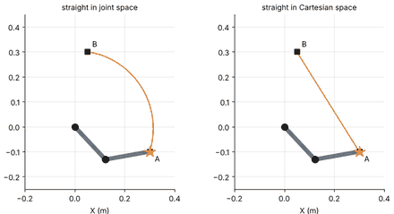

# MFoR — Chapter 1: Introduction, Joints and Degrees of Freedom

**Status: in progress** — 1 of 4 planned notebooks are written; the others are marked *planned*.

| Notebook | Topics | Status |
|:--|:--|:--|
| [1.1 Robots, Links and Joints](1.1-robots-links-and-joints.ipynb) | manipulator anatomy; serial vs closed chains; the six lower pairs; naming robots (RRR, SCARA, …); classification: articulated, spherical, cylindrical, Cartesian, parallel; tour of real robot models | ✅ written |
| 1.2 Degrees of freedom | DOF of a rigid body (plane, space); Grübler–Kutzbach formula; four-bar, slider–crank, Stewart platform; redundancy | ⬜ planned |
| 1.3 Configuration space | explicit vs implicit representation; topology (circle, torus, SO(3)); holonomic and non-holonomic constraints | ⬜ planned |
| 1.4 Spaces of a robot | joint, actuator, Cartesian/task space; workspace, reachable vs dexterous; the FK/IK maps | ⬜ planned |

## Previews

See the [syllabus](../../SYLLABUS.md) for the full plan and [docs/STYLE_GUIDE.md](../../docs/STYLE_GUIDE.md) for the format.
