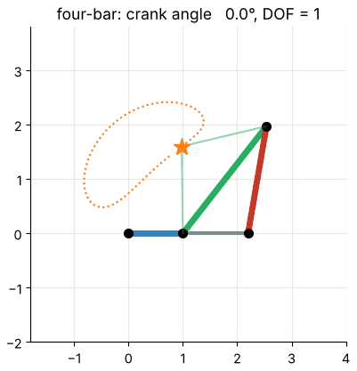
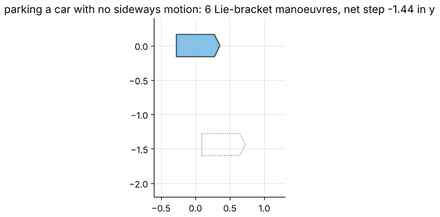

# MFoR — Chapter 1: Introduction, Joints and Degrees of Freedom

**Status: complete** — five notebooks, all executed and checked.

This opening chapter says what a robot is as a mathematical object, before any kinematics is computed. It explains why the whole
subject reduces to mathematics (Notebook 1.1 draws the map of the course), builds the vocabulary of **links, joints and kinematic chains**,
measures real robot models in the MuJoCo simulator (UR5e, Franka Panda, KUKA iiwa 14, Rethink Sawyer and Baxter, ROBOTIS OP3, Dynamixel 2R),
counts **degrees of freedom** with Grübler's formula — and checks every count by the rank of the loop-closure constraints and in the simulator —
then studies the **shape** of the configuration space (circle, torus, SO(3), the four-bar's C-space, holonomic and non-holonomic constraints) and finally the
**spaces of a robot** (actuator, joint, task) and its **workspace**, measured by sampling the simulator.

## Learning path

1. **1.1** gives the vocabulary and the picture of the whole course; 2. **1.2** makes it concrete on real robots;
3. **1.3** turns joint counting into a theory (degrees of freedom, Grübler); 4. **1.4** asks what shape the set of configurations has;
5. **1.5** maps joint space onto the space in which the work is done and measures the workspace.
Notebooks 1.3–1.5 are the mathematical core; 1.1–1.2 can be read quickly by readers who already know the vocabulary.

| Notebook | Topics | Time | Prerequisites |
|:--|:--|:-:|:--|
| [1.1 Robots, Links and Joints](1.1-robots-links-and-joints.ipynb) | why mathematics, the course as a feedback loop, 2R preview (FK, IK, two kinds of path); anatomy of a manipulator; rigid-body idealisation; the six lower pairs (built and measured in MuJoCo); serial, tree and closed chains, independent loops; naming and the five classical arm geometries | 2½ h | none |
| [1.2 A Tour of Real Robots](1.2-a-tour-of-real-robots.ipynb) | joint census of seven MuJoCo models; link length and twist from joint axes; spherical shoulders and wrists tested numerically; `nq`, `nv`, `nu` and mobility; joint limits; the humanoid as a tree (spherical hip, universal ankle) | 2½ h | 1.1 |
| [1.3 Degrees of Freedom and Grübler's Formula](1.3-degrees-of-freedom-and-grublers-formula.ipynb) | rigid-body DOF by point counting; Grübler–Kutzbach; four-bar (with animation), slider-crank, Stewart platform; DOF as `n − rank`; checks in MuJoCo (welded arms, a humanoid in double support); coupling rods, Bennett linkage, Delta robot, bifurcations | 3 h | 1.1 |
| [1.4 Configuration Space](1.4-configuration-space.ipynb) | circle and torus, wrap-around; explicit vs implicit representations; SO(3) as a ball with identified antipodes, double cover by quaternions; C-space of the four-bar (Grashof); holonomic vs non-holonomic constraints, Lie brackets, parallel-parking simulation | 3 h | 1.3 |
| [1.5 Spaces of a Robot and Its Workspace](1.5-spaces-of-a-robot-and-its-workspace.ipynb) | actuator, joint, task space and workspace; transmissions read from MuJoCo; FK of the 2R as a fold of the torus; the annulus theorem; workspace sampling of the real 2R and UR5e; reachable vs dexterous (planar 3R); redundancy and self-motion on the iiwa 14 | 3 h | 1.4 |

The planned syllabus listed four notebooks; the tour of real robots (1.2) was added as its own notebook, so *Degrees of freedom*,
*Configuration space* and *Spaces of a robot* of the syllabus are here 1.3, 1.4 and 1.5.

## Previews

| | |
|:--|:--|
|  |  |
| 1.1 — the same 2R arm moves from A to B: straight in joint space vs straight in Cartesian space | 1.3 — a four-bar linkage driven by its crank, loop closure solved numerically |
|  | |
| 1.4 — a car with no sideways motion parks sideways (Lie-bracket manoeuvre) | |

## Library modules added for this chapter

* `rgkit/mechanisms.py` — Grübler's formula, rigidity (DOF of a rigid body by point counting), numerical mobility `n − rank`, a planar-linkage solver (four-bar, slider-crank, coupling rods), the Stewart platform and the Bennett linkage (tests: `tests/test_mechanisms.py`).
* `rgkit/cspace.py` — angles on circles and tori, SO(3) as a ball, implicit-manifold dimension, Lie brackets and the Chow rank test, the unicycle and its parking manoeuvre (`tests/test_cspace.py`).
* `rgkit/joint_census.py` — reading joints, axes, chains and mobility from a MuJoCo model; projecting 3-D points onto a rendered image (`tests/test_joint_census.py`).

## Scope notes (what this chapter does not cover)

* Forward and inverse kinematics are only *previewed* (the 2R arm); Chapters 3 and 4 derive them. Jacobians, singularities and the null-space motion appear here as demonstrations only; Chapter 5 develops them.
* Topology is treated at the level needed for robotics (circle, torus, SO(3), connected components); the Lie-group structure and screw theory are left to Chapter 2 (2.5–2.6) and Chapter 3.
* Non-holonomic *control* (steering a car to a goal) is not treated; only the reachability argument and the Lie-bracket manoeuvre.
* The workspace of spatial arms is estimated by sampling; exact workspace boundaries and volumes are not derived.

## Where the textbooks cover this

| Topic | Craig | Lynch & Park | Spong et al. | Siciliano et al. |
|:--|:--|:--|:--|:--|
| Links, joints, manipulator classes | Ch. 1 | Ch. 2 | Ch. 1 | Ch. 1 |
| Degrees of freedom, Grübler's formula | Ch. 1 | Ch. 2 | Ch. 1 | Ch. 1–2 |
| Configuration space, topology, constraints | — | Ch. 2 | Ch. 2 (orientation) | Ch. 1 |
| Actuator / joint / task space, workspace | Ch. 3–4 | Ch. 2 | Ch. 1, Ch. 3 | Ch. 2 |

Lecture links are listed at the top of each notebook (Prof. G. C. Nandi, Lectures 1–3; Modern Robotics videos 2.1–2.5). See the
[syllabus](../../SYLLABUS.md) and the [style guide](../../docs/STYLE_GUIDE.md).
