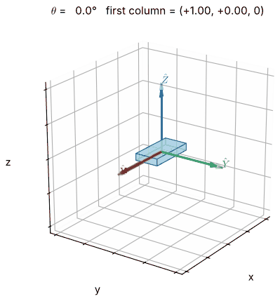
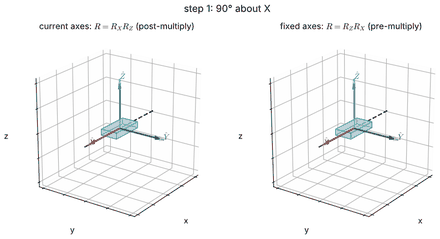
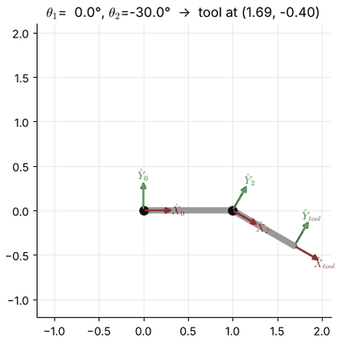
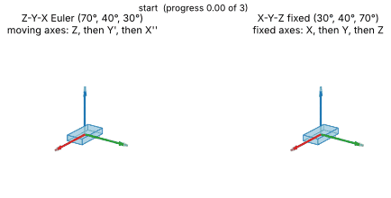
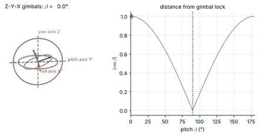
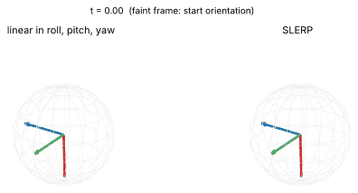

# MFoR Chapter 2 — Spatial Descriptions and Transformations

*Mathematical Foundations of Robotics · follows J. J. Craig, *Introduction to Robotics*, Ch. 2.*

Every later chapter of the course — kinematics, Jacobians, dynamics, trajectories — is written in the language of this
chapter: how to say **where** a rigid body is and **how it is turned**, how to change the frame in which a description
is written, and how to chain such changes. The notebooks build the theory from first principles, check each formula
numerically, and cross-check poses, quaternions and Euler-angle conventions against the MuJoCo simulator using real
robot models (UR5e, Franka Panda) from MuJoCo Menagerie.

## Learning path

2.1 → 2.2 → 2.3 → 2.4 → 2.5. Notebooks 2.1–2.3 are the core of Craig §2.1–2.7 and §2.9–2.10; 2.4–2.5 cover §2.8
(three-angle descriptions, angle–axis, Euler parameters) and Appendix B. Each notebook takes 2–3 hours, including exercises.

| Notebook | Topics | Time | Prerequisites |
|:--|:--|:--|:--|
| [2.1 Positions, Orientations and Frames](2.1-positions-orientations-and-frames.ipynb) | notation; position vectors; rotation matrices and SO(3); elementary rotations; frames; link frames of a UR5e and a Panda | 2½ h | [Math primer](../../math-primer/README.md) |
| [2.2 Mappings and Operators](2.2-mappings-and-operators.ipynb) | mapping between frames; chain rule; fixed vs current axes; non-commutativity; operators; skew-symmetric matrices; MuJoCo check | 2½ h | 2.1 |
| [2.3 Homogeneous Transformations](2.3-homogeneous-transformations.ipynb) | 4×4 transforms and SE(3); inverse; compound transforms; transform equations; UR5e–camera–part workcell | 3 h | 2.2 |
| [2.4 Fixed Angles and Euler Angles](2.4-fixed-angles-and-euler-angles.ipynb) | X-Y-Z fixed (roll–pitch–yaw), Z-Y-X and Z-Y-Z Euler angles; the 24 conventions; inverse with `atan2`; gimbal lock and rank loss of the Euler-rate map; teach-pendant readout of a UR5e and a Panda; MuJoCo `eulerseq` | 3 h | 2.2, 2.3 |
| [2.5 Angle–Axis and Quaternions](2.5-angle-axis-and-quaternions.ipynb) | Euler's theorem; Rodrigues' formula; exponential coordinates and the matrix logarithm; quaternion algebra; double cover; conversions; SLERP vs Euler interpolation; numerical drift; MuJoCo's scalar-first quaternions | 3 h | 2.4 |

## Animation previews

| | |
|:--|:--|
|  |  |
| 2.1 — the direction cosines as a frame turns about Z | 2.2 — the same two rotations about current axes and about fixed axes |
|  |  |
| 2.3 — a planar two-link arm built from compound transforms | 2.4 — X-Y-Z fixed angles and Z-Y-X Euler angles reach the same orientation |
|  |  |
| 2.4 — gimbal rings becoming coplanar at pitch 90° | 2.5 — linear roll–pitch–yaw interpolation (left) versus SLERP (right) |

## Scope notes

* Covered: everything in Craig Ch. 2 that the course examines, plus angle–axis, quaternions and the exponential map of rotations.
* **Planned, not yet written:** 2.6 *Screw theory and exponential coordinates of rigid motion* (twists, se(3), adjoint map, wrenches; beyond Craig) and 2.7 *Practice problems with solutions*. Until then, the beyond-the-syllabus sections of 2.3 (twists, exponential coordinates) give a first look, and the worked examples and exercises of 2.1–2.5 are verified by code.
* Not covered here: angular velocity and rotating frames (Chapter 5), the Denavit–Hartenberg convention (Chapter 3).

## Where the textbooks cover this

| Topic | Craig | Lynch & Park | Spong et al. | Siciliano et al. | Corke |
|:--|:--|:--|:--|:--|:--|
| Frames, rotation matrices, mappings, homogeneous transforms | §2.1–2.7, 2.9–2.10 | §3.2.1, §3.3.1 | Ch. 2 | §2.1–2.3, §2.7 | Ch. 2 |
| Fixed angles, Euler angles, conventions | §2.8, Appendix B | Appendix B | Ch. 2 | §2.4 | Ch. 2 |
| Angle–axis, exponential coordinates, quaternions | §2.8 | §3.2.3, Appendix B | Ch. 2 | §2.5–2.6 | Ch. 2 |
| Twists, screws, wrenches | — | §3.3.2–3.4 | — | — | — |

Lecture links for each notebook are in its header; see [`docs/VIDEO_INDEX.md`](../../docs/VIDEO_INDEX.md) and
[`docs/REFERENCES.md`](../../docs/REFERENCES.md). Robot models: [MuJoCo Menagerie](https://github.com/google-deepmind/mujoco_menagerie)
(downloaded on first use; see [`docs/MUJOCO.md`](../../docs/MUJOCO.md)).
