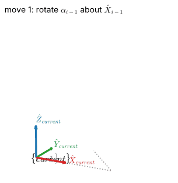

# Chapter 3 — Forward Kinematics

*Mathematical Foundations of Robotics.* This chapter develops forward kinematics of serial arms: link parameters and
frame assignment (Craig's modified Denavit–Hartenberg convention and the standard convention), worked manipulators with
symbolic kinematics, industrial arms (PUMA 560, UR5e, Franka Panda, Sawyer) validated against MuJoCo, the product of
exponentials, and joint, actuator and Cartesian space.

## Learning path and notebooks

| Notebook | Topics | Time | Prerequisites | Status |
|:--|:--|:--|:--|:--|
| [3.1 Link Parameters and Frame Assignment](3.1-link-parameters-and-frame-assignment.ipynb) | link length, twist, offset, joint angle; Craig's recipe; the link transform; standard vs modified convention (row-shift theorem); D-H rules as a test; the recipe as an algorithm; UR5e joint axes in MuJoCo | about 3 h | [2.3](../02-spatial-descriptions-and-transformations/2.3-homogeneous-transformations.ipynb) | written |
| 3.2 Worked Manipulators with Symbolic FK | planar 2R/3R, RPR, articulated, SCARA, spherical, cylindrical | — | 3.1 | planned |
| 3.3 Industrial Arms | PUMA 560; UR5e, Panda, Sawyer D-H tables derived from MuJoCo and verified | — | 3.2 | planned |
| 3.4 Product of Exponentials | screw axes, space and body forms, comparison with D-H | — | 3.3 | planned |
| 3.5 Joint, Actuator and Cartesian Space | transmissions, tool and station frames | — | 3.4 | planned |
| 3.6 Practice Problems | graded problems with verified solutions | — | 3.5 | planned |

## Library support added for this chapter

* `rgkit/dh_tools.py` — parameter extraction, D-H rule checks, frame assignment from joint axes (`dh_from_axes`), modified/standard conversion, MuJoCo helpers, `mjcf_from_dh`, symbolic FK with `c12`/`s23` printing (`tests/test_dh_tools.py`).
* `rgkit/poe.py` — screw axes, exponentials, space/body PoE kinematics, screws from a D-H table or a MuJoCo model (`tests/test_poe.py`).
* `rgkit/dh_plot.py` — 3-D figures of one D-H link and of whole arms with frames (`tests/test_dh_plot.py`).

## Where the textbooks cover this

| Topic | Craig | Spong et al. | Siciliano et al. | Lynch & Park |
|:--|:--|:--|:--|:--|
| D-H frames and link transform | Ch. 3 | Ch. 3 | Ch. 2 | Ch. 4 (D-H appendix) |
| Product of exponentials | — | — | — | Ch. 4 |

## Not covered

Inverse kinematics (Chapter 4), Jacobians (Chapter 5), and the notebooks marked *planned* above.
