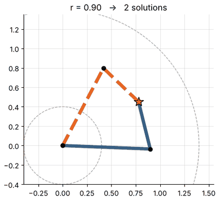

# MFoR — Chapter 4: Inverse Kinematics

**Status: in progress** — 1 of 5 planned notebooks are written; the others are marked *planned*.

| Notebook | Topics | Status |
|:--|:--|:--|
| [4.1 Solvability: Existence, Multiplicity and the Manipulator Subspace](4.1-solvability.ipynb) | existence, workspace, multiple solutions, manipulator subspace, redundancy vs dexterity | ✅ written |
| 4.2 Closed-form solutions | algebraic and geometric methods; 2R, 3R planar; atan2; trigonometric toolbox | ⬜ planned |
| 4.3 Arms with spherical wrists | kinematic decoupling, Pieper's condition, PUMA-style and UR5e solutions, counting branches | ⬜ planned |
| 4.4 Numerical inverse kinematics | Newton–Raphson, gradient descent, pseudoinverse, damped least squares, convergence experiments | ⬜ planned |
| 4.5 Practice | graded problems with full solutions | ⬜ planned |

## Previews

See the [syllabus](../../SYLLABUS.md) for the full plan and [docs/STYLE_GUIDE.md](../../docs/STYLE_GUIDE.md) for the format.
