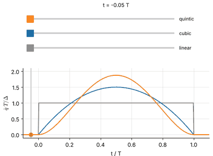

# MFoR Chapter 7 — Trajectory Generation

*Mathematical Foundations of Robotics · follows Craig, Ch. 7 (with Lynch & Park Ch. 9 and Siciliano et al. Ch. 4 as parallel reading)*

A robot must be told, hundreds of times per second, where each joint should be *now*. This chapter turns a few key
poses into such setpoints: it separates the **path** (geometry) from the **trajectory** (path plus time law), derives
the polynomial time laws from their boundary conditions, joins segments through **via points**, and executes the
result on real arm models (UR5e, Panda) in MuJoCo. The tested library behind the notebooks is
[`rgkit/trajectory.py`](../../rgkit/trajectory.py) (tests: [`tests/test_trajectory.py`](../../tests/test_trajectory.py)).

## Learning path and notebooks

| Notebook | Topics | Time | Prerequisites | Status |
|:--|:--|:--|:--|:--|
| [7.1 Joint-Space Trajectories: Paths, Smoothness and Polynomials](7.1-joint-space-polynomial-trajectories.ipynb) | path vs trajectory; smoothness requirements; cubic and quintic from linear systems (SymPy + NumPy); Hermite rule; minimum-jerk property; scaling laws and minimum duration; multi-joint coordination; UR5e quintic in MuJoCo | ~3 h | calculus, small linear systems | written |
| [7.2 Via Points, Velocity Matching and Splines](7.2-via-points-and-splines.ipynb) | stopping vs passing through; cubic Hermite segments; Craig's velocity heuristic; $C^2$ cubic spline (tridiagonal system, SciPy cross-check); locality; overshoot; time allocation; quintic via points; Panda pick-and-place | ~3 h | 7.1 | written |
| 7.3 Trapezoidal profiles, bang-bang and S-curves | LSPB with admissible parameter ranges, minimum time under limits, bang-bang, Craig's blends through via points, jerk-limited S-curve | — | 7.1 | planned (library support and tests exist: `lspb`, `lspb_via`, `min_time_trapezoid`, `bang_bang`, `scurve`, `coordinated_ptp`) |
| 7.4 Cartesian trajectories and orientation interpolation | straight-line paths, SLERP vs Euler-angle interpolation, damped-least-squares IK stepping, 2R workspace/singularity pitfalls, UR5e/Panda Cartesian lines | — | 7.1 | planned (library support and tests exist: `rotation_geodesic`, `euler_interp`, `CartesianLine`, `pose_error`, `dls_step`, `track_poses`) |
| 7.5 Time scaling, limits and execution | $q(s(t))$, time-optimal scaling by a forward–backward pass, limit checking, servo-rate generation, tracking in MuJoCo | — | 7.1–7.4 | planned (library support and tests exist: `time_optimal_scaling`, `required_time_stretch`, `check_limits`, `servo_times`, `OnlinePTP`) |

Animation previews are written to `assets/` when a notebook is built:

## Scope notes

* Covered: joint-space polynomial and spline trajectories (Craig §7.3 material), with derivations of every coefficient.
* Not yet covered in notebooks (planned above): trapezoidal/LSPB profiles, Cartesian-space schemes and their geometric problems, time-optimal scaling and run-time execution. Their algorithms are already implemented and unit-tested in `rgkit/trajectory.py`.
* Not covered at all: path generation with dynamic models (torque limits) and collision-free path planning; these belong with Chapter 6 and with motion-planning texts.
* The instructor notes contain only a past-paper cubic-polynomial question for this chapter; the notebooks follow Craig's scope instead.
* Velocity and acceleration limits used in the notebooks are *illustrative* values chosen for the exercises, not manufacturer data.

## Where the textbooks cover this

| Book | Chapter |
|:--|:--|
| Craig, *Introduction to Robotics* (3rd ed.) | Ch. 7 Trajectory generation |
| Lynch & Park, *Modern Robotics* | Ch. 9 Trajectory generation |
| Siciliano et al., *Robotics: Modelling, Planning and Control* | Ch. 4 Trajectory planning |
| Corke, *Robotics, Vision and Control* | Ch. 3 Time and motion |

No lecture in the verified video index (`docs/VIDEO_INDEX.md`) is devoted to trajectory generation. For related background see the Modern Robotics videos on numerical inverse kinematics (6.2) and singularities (5.3), which matter for Cartesian paths.
