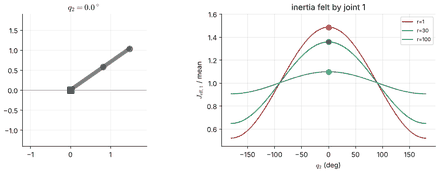

# RMC — Chapter 2: Independent-Joint Control

**Status: in progress** — 1 of 5 planned notebooks are written; the others are marked *planned*.

| Notebook | Topics | Status |
|:--|:--|:--|
| [2.1 The Single-Joint Model: Actuator, Gearing and Disturbances](2.1-the-single-joint-model.ipynb) | actuator, gearing, effective inertia and damping; coupling and gravity as disturbances | ✅ written |
| 2.2 Set-point control | P, PD, PID; critical damping; integral action; steady-state error under gravity | ⬜ planned |
| 2.3 Trajectory following | feedforward; control-law partitioning (model-based + servo portion) | ⬜ planned |
| 2.4 Practical limits | saturation, flexibility, resonance, sampling; industrial controller architecture | ⬜ planned |
| 2.5 Joint control in simulation | PD/PID on a MuJoCo UR5e and 2R arm; tuning experiments | ⬜ planned |

## Previews

See the [syllabus](../../SYLLABUS.md) for the full plan and [docs/STYLE_GUIDE.md](../../docs/STYLE_GUIDE.md) for the format.
