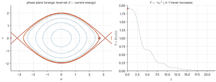

# RMC Chapter 3 — Lyapunov Stability and Model-Based Control

This chapter develops the nonlinear-control toolkit for manipulators: Lyapunov's direct method, LaSalle's invariance
principle and passivity (3.1), then the two model-based control laws that the theory justifies — PD control with gravity
compensation (3.2) and computed-torque (inverse-dynamics) control (3.3) — and how they degrade under model error (3.4).
Primary reading is Craig, *Introduction to Robotics*, Ch. 10; Spong et al., Siciliano et al., Slotine & Li and Khalil are
parallel reading.

## Learning path and notebooks

| Notebook | Topics | Time | Prerequisites | Status |
|:--|:--|:--|:--|:--|
| [3.1 Lyapunov stability and passivity](3.1-lyapunov-stability.ipynb) | definitions, indirect and direct methods, Lyapunov equation, region of attraction, LaSalle, passivity, UR5e energy balance in MuJoCo | ~3 h | linear stability (RMC Ch. 1), MFoR Ch. 6 | written |
| 3.2 PD control with gravity compensation | energy-based proof ($\dot V=-\dot q^{\top}K_d\dot q$), skew-symmetry of $\dot M-2C$, steady-state error of PD alone, regulation of a 2R arm and a UR5e | ~3 h | 3.1 | planned |
| 3.3 Computed-torque control | feedback linearisation, error dynamics $\ddot e+K_v\dot e+K_pe=0$, gain choice, tracking comparison, UR5e in MuJoCo | ~3 h | 3.2 | planned |
| 3.4 Robustness to model error | parameter error, unmodelled friction, delay, sampling, payload on a UR5e | ~3 h | 3.3 | planned |

## Animation preview

## Library support (tested)

* `rgkit/lyapunov.py` (`tests/test_lyapunov.py`): RK4 integration, Lyapunov equation, region-of-attraction estimate, pendulum field.
* `rgkit/model_based_control.py` (`tests/test_model_based_control.py`): planar 2R dynamics (M, C, g, regressor), RK4 simulator with
  sampling/delay/friction, PD, PD+g, independent-joint and computed-torque controllers, and a MuJoCo bridge
  (`MuJoCoDynamics`, `configure_torque_control`, `simulate_mujoco`). The same controller objects drive the Python model and MuJoCo.

## Not covered (yet)

3.2–3.4 are not yet written. Adaptive and sliding-mode control are in Chapter 4; operational-space control in Chapter 4; force control in Chapter 5.

## Where the textbooks cover this

| Topic | Craig | Spong et al. | Siciliano et al. | Slotine & Li | Khalil |
|:--|:--|:--|:--|:--|:--|
| Lyapunov theory | Ch. 10 | App. C | Ch. 8 | Ch. 3–4 | Ch. 4 |
| PD + gravity compensation, computed torque | Ch. 10 | Ch. 8–9 | Ch. 8 | Ch. 9 | Ch. 13 (feedback linearisation) |
