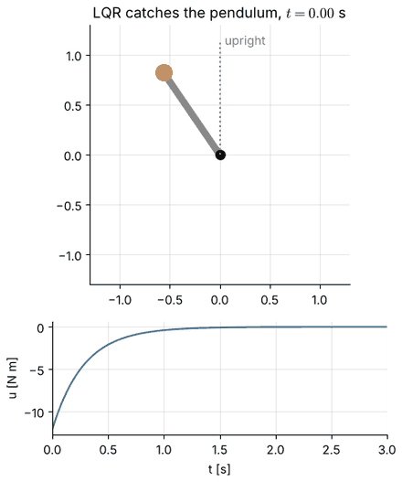
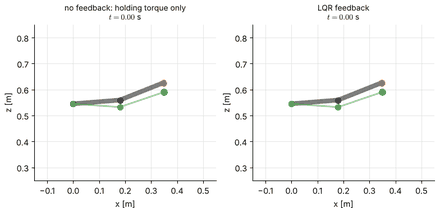

# RMC Chapter 7 — Optimal, Predictive and Learning-Based Control

This chapter replaces "choose the poles" by "optimise a cost": linear-quadratic regulation, trajectory optimisation, model
predictive control, reinforcement-learning basics, and learning for robot control, all implemented with numpy/scipy and
tested against MuJoCo models (Dynamixel 2R, UR5e). **Status: only notebook 7.1 is written; 7.2–7.6 are planned.**

## Learning path

7.1 → 7.2 → 7.3 → 7.4 → 7.5 → 7.6 (the last two require 7.4 for the RL vocabulary; 7.5–7.6 reuse the LQR/MPC baselines).

| Notebook | Topics | Time | Prerequisites | Status |
|:--|:--|:--|:--|:--|
| [7.1 Linear-Quadratic Regulation](7.1-linear-quadratic-regulation.ipynb) | dynamic-programming derivation, Riccati equations, Bryson's rule, Pareto front, guaranteed margins, set-points and integral action, LQR on a 2R arm (unstable posture) and a UR5e with payload; `mjd_transitionFD` cross-checked by hand | ~3 h | state-space basics (RMC 1), joint model (RMC 2) | written |
| 7.2 Trajectory optimisation | iLQR/DDP, direct collocation, swing-up, 2R reaching | ~3 h | 7.1 | planned |
| 7.3 Model predictive control | receding horizon, QP, input/state constraints, receding-horizon animations | ~3 h | 7.1 | planned |
| 7.4 Reinforcement-learning basics | MDPs, value iteration, Q-learning, policy gradient with baseline | ~3 h | 7.1 | planned |
| 7.5 Learning to reach | policy search on a MuJoCo arm, reward design | ~3 h | 7.4 | planned |
| 7.6 Residual learning, imitation and sim-to-real | residual control over computed torque, behaviour cloning, safety | ~3 h | 7.4, 7.5 | planned |

## Previews

## Library code written for this chapter

`rgkit/optimal_control.py` (LQR, Riccati recursion, iLQR, QP solvers, linear MPC; `tests/test_optimal_control.py`),
`rgkit/mj_control.py` (torque-controlled MuJoCo arms with payload; `tests/test_mj_control.py`) and
`rgkit/rl_numpy.py` (grid-world MDPs, DP, Q-learning/SARSA, numpy MLP, CEM/ES; `tests/test_rl_numpy.py`). The modules for the planned notebooks exist and are tested; the notebooks themselves are not yet written.

## Where the textbooks cover this

| Topic | Source |
|:--|:--|
| LQR, dynamic programming, trajectory optimisation | Tedrake, *Underactuated Robotics* (online); CMU 16-745 notes |
| Quadratic optimal regulator | Ogata, *Modern Control Engineering*, state-space design chapters |
| Reinforcement learning | Sutton and Barto, Ch. 3, 4, 6, 13 |

## Not covered

Stochastic/LQG control, estimation, DDP second-order dynamics terms, deep RL (PyTorch/SB3 are not used).
