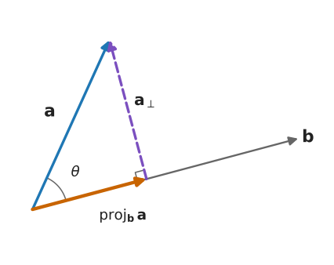
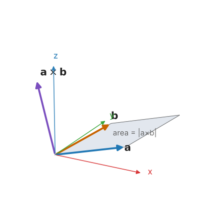

# M1 — Vectors and Geometry

> **Mathematics Primer · Chapter 1 of 8** · [Primer home](README.md) · Next: [M2 — Matrices and Linear Maps](M2-matrices-and-linear-maps.md)

## Why this matters in robotics

A robot is a machine that moves through three-dimensional space, so nearly every quantity in robotics is a vector: the position of a gripper, the direction of a joint axis, the velocity of a link, the force at a fingertip, or the torque produced by a motor. The algebra of vectors (the dot product, the cross product, and the skew-symmetric matrix that represents the cross product) is the vocabulary in which Craig writes the whole of *Introduction to Robotics*. If you can project a vector onto an axis, compute a cross product without hesitation, and recognise the expression $\boldsymbol{\omega} \times \mathbf{r}$ as the velocity of a point on a spinning body, you already have the main tools you need for Chapters 2 to 5 of Craig.

## Learning objectives

After studying this chapter you should be able to:

1. distinguish between a geometric vector and its coordinates in a particular frame, and read Craig's notation ${}^{A}\mathbf{P}$;
2. compute norms, unit vectors, dot products, angles and orthogonal projections;
3. compute cross products, apply the right-hand rule, and interpret $\lVert \mathbf{a} \times \mathbf{b} \rVert$ as an area;
4. evaluate scalar and vector triple products and use them to test coplanarity and compute volumes;
5. describe lines and planes in vector form and compute point-to-line and point-to-plane distances;
6. construct the skew-symmetric matrix $[\boldsymbol{\omega}]_\times$ and use its identities.

## Contents

1. [Vectors, points and frames](#1-vectors-points-and-frames)
2. [Length and unit vectors](#2-length-and-unit-vectors)
3. [The dot product and projections](#3-the-dot-product-and-projections)
4. [The cross product and the right-hand rule](#4-the-cross-product-and-the-right-hand-rule)
5. [Triple products](#5-triple-products)
6. [Lines and planes](#6-lines-and-planes)
7. [The skew-symmetric matrix of a vector](#7-the-skew-symmetric-matrix-of-a-vector)
8. [Worked examples](#8-worked-examples)
9. [Exercises](#9-exercises)
10. [Further reading](#10-further-reading)

---

## 1. Vectors, points and frames

A **vector** is a quantity that has both a magnitude and a direction. Geometrically we draw it as an arrow. Two arrows of the same length pointing the same way represent the same *free* vector, wherever they are drawn. Displacements, velocities and angular velocities behave like free vectors. A **point**, on the other hand, is a location. We describe a point by the vector from some chosen origin to it, which is called a *position vector* or *bound vector*.

To do arithmetic we need numbers, and numbers require a **frame of reference**: an origin together with three mutually perpendicular unit vectors $\hat{\mathbf{x}}, \hat{\mathbf{y}}, \hat{\mathbf{z}}$ arranged in a right-handed way (Section 4). The **coordinates** of a vector $\mathbf{p}$ in that frame are the three numbers $p_x, p_y, p_z$ such that

$$
\mathbf{p} = p_x \hat{\mathbf{x}} + p_y \hat{\mathbf{y}} + p_z \hat{\mathbf{z}}, \qquad \text{written as the column} \qquad \mathbf{p} = \begin{bmatrix} p_x \\ p_y \\ p_z \end{bmatrix}.
$$

The same physical arrow has different coordinates in different frames. Robotics constantly juggles many frames (one for the base, one for each link, one for the tool, one for a camera), so Craig attaches the frame name as a **leading superscript**: ${}^{A}\mathbf{P}$ means "the position of point $P$, written in coordinates of frame $\lbrace A \rbrace$". Converting ${}^{B}\mathbf{P}$ into ${}^{A}\mathbf{P}$ is the subject of [M2](M2-matrices-and-linear-maps.md) and of Craig Chapter 2.

Vectors are added component by component (the head-to-tail rule geometrically) and multiplied by scalars component by component. With these two operations, $\mathbb{R}^3$ is a *vector space*; the properties you would expect (commutativity, associativity, distributivity) all hold.

## 2. Length and unit vectors

The **Euclidean norm**, or length, of $\mathbf{p}$ is

$$
\lVert \mathbf{p} \rVert = \sqrt{p_x^2 + p_y^2 + p_z^2}.
$$

It satisfies $\lVert \mathbf{p} \rVert \ge 0$ with equality only for $\mathbf{p} = \mathbf{0}$, $\lVert c\mathbf{p} \rVert = |c|\,\lVert \mathbf{p} \rVert$, and the **triangle inequality** $\lVert \mathbf{a} + \mathbf{b} \rVert \le \lVert \mathbf{a} \rVert + \lVert \mathbf{b} \rVert$. The triangle inequality has a direct robotic reading: a two-link arm with link lengths $l_1$ and $l_2$ can never reach a point farther than $l_1 + l_2$ from its shoulder.

A **unit vector** has length one and carries direction only. We mark unit vectors with a hat, and normalise any non-zero vector by dividing by its length:

$$
\hat{\mathbf{p}} = \frac{\mathbf{p}}{\lVert \mathbf{p} \rVert}.
$$

Joint axes, surface normals and the columns of rotation matrices are all unit vectors.

## 3. The dot product and projections

### Definition and geometric meaning

The **dot product** (scalar product, inner product) of $\mathbf{a}$ and $\mathbf{b}$ is

$$
\mathbf{a} \cdot \mathbf{b} = \mathbf{a}^{T}\mathbf{b} = a_x b_x + a_y b_y + a_z b_z = \lVert \mathbf{a} \rVert \, \lVert \mathbf{b} \rVert \cos\theta,
$$

where $\theta \in [0, \pi]$ is the angle between the two vectors. The equivalence of the algebraic and the geometric forms follows from the law of cosines applied to the triangle with sides $\mathbf{a}$, $\mathbf{b}$ and $\mathbf{a} - \mathbf{b}$ (see [M4](M4-trigonometry-and-atan2.md)).

**Properties.** The dot product is commutative, $\mathbf{a}\cdot\mathbf{b} = \mathbf{b}\cdot\mathbf{a}$; it is linear in each argument; $\mathbf{a}\cdot\mathbf{a} = \lVert \mathbf{a} \rVert^2$; and $\mathbf{a}\cdot\mathbf{b} = 0$ exactly when the vectors are **orthogonal** (perpendicular), provided neither is zero. The **Cauchy–Schwarz inequality** $|\mathbf{a}\cdot\mathbf{b}| \le \lVert \mathbf{a} \rVert \lVert \mathbf{b} \rVert$ guarantees that $\cos\theta$ computed from the formula lies in $[-1, 1]$.

### Projection

The dot product with a *unit* vector extracts a component. If $\hat{\mathbf{u}}$ is a unit vector, then $\mathbf{a}\cdot\hat{\mathbf{u}}$ is the signed length of the shadow of $\mathbf{a}$ on the line spanned by $\hat{\mathbf{u}}$. The **orthogonal projection** of $\mathbf{a}$ onto a non-zero vector $\mathbf{b}$, and the remaining perpendicular part, are

$$
\operatorname{proj}_{\mathbf{b}} \mathbf{a} = \frac{\mathbf{a}\cdot\mathbf{b}}{\mathbf{b}\cdot\mathbf{b}}\,\mathbf{b}, \qquad \mathbf{a}_{\perp} = \mathbf{a} - \operatorname{proj}_{\mathbf{b}} \mathbf{a}, \qquad \mathbf{a}_{\perp}\cdot\mathbf{b} = 0.
$$

*Figure M1.1 — The vector $\mathbf{a}$ splits into a part parallel to $\mathbf{b}$ (its projection) and a part perpendicular to $\mathbf{b}$.*

**Where this is used.** Coordinates are projections: the $x$-coordinate of $\mathbf{p}$ in a frame is $\hat{\mathbf{x}}\cdot\mathbf{p}$. This is why every entry of a rotation matrix is a dot product of two unit axes, the "direction cosines" of Craig Ch. 2. In statics, the torque felt by a revolute joint is the projection of the moment onto the joint axis, $\tau = \hat{\mathbf{z}}\cdot\mathbf{n}$ (Craig Ch. 5). In control, the power delivered by a force is $\mathbf{f}\cdot\mathbf{v}$.

## 4. The cross product and the right-hand rule

### Definition

The **cross product** (vector product) is defined only in three dimensions:

$$
\mathbf{a} \times \mathbf{b} = \begin{bmatrix} a_y b_z - a_z b_y \\ a_z b_x - a_x b_z \\ a_x b_y - a_y b_x \end{bmatrix}.
$$

A convenient mnemonic is the formal determinant with $\hat{\mathbf{x}}, \hat{\mathbf{y}}, \hat{\mathbf{z}}$ in the first row and the components of $\mathbf{a}$ and $\mathbf{b}$ in the second and third rows.

### Geometric meaning

The vector $\mathbf{a}\times\mathbf{b}$ is perpendicular to both $\mathbf{a}$ and $\mathbf{b}$; its length is

$$
\lVert \mathbf{a}\times\mathbf{b} \rVert = \lVert \mathbf{a} \rVert \, \lVert \mathbf{b} \rVert \sin\theta,
$$

which is the area of the parallelogram spanned by $\mathbf{a}$ and $\mathbf{b}$; and its sense is fixed by the **right-hand rule**: curl the fingers of the right hand from $\mathbf{a}$ towards $\mathbf{b}$ through the smaller angle, and the thumb points along $\mathbf{a}\times\mathbf{b}$. A frame is **right-handed** when $\hat{\mathbf{x}}\times\hat{\mathbf{y}} = \hat{\mathbf{z}}$, and then also $\hat{\mathbf{y}}\times\hat{\mathbf{z}} = \hat{\mathbf{x}}$ and $\hat{\mathbf{z}}\times\hat{\mathbf{x}} = \hat{\mathbf{y}}$ (cyclic order). Every frame in Craig, Lynch & Park, Spong and Siciliano is right-handed.

*Figure M1.2 — $\mathbf{a}\times\mathbf{b}$ is normal to the parallelogram spanned by $\mathbf{a}$ and $\mathbf{b}$, with length equal to its area.*

### Properties

| Property | Statement |
|---|---|
| Anti-commutativity | $\mathbf{b}\times\mathbf{a} = -\,\mathbf{a}\times\mathbf{b}$ |
| Parallel vectors | $\mathbf{a}\times\mathbf{a} = \mathbf{0}$; $\mathbf{a}\times\mathbf{b} = \mathbf{0}$ iff the vectors are parallel (or one is zero) |
| Linearity | $\mathbf{a}\times(\alpha\mathbf{b} + \beta\mathbf{c}) = \alpha\,\mathbf{a}\times\mathbf{b} + \beta\,\mathbf{a}\times\mathbf{c}$ |
| Not associative | in general $(\mathbf{a}\times\mathbf{b})\times\mathbf{c} \neq \mathbf{a}\times(\mathbf{b}\times\mathbf{c})$ |
| Lagrange's identity | $\lVert \mathbf{a}\times\mathbf{b} \rVert^2 = \lVert \mathbf{a} \rVert^2 \lVert \mathbf{b} \rVert^2 - (\mathbf{a}\cdot\mathbf{b})^2$ |
| Rotation invariance | $R(\mathbf{a}\times\mathbf{b}) = (R\mathbf{a})\times(R\mathbf{b})$ for any rotation matrix $R$ |

**Where this is used.** Three physical laws in robotics are cross products:

* the velocity of a point at position $\mathbf{r}$ on a body rotating with angular velocity $\boldsymbol{\omega}$ about the origin is $\mathbf{v} = \boldsymbol{\omega}\times\mathbf{r}$ (Craig Ch. 5; Lynch & Park Ch. 3);
* the moment of a force $\mathbf{f}$ applied at $\mathbf{r}$ is $\mathbf{n} = \mathbf{r}\times\mathbf{f}$ (Craig Ch. 5 statics, Ch. 6 Newton–Euler);
* the linear-velocity column of a revolute joint in the geometric Jacobian is $\hat{\mathbf{z}}_i \times (\mathbf{p}_e - \mathbf{p}_i)$ (Spong Ch. on velocity kinematics; Siciliano Ch. 3).

The cross product is also the standard way to *complete* a frame: given two orthogonal unit axes, the third is their cross product.

## 5. Triple products

### Scalar triple product

The **scalar triple product** of $\mathbf{a}, \mathbf{b}, \mathbf{c}$ is

$$
\mathbf{a}\cdot(\mathbf{b}\times\mathbf{c}) = \det\begin{bmatrix} a_x & a_y & a_z \\ b_x & b_y & b_z \\ c_x & c_y & c_z \end{bmatrix}.
$$

Its absolute value is the volume of the parallelepiped with edges $\mathbf{a}, \mathbf{b}, \mathbf{c}$; its sign is positive when $(\mathbf{a}, \mathbf{b}, \mathbf{c})$ is a right-handed triple. It is unchanged by a cyclic shift, $\mathbf{a}\cdot(\mathbf{b}\times\mathbf{c}) = \mathbf{b}\cdot(\mathbf{c}\times\mathbf{a}) = \mathbf{c}\cdot(\mathbf{a}\times\mathbf{b})$, and changes sign when two vectors are swapped. Three vectors are **coplanar** if and only if their scalar triple product is zero. For the axes of a right-handed frame, $\hat{\mathbf{x}}\cdot(\hat{\mathbf{y}}\times\hat{\mathbf{z}}) = +1$, which is the statement $\det R = +1$ for a rotation matrix ([M2](M2-matrices-and-linear-maps.md)).

### Vector triple product

The **vector triple product** expands by the "BAC-minus-CAB" rule:

$$
\mathbf{a}\times(\mathbf{b}\times\mathbf{c}) = \mathbf{b}\,(\mathbf{a}\cdot\mathbf{c}) - \mathbf{c}\,(\mathbf{a}\cdot\mathbf{b}).
$$

It appears whenever two rotations act in succession: the centripetal acceleration of a point on a rotating body is $\boldsymbol{\omega}\times(\boldsymbol{\omega}\times\mathbf{r})$, a term that appears in Craig's Newton–Euler recursion (Ch. 6).

## 6. Lines and planes

### Lines

The line through point $\mathbf{p}_0$ with direction $\mathbf{d} \neq \mathbf{0}$ is the set of points

$$
\mathbf{p}(t) = \mathbf{p}_0 + t\,\mathbf{d}, \qquad t \in \mathbb{R}.
$$

The distance from a point $\mathbf{q}$ to this line is the length of the component of $\mathbf{q} - \mathbf{p}_0$ perpendicular to $\mathbf{d}$, which Lagrange's identity lets us write compactly:

$$
\operatorname{dist}(\mathbf{q}, \text{line}) = \frac{\lVert (\mathbf{q} - \mathbf{p}_0)\times\mathbf{d} \rVert}{\lVert \mathbf{d} \rVert}.
$$

Joint axes are lines. The Denavit–Hartenberg convention (Craig Ch. 3) is built on the common perpendicular between two successive joint-axis lines; its length is the link length $a_{i-1}$.

### Planes

A plane is determined by a point $\mathbf{p}_0$ on it and a normal vector $\mathbf{n}$. A point $\mathbf{p}$ lies on the plane exactly when $\mathbf{p} - \mathbf{p}_0$ is perpendicular to $\mathbf{n}$:

$$
\mathbf{n}\cdot(\mathbf{p} - \mathbf{p}_0) = 0 \quad\Longleftrightarrow\quad n_x x + n_y y + n_z z = d, \qquad d = \mathbf{n}\cdot\mathbf{p}_0.
$$

Given three non-collinear points $\mathbf{p}_1, \mathbf{p}_2, \mathbf{p}_3$, a normal is $\mathbf{n} = (\mathbf{p}_2 - \mathbf{p}_1)\times(\mathbf{p}_3 - \mathbf{p}_1)$. The **signed distance** from $\mathbf{q}$ to the plane is

$$
s = \frac{\mathbf{n}\cdot\mathbf{q} - d}{\lVert \mathbf{n} \rVert},
$$

positive on the side to which $\mathbf{n}$ points. The line $\mathbf{p}_0 + t\mathbf{d}$ meets the plane $\mathbf{n}\cdot\mathbf{p} = d$ at $t = (d - \mathbf{n}\cdot\mathbf{p}_0)/(\mathbf{n}\cdot\mathbf{d})$, provided $\mathbf{n}\cdot\mathbf{d} \neq 0$. Planes model tables, walls and virtual safety boundaries; the signed-distance formula is the basic collision test.

## 7. The skew-symmetric matrix of a vector

Because $\mathbf{a}\times\mathbf{b}$ is linear in $\mathbf{b}$, it can be written as a matrix times $\mathbf{b}$. For $\boldsymbol{\omega} = (\omega_x, \omega_y, \omega_z)^{T}$ define

$$
[\boldsymbol{\omega}]_\times = \begin{bmatrix} 0 & -\omega_z & \omega_y \\ \omega_z & 0 & -\omega_x \\ -\omega_y & \omega_x & 0 \end{bmatrix}, \qquad\text{so that}\qquad [\boldsymbol{\omega}]_\times\,\mathbf{b} = \boldsymbol{\omega}\times\mathbf{b}.
$$

A matrix $S$ is **skew-symmetric** when $S^{T} = -S$. Every $3\times 3$ skew-symmetric matrix has the form above for exactly one vector, so the map $\boldsymbol{\omega} \mapsto [\boldsymbol{\omega}]_\times$ is a one-to-one correspondence between $\mathbb{R}^3$ and the set of $3\times3$ skew-symmetric matrices. Different books write the same object as $[\boldsymbol{\omega}]$ (Lynch & Park), $S(\boldsymbol{\omega})$ (Spong, Siciliano), $\hat{\boldsymbol{\omega}}$ (Murray, Li & Sastry) or $\boldsymbol{\omega}^{\wedge}$.

**Identities** (each can be checked by expanding components):

1. $[\boldsymbol{\omega}]_\times^{T} = -[\boldsymbol{\omega}]_\times$;
2. $[\boldsymbol{\omega}]_\times\boldsymbol{\omega} = \mathbf{0}$, so $\boldsymbol{\omega}$ spans the null space of $[\boldsymbol{\omega}]_\times$ when $\boldsymbol{\omega} \neq \mathbf{0}$;
3. $\mathbf{x}^{T}[\boldsymbol{\omega}]_\times\mathbf{x} = 0$ for every $\mathbf{x}$;
4. $[\boldsymbol{\omega}]_\times^{2} = \boldsymbol{\omega}\boldsymbol{\omega}^{T} - \lVert \boldsymbol{\omega} \rVert^{2} I$ (from the BAC-CAB rule);
5. $[\boldsymbol{\omega}]_\times^{3} = -\lVert \boldsymbol{\omega} \rVert^{2}\,[\boldsymbol{\omega}]_\times$;
6. $R\,[\boldsymbol{\omega}]_\times R^{T} = [R\boldsymbol{\omega}]_\times$ for every rotation matrix $R$.

**Where this is used.** Identities 4 and 5 are the reason the matrix exponential $e^{[\hat{\boldsymbol{\omega}}]_\times\theta}$ collapses to **Rodrigues' formula** $R = I + \sin\theta\,[\hat{\boldsymbol{\omega}}]_\times + (1 - \cos\theta)\,[\hat{\boldsymbol{\omega}}]_\times^{2}$ (Lynch & Park §3.2; Craig Ch. 2 on equivalent angle–axis). The derivative of a rotation matrix is $\dot{R} = [\boldsymbol{\omega}]_\times R$ ([M5](M5-calculus-and-differential-equations.md)), and identity 6 tells us how angular velocity transforms between frames. In RMC, identity 3 is exactly the property used in the passivity proof of PD control: the matrix $\dot{M} - 2C$ is skew-symmetric, so it does no work.

---

## 8. Worked examples

### Example M1.1 — Angle and projection

*Let $\mathbf{a} = (1, 2, 2)^{T}$ and $\mathbf{b} = (3, 0, 4)^{T}$. Find the angle between them, the projection of $\mathbf{a}$ onto $\mathbf{b}$, and the perpendicular remainder.*

**Solution.** $\lVert \mathbf{a} \rVert = \sqrt{1 + 4 + 4} = 3$, $\lVert \mathbf{b} \rVert = \sqrt{9 + 0 + 16} = 5$ and $\mathbf{a}\cdot\mathbf{b} = 3 + 0 + 8 = 11$. Hence

$$
\cos\theta = \frac{11}{15} = 0.7333, \qquad \theta = \arccos(0.7333) = 42.83^\circ .
$$

The scalar projection is $\mathbf{a}\cdot\hat{\mathbf{b}} = 11/5 = 2.2$, and

$$
\operatorname{proj}_{\mathbf{b}}\mathbf{a} = \frac{11}{25}\begin{bmatrix} 3 \\ 0 \\ 4 \end{bmatrix} = \begin{bmatrix} 1.32 \\ 0 \\ 1.76 \end{bmatrix}, \qquad \mathbf{a}_\perp = \begin{bmatrix} 1 \\ 2 \\ 2 \end{bmatrix} - \begin{bmatrix} 1.32 \\ 0 \\ 1.76 \end{bmatrix} = \begin{bmatrix} -0.32 \\ 2 \\ 0.24 \end{bmatrix}.
$$

Check: $\mathbf{a}_\perp\cdot\mathbf{b} = -0.96 + 0 + 0.96 = 0$, as it must be.

### Example M1.2 — Cross product, area, and Lagrange's identity

*For the same $\mathbf{a}$ and $\mathbf{b}$, compute $\mathbf{a}\times\mathbf{b}$, the area of the triangle with sides $\mathbf{a}$ and $\mathbf{b}$, and verify Lagrange's identity.*

**Solution.**

$$
\mathbf{a}\times\mathbf{b} = \begin{bmatrix} 2\cdot 4 - 2\cdot 0 \\ 2\cdot 3 - 1\cdot 4 \\ 1\cdot 0 - 2\cdot 3 \end{bmatrix} = \begin{bmatrix} 8 \\ 2 \\ -6 \end{bmatrix}.
$$

Check orthogonality: $(8,2,-6)\cdot(1,2,2) = 8 + 4 - 12 = 0$ and $(8,2,-6)\cdot(3,0,4) = 24 - 24 = 0$. The length is $\sqrt{64 + 4 + 36} = \sqrt{104} = 10.198$, so the parallelogram has area $10.198$ and the triangle has area $5.099$. Lagrange's identity: $\lVert \mathbf{a} \rVert^2\lVert \mathbf{b} \rVert^2 - (\mathbf{a}\cdot\mathbf{b})^2 = 9\cdot 25 - 121 = 104$. ✓ As a further check, $\sin\theta = 10.198/15 = 0.6799$, and $\sin 42.83^\circ = 0.6799$, consistent with Example M1.1.

### Example M1.3 — Velocity of a point on a spinning link

*A link rotates about the $z$-axis of the base frame at $2\ \text{rad/s}$, so $\boldsymbol{\omega} = (0, 0, 2)^{T}$ rad/s. A sensor is mounted at $\mathbf{r} = (0.5, 0.3, 0.1)^{T}$ m. Find its velocity using the skew-symmetric matrix.*

**Solution.**

$$
\mathbf{v} = [\boldsymbol{\omega}]_\times\mathbf{r} = \begin{bmatrix} 0 & -2 & 0 \\ 2 & 0 & 0 \\ 0 & 0 & 0 \end{bmatrix}\begin{bmatrix} 0.5 \\ 0.3 \\ 0.1 \end{bmatrix} = \begin{bmatrix} -0.6 \\ 1.0 \\ 0 \end{bmatrix}\ \text{m/s}.
$$

The velocity has no $z$-component (the rotation is about $z$) and is perpendicular to the projection $(0.5, 0.3, 0)$ of $\mathbf{r}$ on the $xy$-plane. Its speed, $1.166$ m/s, equals $\lVert\boldsymbol{\omega}\rVert$ times the distance $\sqrt{0.5^2 + 0.3^2} = 0.583$ m from the axis.

### Example M1.4 — A plane through three points

*Find the plane through $\mathbf{p}_1 = (1,0,0)$, $\mathbf{p}_2 = (0,2,0)$ and $\mathbf{p}_3 = (0,0,3)$. Then find the signed distance of $\mathbf{q} = (1,1,1)$ from it, and the foot of the perpendicular.*

**Solution.** The edge vectors are $\mathbf{p}_2 - \mathbf{p}_1 = (-1, 2, 0)$ and $\mathbf{p}_3 - \mathbf{p}_1 = (-1, 0, 3)$, so

$$
\mathbf{n} = (-1,2,0)\times(-1,0,3) = (2\cdot3 - 0\cdot 0,\; 0\cdot(-1) - (-1)\cdot 3,\; (-1)\cdot 0 - 2\cdot(-1)) = (6, 3, 2), \qquad \lVert\mathbf{n}\rVert = 7.
$$

With $d = \mathbf{n}\cdot\mathbf{p}_1 = 6$, the plane is $6x + 3y + 2z = 6$ (check: $\mathbf{p}_2$ gives $6$ and $\mathbf{p}_3$ gives $6$). For $\mathbf{q}$:

$$
s = \frac{6 + 3 + 2 - 6}{7} = \frac{5}{7} = 0.714 .
$$

The foot of the perpendicular is $\mathbf{q} - s\,\hat{\mathbf{n}} = \mathbf{q} - \tfrac{5}{49}\mathbf{n} = \left(\tfrac{19}{49}, \tfrac{34}{49}, \tfrac{39}{49}\right) \approx (0.388, 0.694, 0.796)$; substituting gives $(114 + 102 + 78)/49 = 6$, so it lies on the plane. The origin has $s = -6/7$: it is on the opposite side from $\mathbf{q}$.

### Example M1.5 — Volume and handedness

*Find the volume of the parallelepiped with edges $\mathbf{a} = (1,0,0)$, $\mathbf{b} = (1,2,0)$, $\mathbf{c} = (0,1,3)$, and state whether $(\mathbf{a}, \mathbf{b}, \mathbf{c})$ is right-handed.*

**Solution.** $\mathbf{b}\times\mathbf{c} = (2\cdot 3 - 0\cdot 1,\ 0\cdot 0 - 1\cdot 3,\ 1\cdot 1 - 2\cdot 0) = (6, -3, 1)$, so $\mathbf{a}\cdot(\mathbf{b}\times\mathbf{c}) = 6$. The volume is $6$ and, because the sign is positive, the triple is right-handed.

---

## 9. Exercises

**E1.1** For $\mathbf{u} = (2, -1, 2)$ and $\mathbf{v} = (1, 1, 0)$, find $\lVert\mathbf{u}\rVert$, $\lVert\mathbf{v}\rVert$, $\mathbf{u}\cdot\mathbf{v}$, and the angle between them.

Answer

$\lVert\mathbf{u}\rVert = 3$, $\lVert\mathbf{v}\rVert = \sqrt{2} \approx 1.414$, $\mathbf{u}\cdot\mathbf{v} = 2 - 1 + 0 = 1$, so $\cos\theta = 1/(3\sqrt2) = 0.2357$ and $\theta = 76.37^\circ$.

**E1.2** Using only the right-hand rule and anti-commutativity, evaluate $\hat{\mathbf{x}}\times\hat{\mathbf{z}}$. Confirm with the component formula.

Answer

Cyclically, $\hat{\mathbf{z}}\times\hat{\mathbf{x}} = \hat{\mathbf{y}}$, so $\hat{\mathbf{x}}\times\hat{\mathbf{z}} = -\hat{\mathbf{y}}$. Components: $(1,0,0)\times(0,0,1) = (0\cdot1 - 0\cdot0,\ 0\cdot0 - 1\cdot1,\ 1\cdot0 - 0\cdot0) = (0,-1,0)$.

**E1.3** Write $[\boldsymbol{\omega}]_\times$ for $\boldsymbol{\omega} = (1, 2, 3)$ and use it to compute $\boldsymbol{\omega}\times\mathbf{r}$ for $\mathbf{r} = (4, 5, 6)$.

Answer

$$
[\boldsymbol{\omega}]_\times = \begin{bmatrix} 0 & -3 & 2 \\ 3 & 0 & -1 \\ -2 & 1 & 0 \end{bmatrix}, \qquad [\boldsymbol{\omega}]_\times\mathbf{r} = \begin{bmatrix} -15 + 12 \\ 12 - 6 \\ -8 + 5 \end{bmatrix} = \begin{bmatrix} -3 \\ 6 \\ -3 \end{bmatrix}.
$$

**E1.4** Prove identity 4 of Section 7, $[\boldsymbol{\omega}]_\times^{2} = \boldsymbol{\omega}\boldsymbol{\omega}^{T} - \lVert\boldsymbol{\omega}\rVert^{2} I$.

Answer

For any $\mathbf{x}$, $[\boldsymbol{\omega}]_\times^{2}\mathbf{x} = \boldsymbol{\omega}\times(\boldsymbol{\omega}\times\mathbf{x}) = \boldsymbol{\omega}(\boldsymbol{\omega}\cdot\mathbf{x}) - \mathbf{x}(\boldsymbol{\omega}\cdot\boldsymbol{\omega})$ by BAC-CAB. Since $\boldsymbol{\omega}(\boldsymbol{\omega}\cdot\mathbf{x}) = (\boldsymbol{\omega}\boldsymbol{\omega}^{T})\mathbf{x}$, this equals $(\boldsymbol{\omega}\boldsymbol{\omega}^{T} - \lVert\boldsymbol{\omega}\rVert^2 I)\mathbf{x}$. Two matrices that agree on every $\mathbf{x}$ are equal.

**E1.5** Find the distance from $\mathbf{q} = (3, 4, 0)$ to the line through the origin with direction $\mathbf{d} = (1, 1, 1)$, and the closest point on the line.

Answer

$\mathbf{q}\times\mathbf{d} = (4\cdot1 - 0\cdot1,\ 0\cdot1 - 3\cdot1,\ 3\cdot1 - 4\cdot1) = (4, -3, -1)$, of length $\sqrt{26}$. Distance $= \sqrt{26}/\sqrt{3} = \sqrt{26/3} \approx 2.944$. The closest point is $\tfrac{\mathbf{q}\cdot\mathbf{d}}{\mathbf{d}\cdot\mathbf{d}}\mathbf{d} = \tfrac{7}{3}(1,1,1) \approx (2.333, 2.333, 2.333)$; indeed $\lVert\mathbf{q} - (7/3)(1,1,1)\rVert = 2.944$.

**E1.6** Are the vectors $(1,2,3)$, $(4,5,6)$, $(7,8,9)$ coplanar?

Answer

Yes. The determinant of the matrix with these rows is $1(45 - 48) - 2(36 - 42) + 3(32 - 35) = -3 + 12 - 9 = 0$. (Indeed the third is $2\times$ the second minus the first.)

**E1.7** A gripper's approach direction must be $\hat{\mathbf{x}}' = (1, 1, 0)/\sqrt{2}$ and its $z$-axis must remain vertical, $\hat{\mathbf{z}}' = (0, 0, 1)$. Find $\hat{\mathbf{y}}'$ so that the frame is right-handed, and check.

Answer

$\hat{\mathbf{y}}' = \hat{\mathbf{z}}'\times\hat{\mathbf{x}}' = (0\cdot0 - 1\cdot1,\ 1\cdot1 - 0\cdot0,\ 0)/\sqrt2 = (-1, 1, 0)/\sqrt{2}$. Check: $\hat{\mathbf{x}}'\times\hat{\mathbf{y}}' = \tfrac12(1\cdot0 - 0\cdot1,\ 0\cdot(-1) - 1\cdot 0,\ 1\cdot1 - 1\cdot(-1)) = (0, 0, 1) = \hat{\mathbf{z}}'$. ✓

**E1.8** Where does the line $\mathbf{p}(t) = t\,(1, 1, 1)$ meet the plane $6x + 3y + 2z = 6$ of Example M1.4?

Answer

$t = 6/(6 + 3 + 2) = 6/11$, so the intersection is $(6/11)(1,1,1) \approx (0.5455, 0.5455, 0.5455)$.

---

## 10. Further reading

* G. Strang, *Introduction to Linear Algebra*, Ch. 1 (Introduction to Vectors).
* E. Kreyszig, *Advanced Engineering Mathematics*, Ch. 9 (Vector Differential Calculus; the opening sections cover the dot and cross products).
* J. J. Craig, *Introduction to Robotics: Mechanics and Control*, Ch. 2 (Spatial Descriptions and Transformations).
* K. M. Lynch and F. C. Park, *Modern Robotics*, Ch. 3 (Rigid-Body Motions), especially §3.2 on rotations and the skew-symmetric representation of angular velocity.
* B. Siciliano, L. Sciavicco, L. Villani and G. Oriolo, *Robotics: Modelling, Planning and Control*, Appendix A (Linear Algebra) and Appendix B (Rigid-Body Mechanics).

---

[Primer home](README.md) · Next: [M2 — Matrices and Linear Maps](M2-matrices-and-linear-maps.md)
