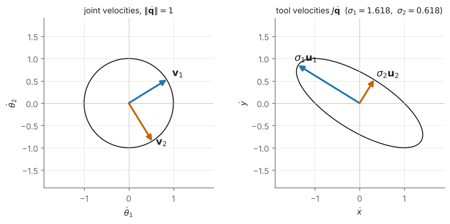

# M3 — Eigenvalues, the SVD and Least Squares

> **Mathematics Primer · Chapter 3 of 8** · Previous: [M2 — Matrices and Linear Maps](M2-matrices-and-linear-maps.md) · [Primer home](README.md) · Next: [M4 — Trigonometry and atan2](M4-trigonometry-and-atan2.md)

## Why this matters in robotics

A matrix describes a linear map, but the raw entries rarely reveal what the map *does*. Eigenvalues and singular values do. The axis of a rotation is the eigenvector of its rotation matrix with eigenvalue $1$. The principal axes of a rigid body are the eigenvectors of its inertia tensor. A controller is stable when the eigenvalues of its closed-loop matrix lie in the left half-plane, and a Lyapunov function $V = \mathbf{x}^{T}P\mathbf{x}$ requires $P$ to be positive-definite. The singular value decomposition (SVD) of the Jacobian tells us in which directions a manipulator moves easily, in which it moves with difficulty, and how close it is to a singularity; it also yields the pseudoinverse, which solves the inverse velocity problem for redundant robots, and the damped least-squares method that keeps that solution well behaved near singularities. These ideas run through Craig Chapters 2, 5, 6 and 10, Lynch & Park Chapters 3, 5, 6 and 8, and every chapter of RMC.

## Learning objectives

After studying this chapter you should be able to:

1. compute eigenvalues and eigenvectors of small matrices from the characteristic polynomial;
2. extract the angle and axis of a rotation matrix, including the special case $\theta = \pi$;
3. state the spectral theorem for symmetric matrices and test a matrix for positive-definiteness;
4. compute and interpret the SVD, singular values, condition number and the manipulability ellipsoid;
5. solve over- and under-determined linear systems by least squares and the Moore–Penrose pseudoinverse;
6. explain why damped least squares is used near singularities and compute a damped solution.

## Contents

1. [Eigenvalues and eigenvectors](#1-eigenvalues-and-eigenvectors)
2. [The eigen-structure of a rotation matrix](#2-the-eigen-structure-of-a-rotation-matrix)
3. [Symmetric and positive-definite matrices](#3-symmetric-and-positive-definite-matrices)
4. [The singular value decomposition](#4-the-singular-value-decomposition)
5. [Least squares and the pseudoinverse](#5-least-squares-and-the-pseudoinverse)
6. [Conditioning and damped least squares](#6-conditioning-and-damped-least-squares)
7. [Worked examples](#7-worked-examples)
8. [Exercises](#8-exercises)
9. [Further reading](#9-further-reading)

---

## 1. Eigenvalues and eigenvectors

Most vectors change direction when a matrix acts on them. A non-zero vector $\mathbf{v}$ whose direction is preserved (or exactly reversed) is an **eigenvector**, and the stretch factor is its **eigenvalue**:

$$
A\mathbf{v} = \lambda\mathbf{v}, \qquad \mathbf{v} \neq \mathbf{0}.
$$

Rewriting as $(A - \lambda I)\mathbf{v} = \mathbf{0}$ shows that a non-zero solution exists only when $A - \lambda I$ is singular, that is, when $\lambda$ is a root of the **characteristic polynomial**

$$
p(\lambda) = \det(A - \lambda I) = 0 .
$$

An $n\times n$ matrix has $n$ eigenvalues, counted with multiplicity, which may be complex even when $A$ is real (complex ones appear in conjugate pairs). Once $\lambda$ is known, the eigenvectors are the non-zero vectors in the null space of $A - \lambda I$ ([M2](M2-matrices-and-linear-maps.md), §6).

Two facts provide quick checks:

$$
\sum_{i}\lambda_i = \operatorname{tr}A, \qquad \prod_i \lambda_i = \det A .
$$

For a $2\times2$ matrix these determine the eigenvalues completely: $\lambda^2 - (\operatorname{tr}A)\lambda + \det A = 0$.

If $A$ has $n$ linearly independent eigenvectors, collected as the columns of $V$, then $A = V\Lambda V^{-1}$ with $\Lambda = \operatorname{diag}(\lambda_1, \dots, \lambda_n)$. In the eigenvector basis, $A$ acts by simply scaling each coordinate. This is why the eigenvalues of the state matrix of a linear system $\dot{\mathbf{x}} = A\mathbf{x}$ decide its behaviour: each eigen-direction evolves independently as $e^{\lambda_i t}$ ([M5](M5-calculus-and-differential-equations.md), [M6](M6-laplace-and-linear-systems.md)).

## 2. The eigen-structure of a rotation matrix

Euler's rotation theorem states that any rotation of a rigid body about a fixed point is a rotation by some angle $\theta$ about some axis $\hat{\mathbf{k}}$. In matrix language: **every $R \in SO(3)$ has eigenvalue $1$, and the corresponding unit eigenvector is the rotation axis**, since points on the axis do not move, $R\hat{\mathbf{k}} = \hat{\mathbf{k}}$. The other two eigenvalues are $e^{\pm i\theta} = \cos\theta \pm i\sin\theta$. Using the trace rule,

$$
\operatorname{tr}R = 1 + 2\cos\theta \qquad\Longrightarrow\qquad \cos\theta = \frac{\operatorname{tr}R - 1}{2}.
$$

For $0 < \theta < \pi$ the axis can be read off the skew-symmetric part of $R$, since Rodrigues' formula gives $R - R^{T} = 2\sin\theta\,[\hat{\mathbf{k}}]_\times$:

$$
\hat{\mathbf{k}} = \frac{1}{2\sin\theta}\begin{bmatrix} r_{32} - r_{23} \\ r_{13} - r_{31} \\ r_{21} - r_{12} \end{bmatrix}.
$$

At $\theta = 0$ the axis is undefined (any axis will do). At $\theta = \pi$ the formula fails because $\sin\theta = 0$; instead use $R = 2\hat{\mathbf{k}}\hat{\mathbf{k}}^{T} - I$, so $\hat{\mathbf{k}}\hat{\mathbf{k}}^{T} = (R + I)/2$, and read $\hat{\mathbf{k}}$ (up to sign) from any non-zero column. These formulas are Craig's "equivalent angle–axis" conversion (Ch. 2) and the matrix logarithm of Lynch & Park §3.2. For numerical robustness near $\theta = 0$ or $\pi$, see [M7](M7-numerical-methods.md).

## 3. Symmetric and positive-definite matrices

### The spectral theorem

**Theorem (spectral theorem).** If $A$ is real and symmetric ($A = A^{T}$), then all its eigenvalues are real, eigenvectors belonging to distinct eigenvalues are orthogonal, and $A$ can be written as

$$
A = Q\Lambda Q^{T}, \qquad Q^{T}Q = I,
$$

with the orthonormal eigenvectors as the columns of $Q$.

*Proof of orthogonality.* If $A\mathbf{v}_1 = \lambda_1\mathbf{v}_1$ and $A\mathbf{v}_2 = \lambda_2\mathbf{v}_2$, then $\lambda_1\mathbf{v}_1^{T}\mathbf{v}_2 = (A\mathbf{v}_1)^{T}\mathbf{v}_2 = \mathbf{v}_1^{T}A\mathbf{v}_2 = \lambda_2\mathbf{v}_1^{T}\mathbf{v}_2$, so $(\lambda_1 - \lambda_2)\,\mathbf{v}_1^{T}\mathbf{v}_2 = 0$, and $\lambda_1 \neq \lambda_2$ forces $\mathbf{v}_1^{T}\mathbf{v}_2 = 0$. $\square$

**Where this is used.** The inertia tensor $I_C$ of a rigid body is symmetric, so there is always a rotation $Q$ to a body frame in which it is diagonal. The columns of $Q$ are the **principal axes** and the eigenvalues are the **principal moments of inertia** (Craig Ch. 6; Lynch & Park §8.2; [M8](M8-lagrangian-mechanics-primer.md)).

### Quadratic forms and definiteness

A symmetric matrix $P$ defines the **quadratic form** $\mathbf{x}^{T}P\mathbf{x}$. We say that $P$ is

| Name | Condition for all $\mathbf{x} \neq \mathbf{0}$ | Eigenvalue test |
|---|---|---|
| positive-definite ($P \succ 0$) | $\mathbf{x}^{T}P\mathbf{x} > 0$ | all $\lambda_i > 0$ |
| positive-semidefinite ($P \succeq 0$) | $\mathbf{x}^{T}P\mathbf{x} \ge 0$ | all $\lambda_i \ge 0$ |
| negative-definite | $\mathbf{x}^{T}P\mathbf{x} < 0$ | all $\lambda_i < 0$ |
| indefinite | takes both signs | eigenvalues of both signs |

The eigenvalue test follows from the spectral theorem: with $\mathbf{y} = Q^{T}\mathbf{x}$, $\mathbf{x}^{T}P\mathbf{x} = \sum_i\lambda_i y_i^2$. A second test, convenient by hand, is **Sylvester's criterion**: a symmetric $P$ is positive-definite if and only if all its *leading principal minors* (the determinants of the upper-left $1\times1$, $2\times2$, ..., $n\times n$ submatrices) are positive. Numerically, the cleanest test is to attempt a Cholesky factorisation $P = LL^{T}$, which succeeds exactly when $P \succ 0$.

The level sets $\mathbf{x}^{T}P\mathbf{x} = 1$ of a positive-definite form are ellipsoids whose axes point along the eigenvectors, with semi-axis lengths $1/\sqrt{\lambda_i}$.

**Where this is used.**

* The **kinetic energy** of a manipulator is $T = \tfrac12\dot{\mathbf{q}}^{T}M(\mathbf{q})\dot{\mathbf{q}}$, and since $T > 0$ whenever the robot moves, the mass matrix $M(\mathbf{q})$ is symmetric positive-definite (Craig Ch. 6; Spong Ch. on dynamics).
* A **Lyapunov function** $V(\mathbf{x}) = \mathbf{x}^{T}P\mathbf{x}$ with $P \succ 0$ certifies stability of $\dot{\mathbf{x}} = A\mathbf{x}$ if $A^{T}P + PA \prec 0$ (Example M3.6; Craig Ch. 10; Spong's Lyapunov appendix).
* Gain matrices $K_p, K_d$ of PD controllers are chosen symmetric positive-definite (RMC).

## 4. The singular value decomposition

Eigen-decomposition requires a square matrix and may need complex numbers. The **singular value decomposition** works for every real $m\times n$ matrix:

$$
A = U\Sigma V^{T}, \qquad U \in \mathbb{R}^{m\times m},\ V \in \mathbb{R}^{n\times n} \text{ orthogonal}, \qquad \Sigma = \operatorname{diag}(\sigma_1, \sigma_2, \dots) \in \mathbb{R}^{m\times n},
$$

with **singular values** $\sigma_1 \ge \sigma_2 \ge \dots \ge 0$. Equivalently, $A\mathbf{v}_i = \sigma_i\mathbf{u}_i$: the map sends the orthonormal input directions $\mathbf{v}_i$ (columns of $V$) to the orthonormal output directions $\mathbf{u}_i$ (columns of $U$), scaled by $\sigma_i$.

**Geometric meaning.** Every linear map is "rotate, stretch along the axes, rotate". Consequently the image of the unit sphere $\lbrace\lVert\mathbf{x}\rVert = 1\rbrace$ is an ellipsoid with semi-axes $\sigma_i\mathbf{u}_i$ (Figure M3.1).

**Computing it.** From $A^{T}A = V\Sigma^{T}\Sigma V^{T}$ and $AA^{T} = U\Sigma\Sigma^{T}U^{T}$:

* the $\sigma_i^2$ are the eigenvalues of $A^{T}A$ (and the non-zero ones also of $AA^{T}$);
* the $\mathbf{v}_i$ are the eigenvectors of $A^{T}A$, the $\mathbf{u}_i$ those of $AA^{T}$, and $\mathbf{u}_i = A\mathbf{v}_i/\sigma_i$ for $\sigma_i > 0$.

By hand this is fine for $2\times2$ problems; in practice use `numpy.linalg.svd`, which does not form $A^{T}A$ (doing so squares the condition number).

**What it reveals.** The rank of $A$ is the number of non-zero singular values; the last columns of $V$ (those with $\sigma_i = 0$, together with any extra columns when $n > m$) span the null space; $\lVert A\rVert_2 = \sigma_1$; and for square $A$, $|\det A| = \prod_i\sigma_i$.

*Figure M3.1 — The Jacobian of Example M3.3 maps the unit circle of joint velocities (left) to the manipulability ellipse of tool velocities (right). The semi-axes are $\sigma_1\mathbf{u}_1$ and $\sigma_2\mathbf{u}_2$.*

**The manipulability ellipsoid (preview).** For a Jacobian $J$, the set of tool velocities $\mathbf{v} = J\dot{\mathbf{q}}$ produced by unit-norm joint velocities $\lVert\dot{\mathbf{q}}\rVert \le 1$ is an ellipsoid with semi-axes $\sigma_i\mathbf{u}_i$; equivalently $\mathbf{v}^{T}(JJ^{T})^{-1}\mathbf{v} \le 1$ when $J$ has full row rank. Yoshikawa's **manipulability measure** is its volume up to a constant,

$$
w = \sqrt{\det(JJ^{T})} = \sigma_1\sigma_2\cdots\sigma_m,
$$

which falls to zero at a singularity, where the ellipsoid collapses in at least one direction (Lynch & Park §5.4; Siciliano Ch. 3; RMC).

## 5. Least squares and the pseudoinverse

### Overdetermined systems: best fit

When $A$ is $m\times n$ with $m > n$ (more equations than unknowns, as in fitting a model to many measurements), $A\mathbf{x} = \mathbf{b}$ usually has no exact solution. The **least-squares** solution minimises the squared residual $\lVert A\mathbf{x} - \mathbf{b}\rVert^2$. Setting its gradient to zero gives the **normal equations**

$$
A^{T}A\,\mathbf{x} = A^{T}\mathbf{b}, \qquad \mathbf{x}_{\text{LS}} = (A^{T}A)^{-1}A^{T}\mathbf{b} \quad (\text{if } A \text{ has full column rank}).
$$

Geometrically, $A\mathbf{x}_{\text{LS}}$ is the orthogonal projection of $\mathbf{b}$ onto the column space of $A$, so the residual $\mathbf{r} = \mathbf{b} - A\mathbf{x}_{\text{LS}}$ is orthogonal to every column: $A^{T}\mathbf{r} = \mathbf{0}$. Robotics uses this for **calibration** (kinematic parameters), **system identification** (the dynamic parameters enter the equations of motion linearly, $\boldsymbol{\tau} = Y(\mathbf{q}, \dot{\mathbf{q}}, \ddot{\mathbf{q}})\boldsymbol{\pi}$, so they can be fitted by least squares; RMC) and sensor fitting.

### Underdetermined systems: minimum norm

When $m < n$ (a redundant robot: more joints than task coordinates), $J\dot{\mathbf{q}} = \mathbf{v}$ has infinitely many solutions if $J$ has full row rank. The one of smallest norm $\lVert\dot{\mathbf{q}}\rVert$ is

$$
\dot{\mathbf{q}} = J^{T}(JJ^{T})^{-1}\mathbf{v},
$$

and the general solution adds any null-space motion, $\dot{\mathbf{q}} = J^{+}\mathbf{v} + (I - J^{+}J)\mathbf{z}$ for arbitrary $\mathbf{z}$ (Siciliano Ch. 3; Lynch & Park Ch. 6).

### The Moore–Penrose pseudoinverse

Both cases, and the rank-deficient case, are unified by the **pseudoinverse**, defined through the SVD:

$$
A^{+} = V\Sigma^{+}U^{T}, \qquad \Sigma^{+} = \operatorname{diag}\left(\frac{1}{\sigma_1}, \dots, \frac{1}{\sigma_r}, 0, \dots, 0\right)^{T},
$$

where $r$ is the rank. The vector $\mathbf{x} = A^{+}\mathbf{b}$ is always the minimum-norm vector among those that minimise $\lVert A\mathbf{x} - \mathbf{b}\rVert$. When $A$ has full column rank, $A^{+} = (A^{T}A)^{-1}A^{T}$ (the *left* pseudoinverse); when it has full row rank, $A^{+} = A^{T}(AA^{T})^{-1}$ (the *right* pseudoinverse); when $A$ is square and invertible, $A^{+} = A^{-1}$.

## 6. Conditioning and damped least squares

### Condition number

The **condition number** of a matrix (in the 2-norm) is

$$
\kappa(A) = \frac{\sigma_{\max}}{\sigma_{\min}} \ge 1 .
$$

It bounds how much relative errors in $\mathbf{b}$ can be amplified in the solution of $A\mathbf{x} = \mathbf{b}$: roughly, one loses $\log_{10}\kappa$ significant digits. For a Jacobian, $\kappa(J)$ measures how far the manipulability ellipsoid is from a sphere: $\kappa = 1$ is **isotropic** (equally easy in every direction), $\kappa \to \infty$ at a singularity. Its reciprocal is a common dexterity index in robot design (Craig Ch. 8).

### Why the pseudoinverse misbehaves near singularities

From the SVD, $J^{+}\mathbf{v} = \sum_i \dfrac{\mathbf{u}_i^{T}\mathbf{v}}{\sigma_i}\mathbf{v}_i$. As the arm approaches a singularity some $\sigma_i \to 0$, so a modest task velocity with a component along $\mathbf{u}_i$ demands enormous joint velocities. At the singularity itself, the term drops out abruptly (by convention $1/0$ is replaced by $0$), producing a discontinuous jump.

### Damped least squares

**Damped least squares** (DLS, also called the Levenberg–Marquardt method) instead minimises a weighted sum of tracking error and joint-velocity size,

$$
\min_{\dot{\mathbf{q}}}\ \lVert J\dot{\mathbf{q}} - \mathbf{v}\rVert^2 + \lambda^2\lVert\dot{\mathbf{q}}\rVert^2
\qquad\Longrightarrow\qquad
\dot{\mathbf{q}} = J^{T}(JJ^{T} + \lambda^2 I)^{-1}\mathbf{v} = \sum_i\frac{\sigma_i}{\sigma_i^2 + \lambda^2}(\mathbf{u}_i^{T}\mathbf{v})\,\mathbf{v}_i .
$$

The **damping factor** $\lambda > 0$ replaces each gain $1/\sigma_i$ by $\sigma_i/(\sigma_i^2 + \lambda^2)$. For $\sigma_i \gg \lambda$ this is almost $1/\sigma_i$, so far from singularities DLS behaves like the pseudoinverse; for $\sigma_i \ll \lambda$ it tends smoothly to zero rather than blowing up. The price is a tracking error in the near-singular directions. The gain is largest when $\sigma_i = \lambda$, where it equals $1/(2\lambda)$ (Exercise E3.7). DLS is the default choice in numerical inverse kinematics ([M7](M7-numerical-methods.md); Lynch & Park Ch. 6; Siciliano Ch. 3).

---

## 7. Worked examples

### Example M3.1 — Eigen-decomposition of a symmetric matrix

*Find the eigenvalues and orthonormal eigenvectors of $A = \begin{bmatrix} 2&1\\1&2 \end{bmatrix}$, and decide whether it is positive-definite.*

**Solution.** $\operatorname{tr}A = 4$ and $\det A = 3$, so $\lambda^2 - 4\lambda + 3 = (\lambda - 3)(\lambda - 1) = 0$, giving $\lambda_1 = 3$ and $\lambda_2 = 1$. For $\lambda = 3$, $A - 3I = \begin{bmatrix} -1&1\\1&-1 \end{bmatrix}$, whose null space is spanned by $(1, 1)$; for $\lambda = 1$, $A - I = \begin{bmatrix} 1&1\\1&1 \end{bmatrix}$ gives $(1, -1)$. Normalising,

$$
Q = \frac{1}{\sqrt2}\begin{bmatrix} 1 & 1 \\ 1 & -1 \end{bmatrix}, \qquad A = Q\begin{bmatrix} 3 & 0 \\ 0 & 1 \end{bmatrix}Q^{T}.
$$

The eigenvectors are orthogonal, as the spectral theorem promises, and both eigenvalues are positive, so $A \succ 0$. (Sylvester: $2 > 0$ and $\det A = 3 > 0$.)

### Example M3.2 — Angle and axis of a rotation matrix

*Find the angle and axis of $R = \begin{bmatrix} 0&0&1\\1&0&0\\0&1&0 \end{bmatrix}$ (the product $R_z(90^\circ)R_x(90^\circ)$ of [M2](M2-matrices-and-linear-maps.md), Example M2.2).*

**Solution.** $\operatorname{tr}R = 0$, so $\cos\theta = (0 - 1)/2 = -\tfrac12$ and $\theta = 120^\circ$, with $\sin\theta = \sqrt3/2$. Then

$$
\hat{\mathbf{k}} = \frac{1}{2(\sqrt3/2)}\begin{bmatrix} r_{32} - r_{23} \\ r_{13} - r_{31} \\ r_{21} - r_{12} \end{bmatrix} = \frac{1}{\sqrt3}\begin{bmatrix} 1 - 0 \\ 1 - 0 \\ 1 - 0 \end{bmatrix} = \frac{1}{\sqrt3}\begin{bmatrix} 1 \\ 1 \\ 1 \end{bmatrix}.
$$

Check: $R(1,1,1)^{T} = (1,1,1)^{T}$, so it is the eigenvector with eigenvalue $1$. The other eigenvalues are $e^{\pm i\,120^\circ} = -0.5 \pm 0.8660i$. Geometrically, a $120^\circ$ turn about the cube diagonal permutes the axes cyclically: $\hat{\mathbf{x}} \to \hat{\mathbf{y}} \to \hat{\mathbf{z}} \to \hat{\mathbf{x}}$, which is exactly what the columns of $R$ say.

### Example M3.3 — SVD and manipulability of a planar 2R arm

*The planar 2R arm of Craig Ch. 5 has, for $l_1 = l_2 = 1$,*

$$
J(\boldsymbol{\theta}) = \begin{bmatrix} -\sin\theta_1 - \sin(\theta_1 + \theta_2) & -\sin(\theta_1 + \theta_2) \\ \cos\theta_1 + \cos(\theta_1 + \theta_2) & \cos(\theta_1 + \theta_2) \end{bmatrix}.
$$

*At $\theta_1 = 0$, $\theta_2 = 90^\circ$, find the singular values, the manipulability $w$ and the condition number.*

**Solution.** Substituting, $J = \begin{bmatrix} -1&-1\\1&0 \end{bmatrix}$. Then

$$
JJ^{T} = \begin{bmatrix} 2 & -1 \\ -1 & 1 \end{bmatrix}, \qquad \lambda^2 - 3\lambda + 1 = 0, \qquad \lambda = \frac{3 \pm \sqrt5}{2} = 2.618,\ 0.382 .
$$

The singular values are the square roots: $\sigma_1 = 1.618$ and $\sigma_2 = 0.618$ (the golden ratio and its reciprocal). The manipulability is $w = \sigma_1\sigma_2 = 1.000$, equal to $|\det J| = |0\cdot(-1) - (-1)\cdot 1| = 1$, which agrees with the formula $\det J = l_1l_2\sin\theta_2$. The condition number is $\kappa = 1.618/0.618 = 2.618$. The major axis of the ellipse is $\mathbf{u}_1 \approx (-0.851, 0.526)$: the tool moves most easily in that direction (Figure M3.1). Note that, because $\sin\theta_2$ is largest at $\theta_2 = 90^\circ$, this posture maximises $w$ for this arm, yet the ellipse is not a circle.

### Example M3.4 — Identifying joint friction by least squares

*A joint is driven at constant speeds $v$ and the torque needed is measured:*

| $v$ (rad/s) | 0.5 | 1.0 | 1.5 | 2.0 |
|---|---|---|---|---|
| $\tau$ (N m) | 0.32 | 0.48 | 0.71 | 0.89 |

*Fit the model $\tau = b\,v + c$ (viscous plus Coulomb friction).*

**Solution.** Each row of $A$ is $(v_i, 1)$ and $\mathbf{x} = (b, c)^{T}$. Then

$$
A^{T}A = \begin{bmatrix} \sum v_i^2 & \sum v_i \\ \sum v_i & 4 \end{bmatrix} = \begin{bmatrix} 7.5 & 5 \\ 5 & 4 \end{bmatrix}, \qquad A^{T}\boldsymbol{\tau} = \begin{bmatrix} \sum v_i\tau_i \\ \sum\tau_i \end{bmatrix} = \begin{bmatrix} 3.485 \\ 2.40 \end{bmatrix}.
$$

With $\det(A^{T}A) = 30 - 25 = 5$,

$$
b = \frac{4(3.485) - 5(2.40)}{5} = 0.388\ \text{N m s/rad}, \qquad c = \frac{7.5(2.40) - 5(3.485)}{5} = 0.115\ \text{N m}.
$$

The residuals are $(0.011, -0.023, 0.013, -0.001)$, their sum of squares is $8.2\times10^{-4}$, and $A^{T}\mathbf{r} = \mathbf{0}$ to rounding, confirming the orthogonality condition.

### Example M3.5 — Pseudoinverse versus damped least squares near a singularity

*A two-joint mechanism near a singularity has $J = \operatorname{diag}(1, 0.01)$. The desired task velocity is $\mathbf{v} = (0, 0.1)^{T}$. Compare $J^{+}\mathbf{v}$ with the DLS solution for $\lambda = 0.1$.*

**Solution.** The pseudoinverse (here the inverse) gives $\dot{\mathbf{q}} = (0, 0.1/0.01) = (0, 10)$ rad/s: a hundredfold amplification that would saturate any real motor. DLS gives

$$
\dot q_2 = \frac{\sigma_2}{\sigma_2^2 + \lambda^2}v_2 = \frac{0.01}{0.0001 + 0.01}(0.1) = 0.0990\ \text{rad/s},
$$

so $\dot{\mathbf{q}} = (0, 0.0990)$, and the achieved task velocity is $J\dot{\mathbf{q}} = (0, 0.00099)$. DLS refuses to chase the nearly unreachable direction: the joint rate stays bounded, at the cost of tracking only about 1% of the requested velocity in that direction. Choosing $\lambda$ is a trade-off between these two effects.

### Example M3.6 — A quadratic Lyapunov function

*The error dynamics of a PD-controlled joint are $\dot{\mathbf{x}} = A\mathbf{x}$ with $A = \begin{bmatrix} 0&1\\-4&-2 \end{bmatrix}$. Verify that $P = \begin{bmatrix} 1.5&0.125\\0.125&0.3125 \end{bmatrix}$ solves the Lyapunov equation $A^{T}P + PA = -I$, and conclude stability.*

**Solution.** Compute

$$
A^{T}P = \begin{bmatrix} 0 & -4 \\ 1 & -2 \end{bmatrix}\begin{bmatrix} 1.5 & 0.125 \\ 0.125 & 0.3125 \end{bmatrix} = \begin{bmatrix} -0.5 & -1.25 \\ 1.25 & -0.5 \end{bmatrix}, \qquad PA = (A^{T}P)^{T} = \begin{bmatrix} -0.5 & 1.25 \\ -1.25 & -0.5 \end{bmatrix},
$$

whose sum is $-I$. ✓ Sylvester's criterion for $P$: $1.5 > 0$ and $\det P = 0.46875 - 0.015625 = 0.453 > 0$, so $P \succ 0$ (its eigenvalues are $0.299$ and $1.513$). Hence $V = \mathbf{x}^{T}P\mathbf{x}$ is positive and $\dot V = \mathbf{x}^{T}(A^{T}P + PA)\mathbf{x} = -\lVert\mathbf{x}\rVert^2 < 0$ away from the origin, so the origin is asymptotically stable. (Consistently, the eigenvalues of $A$ are $-1 \pm i\sqrt3$, in the left half-plane.)

---

## 8. Exercises

**E3.1** Find the eigenvalues and eigenvectors of $\begin{bmatrix} 4&1\\2&3 \end{bmatrix}$.

Answer

$\operatorname{tr} = 7$, $\det = 10$, so $\lambda^2 - 7\lambda + 10 = 0$ and $\lambda = 5, 2$. For $\lambda = 5$: $(1, 1)$. For $\lambda = 2$: $\begin{bmatrix} 2&1\\2&1 \end{bmatrix}\mathbf{v} = \mathbf{0}$ gives $(1, -2)$. (The matrix is not symmetric, and indeed the eigenvectors are not orthogonal.)

**E3.2** Classify $P_1 = \begin{bmatrix} 2&-1\\-1&2 \end{bmatrix}$ and $P_2 = \begin{bmatrix} 1&2\\2&1 \end{bmatrix}$.

Answer

$P_1$: eigenvalues $1$ and $3$ (leading minors $2$ and $3$), so positive-definite. $P_2$: eigenvalues $3$ and $-1$ (second minor $1 - 4 = -3 < 0$), so indefinite; for example $\mathbf{x} = (1, -1)$ gives $\mathbf{x}^{T}P_2\mathbf{x} = -2$.

**E3.3** Find the angle and axis of $R = \begin{bmatrix} 0&1&0\\1&0&0\\0&0&-1 \end{bmatrix}$.

Answer

$\det R = 1$ and $\operatorname{tr}R = -1$, so $\cos\theta = -1$ and $\theta = 180^\circ$. The skew formula fails ($\sin\theta = 0$), so use $\hat{\mathbf{k}}\hat{\mathbf{k}}^{T} = (R + I)/2 = \begin{bmatrix} 0.5&0.5&0\\0.5&0.5&0\\0&0&0 \end{bmatrix}$, giving $\hat{\mathbf{k}} = \pm(1, 1, 0)/\sqrt2$. (Either sign is correct for a half-turn.)

**E3.4** Find the singular values and the condition number of $A = \begin{bmatrix} 3&0\\4&5 \end{bmatrix}$, and check $|\det A| = \sigma_1\sigma_2$.

Answer

$A^{T}A = \begin{bmatrix} 25&20\\20&25 \end{bmatrix}$ has eigenvalues $45$ and $5$, so $\sigma_1 = \sqrt{45} = 3\sqrt5 \approx 6.708$ and $\sigma_2 = \sqrt5 \approx 2.236$. $\kappa = 3$. $\sigma_1\sigma_2 = \sqrt{225} = 15 = \det A$. ✓

**E3.5** A redundant "robot" has one task coordinate and three joints, with $J = \begin{bmatrix} 1&1&1 \end{bmatrix}$. Find $J^{+}$ and the minimum-norm joint velocity that produces task velocity $3$.

Answer

$JJ^{T} = 3$, so $J^{+} = J^{T}/3 = (1/3, 1/3, 1/3)^{T}$ and $\dot{\mathbf{q}} = J^{+}(3) = (1, 1, 1)^{T}$. Any other solution, such as $(3, 0, 0)$, has a larger norm ($3 > \sqrt3$).

**E3.6** Fit $y = kx$ (a line through the origin) to the data $(1, 2.1)$, $(2, 3.9)$, $(3, 6.2)$.

Answer

Here $A = (1, 2, 3)^{T}$, so $k = \dfrac{\sum x_iy_i}{\sum x_i^2} = \dfrac{2.1 + 7.8 + 18.6}{1 + 4 + 9} = \dfrac{28.5}{14} = 2.036$.

**E3.7** Show that the DLS gain $g(\sigma) = \sigma/(\sigma^2 + \lambda^2)$ is maximised over $\sigma > 0$ at $\sigma = \lambda$, with maximum $1/(2\lambda)$.

Answer

$g'(\sigma) = \dfrac{(\sigma^2 + \lambda^2) - 2\sigma^2}{(\sigma^2 + \lambda^2)^2} = \dfrac{\lambda^2 - \sigma^2}{(\sigma^2 + \lambda^2)^2}$, which is positive for $\sigma < \lambda$ and negative for $\sigma > \lambda$. Hence the maximum is at $\sigma = \lambda$, where $g = \lambda/(2\lambda^2) = 1/(2\lambda)$. With $\lambda = 0.1$, joint rates can never exceed $5$ times the task-velocity component in any singular direction.

**E3.8** Explain why every eigenvalue of a rotation matrix has modulus $1$.

Answer

If $R\mathbf{v} = \lambda\mathbf{v}$ with $\mathbf{v}$ possibly complex, then, using the conjugate transpose, $\mathbf{v}^{H}\mathbf{v} = \mathbf{v}^{H}R^{T}R\mathbf{v} = (R\mathbf{v})^{H}(R\mathbf{v}) = |\lambda|^2\mathbf{v}^{H}\mathbf{v}$, so $|\lambda| = 1$. Rotations preserve length, so they cannot stretch any direction.

---

## 9. Further reading

* G. Strang, *Introduction to Linear Algebra*, Ch. 4 (Orthogonality, including least squares and projections), Ch. 6 (Eigenvalues and Eigenvectors) and Ch. 7 (The Singular Value Decomposition).
* E. Kreyszig, *Advanced Engineering Mathematics*, Ch. 8 (Linear Algebra: Matrix Eigenvalue Problems).
* J. J. Craig, *Introduction to Robotics*, Ch. 2 (equivalent angle–axis), Ch. 5 (singularities) and Ch. 6 (inertia tensor).
* K. M. Lynch and F. C. Park, *Modern Robotics*, §5.4 (manipulability) and Ch. 6 (numerical inverse kinematics with the pseudoinverse); Appendix D (optimisation and Lagrange multipliers).
* B. Siciliano et al., *Robotics: Modelling, Planning and Control*, Ch. 3 (differential kinematics, redundancy and the damped least-squares inverse) and Appendix A (Linear Algebra, including the pseudoinverse and the SVD).
* M. W. Spong et al., *Robot Modeling and Control*, the linear-algebra appendix and the appendix on Lyapunov stability.

---

Previous: [M2 — Matrices and Linear Maps](M2-matrices-and-linear-maps.md) · [Primer home](README.md) · Next: [M4 — Trigonometry and atan2](M4-trigonometry-and-atan2.md)
