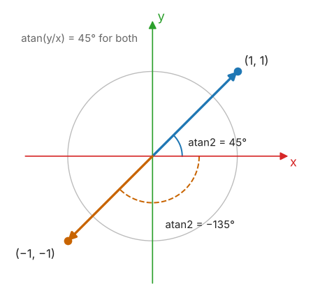
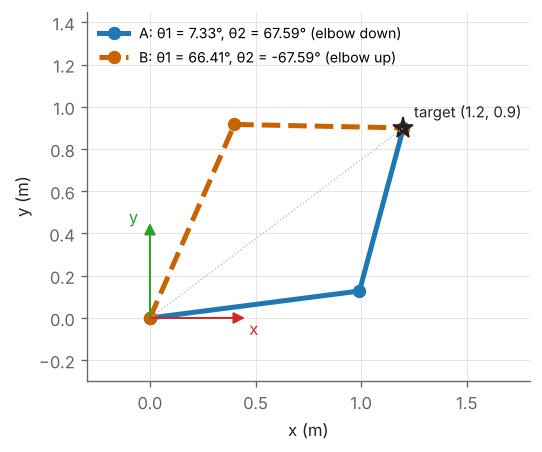

# M4 — Trigonometry and the Two-Argument Arctangent

> **Mathematics Primer · Chapter 4 of 8** · Previous: [M3 — Eigenvalues, SVD and Least Squares](M3-eigen-svd-least-squares.md) · [Primer home](README.md) · Next: [M5 — Calculus and Differential Equations](M5-calculus-and-differential-equations.md)

## Why this matters in robotics

Revolute joints turn through angles, so the forward kinematics of an arm is a collection of sines and cosines of joint angles and of their sums. Inverse kinematics runs the process backwards: given where the tool must be, find the angles. That inversion is almost entirely trigonometry. Craig's Chapter 4 reduces nearly every closed-form inverse-kinematics problem to a handful of standard equations, such as $a\cos\theta + b\sin\theta = c$, and solves each one with the **two-argument arctangent** $\operatorname{atan2}(y, x)$. A student who understands why $\operatorname{atan2}$ is used instead of $\arcsin$, $\arccos$ or $\arctan$, how many solutions each equation has, and where those solutions come from, will find Craig Ch. 4, Spong's chapter on inverse kinematics and Lynch & Park Ch. 6 straightforward.

## Learning objectives

After studying this chapter you should be able to:

1. use the sum, difference and double-angle identities fluently, in the compact notation $c_{12}$, $s_{12}$ of robotics texts;
2. explain the ambiguities of $\arcsin$, $\arccos$ and $\arctan$, and define and evaluate $\operatorname{atan2}$ in every quadrant;
3. solve $a\cos\theta + b\sin\theta = c$ in closed form, and state how many solutions it has;
4. use the tangent half-angle substitution to convert a trigonometric equation into a polynomial;
5. apply the law of cosines to solve the inverse kinematics of the planar two-link arm, including both elbow configurations.

## Contents

1. [Angles, the unit circle and notation](#1-angles-the-unit-circle-and-notation)
2. [Identities used in kinematics](#2-identities-used-in-kinematics)
3. [Inverse trigonometric functions and their ambiguity](#3-inverse-trigonometric-functions-and-their-ambiguity)
4. [The two-argument arctangent](#4-the-two-argument-arctangent)
5. [Solving a cos θ + b sin θ = c](#5-solving-a-cos-θ--b-sin-θ--c)
6. [The tangent half-angle substitution](#6-the-tangent-half-angle-substitution)
7. [The law of cosines and the 2R arm](#7-the-law-of-cosines-and-the-2r-arm)
8. [Worked examples](#8-worked-examples)
9. [Exercises](#9-exercises)
10. [Further reading](#10-further-reading)

---

## 1. Angles, the unit circle and notation

Angles in robotics are measured in **radians** in every formula, with degrees used only for human-readable input and output ($180^\circ = \pi$ rad). The point at angle $\theta$ on the unit circle, measured counter-clockwise from the positive $x$-axis, is $(\cos\theta, \sin\theta)$. Hence $\cos^2\theta + \sin^2\theta = 1$, $\tan\theta = \sin\theta/\cos\theta$, and both $\sin$ and $\cos$ are periodic with period $2\pi$.

Because expressions like $\cos(\theta_1 + \theta_2 + \theta_3)$ appear on every page of kinematics, robotics texts abbreviate:

$$
c_i = \cos\theta_i, \qquad s_i = \sin\theta_i, \qquad c_{12} = \cos(\theta_1 + \theta_2), \qquad s_{123} = \sin(\theta_1 + \theta_2 + \theta_3).
$$

For small angles (in radians) the Taylor series of [M5](M5-calculus-and-differential-equations.md) give the approximations

$$
\sin\theta \approx \theta, \qquad \cos\theta \approx 1 - \frac{\theta^2}{2}, \qquad \tan\theta \approx \theta .
$$

The relative error of $\sin\theta \approx \theta$ is about $0.13\%$ at $5^\circ$, $0.51\%$ at $10^\circ$ and $2.1\%$ at $20^\circ$. These approximations underlie the linearisation of pendulum-like dynamics and the "small rotation" matrix $R \approx I + [\delta\boldsymbol{\theta}]_\times$ used in differential kinematics (Craig Ch. 5).

## 2. Identities used in kinematics

The following identities are used constantly; the first two are the most important.

| Identity | Formula |
|---|---|
| Cosine of a sum | $\cos(\alpha \pm \beta) = \cos\alpha\cos\beta \mp \sin\alpha\sin\beta$ |
| Sine of a sum | $\sin(\alpha \pm \beta) = \sin\alpha\cos\beta \pm \cos\alpha\sin\beta$ |
| Pythagorean | $\cos^2\theta + \sin^2\theta = 1$ |
| Double angle | $\sin2\theta = 2\sin\theta\cos\theta$, $\cos2\theta = \cos^2\theta - \sin^2\theta = 1 - 2\sin^2\theta$ |
| Half angle | $\cos^2\theta = \tfrac12(1 + \cos2\theta)$, $\sin^2\theta = \tfrac12(1 - \cos2\theta)$ |
| Negation | $\cos(-\theta) = \cos\theta$, $\sin(-\theta) = -\sin\theta$ |
| Shifts | $\cos(\theta + \tfrac{\pi}{2}) = -\sin\theta$, $\sin(\theta + \tfrac{\pi}{2}) = \cos\theta$, $\cos(\theta + \pi) = -\cos\theta$ |

In the compact notation, the sum formulas read $c_{12} = c_1c_2 - s_1s_2$ and $s_{12} = s_1c_2 + c_1s_2$.

**Where this is used.** Multiplying the planar rotation matrices of two revolute joints,

$$
\begin{bmatrix} c_1 & -s_1 \\ s_1 & c_1 \end{bmatrix}\begin{bmatrix} c_2 & -s_2 \\ s_2 & c_2 \end{bmatrix} = \begin{bmatrix} c_1c_2 - s_1s_2 & -(s_1c_2 + c_1s_2) \\ s_1c_2 + c_1s_2 & c_1c_2 - s_1s_2 \end{bmatrix} = \begin{bmatrix} c_{12} & -s_{12} \\ s_{12} & c_{12} \end{bmatrix},
$$

shows that successive rotations about parallel axes simply add their angles. This is why the forward kinematics of the planar 2R arm is

$$
x = l_1c_1 + l_2c_{12}, \qquad y = l_1s_1 + l_2s_{12}.
$$

The same simplification appears in every manipulator with parallel joint axes (the shoulder–elbow–wrist-pitch joints of a PUMA-type arm, Craig Ch. 3–4).

## 3. Inverse trigonometric functions and their ambiguity

Since $\sin$, $\cos$ and $\tan$ are periodic, none is one-to-one, and their inverses must restrict the output to a **principal range**:

| Function | Principal range | Information lost |
|---|---|---|
| $\arcsin u$ | $[-\pi/2, \pi/2]$ | cannot distinguish $\theta$ from $\pi - \theta$ |
| $\arccos u$ | $[0, \pi]$ | cannot distinguish $\theta$ from $-\theta$ |
| $\arctan u$ | $(-\pi/2, \pi/2)$ | cannot distinguish $\theta$ from $\theta + \pi$ |

A revolute joint usually ranges over a full turn, so each of these returns the wrong angle for part of the circle. There are also two numerical drawbacks. First, $\arcsin$ and $\arccos$ are ill-conditioned near $\pm1$: since $\tfrac{d}{du}\arccos u = -1/\sqrt{1 - u^2}$, a tiny error in $u$ near $1$ produces a large error in the angle, and rounding can push $u$ slightly outside $[-1, 1]$, producing NaN. Second, $\arctan(y/x)$ divides by $x$, which fails at $x = 0$.

## 4. The two-argument arctangent

If we know *both* $\sin\theta$ and $\cos\theta$, or any pair $(y, x) = (r\sin\theta, r\cos\theta)$ with $r > 0$, then $\theta$ is determined uniquely in $(-\pi, \pi]$. The function that recovers it is the **two-argument arctangent**:

$$
\operatorname{atan2}(y, x) =
\begin{cases}
\arctan(y/x) & x > 0, \\
\arctan(y/x) + \pi & x < 0,\ y \ge 0, \\
\arctan(y/x) - \pi & x < 0,\ y < 0, \\
+\pi/2 & x = 0,\ y > 0, \\
-\pi/2 & x = 0,\ y < 0, \\
\text{undefined} & x = 0,\ y = 0.
\end{cases}
$$

In words: $\operatorname{atan2}(y, x)$ is the angle of the point $(x, y)$ measured from the positive $x$-axis. It uses the signs of *both* arguments to place the angle in the correct quadrant, it never divides by zero, and it is well-conditioned everywhere except at the origin. Note that the overall scale does not matter: $\operatorname{atan2}(ky, kx) = \operatorname{atan2}(y, x)$ for any $k > 0$. This is extremely convenient: if an inverse-kinematics derivation gives $\sin\theta$ and $\cos\theta$ only up to a common positive factor, $\operatorname{atan2}$ needs no normalisation.

*Figure M4.1 — The points $(1,1)$ and $(-1,-1)$ have the same ratio $y/x = 1$, so $\arctan$ returns $45^\circ$ for both. $\operatorname{atan2}$ uses both signs and returns $45^\circ$ and $-135^\circ$.*

**Argument order.** Craig, Spong, Lynch & Park, C, C++, Python (`math.atan2`, `numpy.arctan2`) and MATLAB all use the order $(y, x)$. Some spreadsheets use the order $(x, y)$. Always check.

**The robotics rule.** *Whenever you need an angle, try to obtain expressions for both its sine and its cosine, and then use $\operatorname{atan2}$.* If only the cosine is available, as in the law of cosines below, compute $\sin\theta = \pm\sqrt{1 - \cos^2\theta}$ explicitly, keep both signs (they are distinct physical solutions), and pass the pair to $\operatorname{atan2}$.

## 5. Solving a cos θ + b sin θ = c

This equation, with known constants $a$, $b$, $c$ and unknown $\theta$, appears in the inverse kinematics of almost every manipulator (Craig Ch. 4 lists it among the standard forms). Assume $a$ and $b$ are not both zero.

**Derivation.** Introduce $r = \sqrt{a^2 + b^2}$ and the angle $\varphi = \operatorname{atan2}(b, a)$, so that $a = r\cos\varphi$ and $b = r\sin\varphi$. The left-hand side becomes a single cosine:

$$
a\cos\theta + b\sin\theta = r(\cos\varphi\cos\theta + \sin\varphi\sin\theta) = r\cos(\theta - \varphi).
$$

Hence $\cos(\theta - \varphi) = c/r$. This has solutions only if $|c| \le r$, and then $\sin(\theta - \varphi) = \pm\sqrt{1 - c^2/r^2}$. Using $\operatorname{atan2}$ on this sine–cosine pair (and multiplying both by $r$):

$$
\boxed{\ \theta = \operatorname{atan2}(b, a) \pm \operatorname{atan2}\left(\sqrt{a^2 + b^2 - c^2},\ c\right)\ }
$$

**Number of solutions.**

| Condition | Solutions in $(-\pi, \pi]$ | Interpretation |
|---|---|---|
| $c^2 < a^2 + b^2$ | two | e.g. two arm configurations |
| $c^2 = a^2 + b^2$ | one (double root) | boundary of the workspace |
| $c^2 > a^2 + b^2$ | none | target out of reach |

**Two special cases.**

* $c = 0$, i.e. $a\cos\theta + b\sin\theta = 0$: then $\tan\theta = -a/b$, and the two solutions, $\pi$ apart, are $\theta = \operatorname{atan2}(-a, b)$ and $\theta = \operatorname{atan2}(a, -b)$.
* A *pair* of equations $a\cos\theta - b\sin\theta = c$ and $a\sin\theta + b\cos\theta = d$ (which arises when a known vector is rotated by an unknown angle) has the unique solution

$$
\theta = \operatorname{atan2}(ad - bc,\ ac + bd),
$$

  since, with $a = r\cos\varphi$ and $b = r\sin\varphi$, the equations say $r\cos(\theta + \varphi) = c$ and $r\sin(\theta + \varphi) = d$, and expanding $\sin\theta = \sin((\theta + \varphi) - \varphi)$ and $\cos\theta = \cos((\theta + \varphi) - \varphi)$ gives $r^2\sin\theta = ad - bc$ and $r^2\cos\theta = ac + bd$.

## 6. The tangent half-angle substitution

An alternative, which converts trigonometric equations into **polynomial** ones, is the substitution

$$
u = \tan\frac{\theta}{2}, \qquad \cos\theta = \frac{1 - u^2}{1 + u^2}, \qquad \sin\theta = \frac{2u}{1 + u^2}.
$$

These follow from the double-angle formulas: $\cos\theta = \dfrac{\cos^2(\theta/2) - \sin^2(\theta/2)}{\cos^2(\theta/2) + \sin^2(\theta/2)}$ and $\sin\theta = \dfrac{2\sin(\theta/2)\cos(\theta/2)}{\cos^2(\theta/2) + \sin^2(\theta/2)}$, after dividing numerator and denominator by $\cos^2(\theta/2)$.

Applied to $a\cos\theta + b\sin\theta = c$ and multiplied through by $1 + u^2$:

$$
a(1 - u^2) + 2bu = c(1 + u^2) \quad\Longrightarrow\quad (a + c)\,u^2 - 2b\,u + (c - a) = 0,
$$

$$
u = \frac{b \pm \sqrt{a^2 + b^2 - c^2}}{a + c}, \qquad \theta = 2\arctan u .
$$

The discriminant condition is the same as in Section 5. **Caveat:** $\theta = \pi$ corresponds to $u = \infty$ and is lost by the substitution; it is a solution exactly when $a + c = 0$, in which case the quadratic degenerates to a linear equation. The half-angle substitution is the standard route to the **polynomial** formulation of inverse kinematics: for a general six-revolute arm it leads to a single polynomial of degree 16, consistent with the maximum of sixteen solutions discussed in Craig Ch. 4, and it underlies modern algebraic and numerical solvers. For a single equation, the $\operatorname{atan2}$ formula of Section 5 is simpler and more robust.

## 7. The law of cosines and the 2R arm

For a triangle with sides $p$, $q$, $s$ and angle $\gamma$ opposite $s$,

$$
s^2 = p^2 + q^2 - 2pq\cos\gamma .
$$

It is the vector identity $\lVert\mathbf{p} - \mathbf{q}\rVert^2 = \lVert\mathbf{p}\rVert^2 + \lVert\mathbf{q}\rVert^2 - 2\,\mathbf{p}\cdot\mathbf{q}$ in disguise.

### Inverse kinematics of the planar two-link arm (preview of Craig Ch. 4)

Given a target $(x, y)$ for the tip of an arm with links $l_1$, $l_2$, the triangle formed by the shoulder, the elbow and the tip has sides $l_1$, $l_2$ and $\rho = \sqrt{x^2 + y^2}$, and the interior angle at the elbow is $\pi - \theta_2$. The law of cosines gives $\rho^2 = l_1^2 + l_2^2 - 2l_1l_2\cos(\pi - \theta_2) = l_1^2 + l_2^2 + 2l_1l_2\cos\theta_2$, so

$$
c_2 = \frac{x^2 + y^2 - l_1^2 - l_2^2}{2l_1l_2}, \qquad s_2 = \pm\sqrt{1 - c_2^2}, \qquad \theta_2 = \operatorname{atan2}(s_2, c_2).
$$

A real solution requires $|c_2| \le 1$, which is the condition $|l_1 - l_2| \le \rho \le l_1 + l_2$: the workspace is an annulus. The two signs of $s_2$ are the two **elbow configurations**. For the shoulder angle, write the tip position as the shoulder direction plus a correction: the tip is at angle $\operatorname{atan2}(y, x)$ from the base, and in a frame aligned with link 1 it is at $(l_1 + l_2c_2,\ l_2s_2)$, i.e. at angle $\operatorname{atan2}(l_2s_2, l_1 + l_2c_2)$. Therefore

$$
\theta_1 = \operatorname{atan2}(y, x) - \operatorname{atan2}(l_2s_2,\ l_1 + l_2c_2).
$$

Every step uses $\operatorname{atan2}$, and the formula works in all four quadrants without special cases.

*Figure M4.2 — The two solutions of Example M4.4. Both place the tip at $(1.2, 0.9)$; they differ in the sign of $\theta_2$.*

---

## 8. Worked examples

### Example M4.1 — atan2 in all four quadrants

*Evaluate $\arctan(y/x)$ and $\operatorname{atan2}(y, x)$ for the points $(x, y) = (1, 1)$, $(-1, 1)$, $(-1, -1)$, $(1, -1)$ and $(-1, 0)$.*

**Solution.**

| Point $(x, y)$ | Quadrant | $\arctan(y/x)$ | $\operatorname{atan2}(y, x)$ |
|---|---|---|---|
| $(1, 1)$ | I | $45^\circ$ | $45^\circ$ |
| $(-1, 1)$ | II | $-45^\circ$ | $135^\circ$ |
| $(-1, -1)$ | III | $45^\circ$ | $-135^\circ$ |
| $(1, -1)$ | IV | $-45^\circ$ | $-45^\circ$ |
| $(-1, 0)$ | negative $x$-axis | $0^\circ$ | $180^\circ$ |

$\arctan$ is wrong by $180^\circ$ in quadrants II and III and on the negative $x$-axis.

### Example M4.2 — Solving 3 cos θ + 4 sin θ = 2

**Solution.** Here $a = 3$, $b = 4$, $c = 2$, $r = 5$ and $c^2 = 4 < 25$, so there are two solutions. $\varphi = \operatorname{atan2}(4, 3) = 53.130^\circ$ and $\operatorname{atan2}(\sqrt{25 - 4}, 2) = \operatorname{atan2}(4.583, 2) = 66.422^\circ$. Hence

$$
\theta = 53.130^\circ \pm 66.422^\circ = 119.552^\circ \quad\text{or}\quad -13.292^\circ .
$$

Check: $3\cos(119.552^\circ) + 4\sin(119.552^\circ) = 3(-0.4932) + 4(0.8699) = 2.000$, and $3\cos(-13.292^\circ) + 4\sin(-13.292^\circ) = 3(0.9732) + 4(-0.2299) = 2.000$.

### Example M4.3 — The same equation by the half-angle substitution

**Solution.** With $a + c = 5$, $-2b = -8$ and $c - a = -1$, the quadratic is $5u^2 - 8u - 1 = 0$, so

$$
u = \frac{8 \pm \sqrt{64 + 20}}{10} = \frac{8 \pm 9.165}{10} = 1.7165 \ \text{or}\ -0.1165 .
$$

Then $\theta = 2\arctan u = 2(59.776^\circ) = 119.552^\circ$ or $2(-6.646^\circ) = -13.292^\circ$, agreeing with Example M4.2.

### Example M4.4 — Inverse kinematics of a 2R arm

*An arm has $l_1 = 1.0$ m and $l_2 = 0.8$ m. Find all joint angles that place the tip at $(x, y) = (1.2, 0.9)$ m.*

**Solution.** $\rho^2 = 1.44 + 0.81 = 2.25$, so $\rho = 1.5$ m, inside the annulus $0.2 \le \rho \le 1.8$. Then

$$
c_2 = \frac{2.25 - 1 - 0.64}{2(1)(0.8)} = \frac{0.61}{1.6} = 0.38125, \qquad s_2 = \pm\sqrt{1 - 0.38125^2} = \pm0.92447 .
$$

**Solution A** ($s_2 > 0$): $\theta_2 = \operatorname{atan2}(0.92447, 0.38125) = 67.589^\circ$. With $l_2s_2 = 0.73958$ and $l_1 + l_2c_2 = 1.305$,

$$
\theta_1 = \operatorname{atan2}(0.9, 1.2) - \operatorname{atan2}(0.73958, 1.305) = 36.870^\circ - 29.541^\circ = 7.329^\circ .
$$

**Solution B** ($s_2 < 0$): $\theta_2 = -67.589^\circ$ and $\theta_1 = 36.870^\circ + 29.541^\circ = 66.411^\circ$.

**Check (Solution A).** $\theta_1 + \theta_2 = 74.917^\circ$, so $x = \cos7.329^\circ + 0.8\cos74.917^\circ = 0.99183 + 0.20817 = 1.2000$ and $y = \sin7.329^\circ + 0.8\sin74.917^\circ = 0.12756 + 0.77244 = 0.9000$. Solution B checks in the same way. In Solution A the elbow lies below the line from the shoulder to the target ("elbow down"); in Solution B it lies above ("elbow up"). See Figure M4.2.

---

## 9. Exercises

**E4.1** Evaluate $\operatorname{atan2}(1, -\sqrt3)$, $\operatorname{atan2}(-2, 0)$ and $\operatorname{atan2}(0, -1)$.

Answer

$150^\circ$ (the point $(-\sqrt3, 1)$ is in quadrant II), $-90^\circ$, and $180^\circ$.

**E4.2** Using the sum formulas, find exact values of $\cos75^\circ$ and $\sin75^\circ$ from the values at $30^\circ$ and $45^\circ$.

Answer

$\cos75^\circ = c_{30}c_{45} - s_{30}s_{45} = \tfrac{\sqrt3}{2}\tfrac{\sqrt2}{2} - \tfrac12\tfrac{\sqrt2}{2} = \tfrac{\sqrt6 - \sqrt2}{4} \approx 0.2588$, and $\sin75^\circ = s_{30}c_{45} + c_{30}s_{45} = \tfrac{\sqrt2 + \sqrt6}{4} \approx 0.9659$.

**E4.3** Solve $\sin\theta + \cos\theta = 1$ for $\theta \in (-\pi, \pi]$.

Answer

$a = b = c = 1$, $r = \sqrt2$, $\varphi = \operatorname{atan2}(1, 1) = 45^\circ$ and $\operatorname{atan2}(\sqrt{2 - 1}, 1) = 45^\circ$. So $\theta = 45^\circ \pm 45^\circ$, i.e. $\theta = 90^\circ$ or $\theta = 0^\circ$. Both check directly.

**E4.4** Show that $2\cos\theta - \sin\theta = 3$ has no solution, and interpret this for a robot.

Answer

$r = \sqrt{4 + 1} = \sqrt5 \approx 2.236 < 3$, so $|c| > r$: the left-hand side never exceeds $2.236$ in magnitude. In inverse kinematics this signals a target outside the workspace.

**E4.5** Given $a = 1$, $b = 2$, solve the pair $a\cos\theta - b\sin\theta = -0.51953$, $a\sin\theta + b\cos\theta = 2.17488$.

Answer

$ad - bc = 2.17488 + 1.03906 = 3.21394$ and $ac + bd = -0.51953 + 4.34976 = 3.83022$, so $\theta = \operatorname{atan2}(3.21394, 3.83022) = 40.00^\circ$. (Both numbers equal $r^2 = 5$ times $\sin40^\circ$ and $\cos40^\circ$ respectively.)

**E4.6** For a 2R arm with $l_1 = l_2 = 1$, find both solutions that place the tip at $(1, 1)$, and verify one of them.

Answer

$c_2 = (2 - 2)/2 = 0$, so $\theta_2 = \pm90^\circ$. With $\theta_2 = 90^\circ$: $\theta_1 = \operatorname{atan2}(1,1) - \operatorname{atan2}(1, 1) = 0^\circ$. With $\theta_2 = -90^\circ$: $\theta_1 = 45^\circ + 45^\circ = 90^\circ$. Check $(0^\circ, 90^\circ)$: $x = \cos0 + \cos90^\circ = 1$, $y = \sin0 + \sin90^\circ = 1$. ✓

**E4.7** A derivation gives $\sin\theta = 0.6$, and the geometry requires $\cos\theta < 0$. Find $\theta$, and explain why $\arcsin(0.6)$ alone would be wrong.

Answer

$\cos\theta = -\sqrt{1 - 0.36} = -0.8$, so $\theta = \operatorname{atan2}(0.6, -0.8) = 143.13^\circ$. $\arcsin(0.6) = 36.87^\circ$ has the right sine but a positive cosine: it is the mirror-image solution $\pi - \theta$.

**E4.8** Describe the workspace of a 2R arm with $l_1 = 1$ and $l_2 = 0.8$, and say how many inverse-kinematics solutions exist at $\rho = 1.8$, at $\rho = 1.0$ and at $\rho = 0.1$.

Answer

The workspace is the annulus $0.2 \le \rho \le 1.8$. At $\rho = 1.8$ (outer boundary), $c_2 = 1$ and there is one solution ($\theta_2 = 0$, arm stretched). At $\rho = 1.0$ there are two (elbow up and down). At $\rho = 0.1$ there are none ($c_2 = (0.01 - 1.64)/1.6 < -1$).

---

## 10. Further reading

* J. J. Craig, *Introduction to Robotics*, Ch. 4 (Inverse Manipulator Kinematics), including the algebraic and geometric solutions of the planar arm and the standard trigonometric equations.
* M. W. Spong et al., *Robot Modeling and Control*, the trigonometry appendix (including $\operatorname{atan2}$) and the chapter on inverse kinematics.
* K. M. Lynch and F. C. Park, *Modern Robotics*, Ch. 6 (Inverse Kinematics), which treats the 2R arm with the law of cosines.
* B. Siciliano et al., *Robotics: Modelling, Planning and Control*, Ch. 2 (Kinematics), sections on inverse kinematics of the planar arm and the anthropomorphic arm.
* E. Kreyszig, *Advanced Engineering Mathematics*, appendix on formulas for special functions (trigonometric identities).

---

Previous: [M3 — Eigenvalues, SVD and Least Squares](M3-eigen-svd-least-squares.md) · [Primer home](README.md) · Next: [M5 — Calculus and Differential Equations](M5-calculus-and-differential-equations.md)
