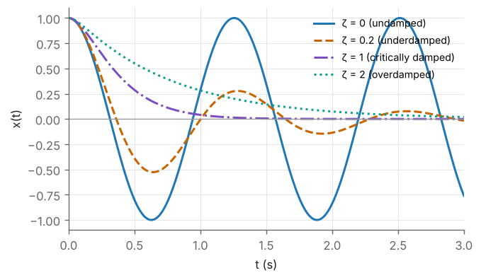

# M5 — Calculus and Differential Equations

> **Mathematics Primer · Chapter 5 of 8** · Previous: [M4 — Trigonometry and atan2](M4-trigonometry-and-atan2.md) · [Primer home](README.md) · Next: [M6 — Laplace Transforms and Linear Systems](M6-laplace-and-linear-systems.md)

## Why this matters in robotics

Kinematics tells us where a robot is; calculus tells us how fast it is moving and how it responds to forces. Differentiating the forward-kinematics map gives the **Jacobian**, the central object of Craig Chapter 5 and Lynch & Park Chapter 5. Differentiating a rotation matrix gives the **angular velocity**. Expanding a nonlinear function to first order (**linearisation**) is how we analyse a robot near an operating point and how Newton's method solves inverse kinematics ([M7](M7-numerical-methods.md)). Finally, the dynamics of a robot are **differential equations**, and the simplest controller of a robot joint, proportional–derivative (PD) control, turns each joint into a mass–spring–damper whose behaviour is fixed by two numbers: the natural frequency $\omega_n$ and the damping ratio $\zeta$. That observation is the starting point of Craig Chapter 9 and of RMC.

## Learning objectives

After studying this chapter you should be able to:

1. differentiate vector- and matrix-valued functions, including products, inverses and rotation matrices;
2. compute gradients and Jacobian matrices and apply the multivariable chain rule $\dot{\mathbf{p}} = J(\mathbf{q})\dot{\mathbf{q}}$;
3. linearise a nonlinear function or system about an operating point using Taylor's theorem;
4. solve first-order linear ODEs and interpret the time constant;
5. solve second-order linear ODEs, compute $\omega_n$ and $\zeta$, and classify the response; choose PD gains for a given $\omega_n$ and $\zeta$;
6. write an ODE in state-space form and relate the eigenvalues of the state matrix to the characteristic roots.

## Contents

1. [Derivatives of vector and matrix functions](#1-derivatives-of-vector-and-matrix-functions)
2. [Partial derivatives, gradient and the Jacobian](#2-partial-derivatives-gradient-and-the-jacobian)
3. [Taylor series and linearisation](#3-taylor-series-and-linearisation)
4. [First-order linear ODEs](#4-first-order-linear-odes)
5. [Second-order linear ODEs](#5-second-order-linear-odes)
6. [State-space form](#6-state-space-form)
7. [Worked examples](#7-worked-examples)
8. [Exercises](#8-exercises)
9. [Further reading](#9-further-reading)

---

## 1. Derivatives of vector and matrix functions

A vector or matrix that depends on time is differentiated **entry by entry**: if $\mathbf{p}(t) = (x(t), y(t), z(t))^{T}$ then $\dot{\mathbf{p}} = (\dot x, \dot y, \dot z)^{T}$. All the familiar rules carry over, provided the *order of factors is preserved* (matrices do not commute):

| Rule | Formula |
|---|---|
| Dot product | $\dfrac{d}{dt}(\mathbf{a}\cdot\mathbf{b}) = \dot{\mathbf{a}}\cdot\mathbf{b} + \mathbf{a}\cdot\dot{\mathbf{b}}$ |
| Cross product | $\dfrac{d}{dt}(\mathbf{a}\times\mathbf{b}) = \dot{\mathbf{a}}\times\mathbf{b} + \mathbf{a}\times\dot{\mathbf{b}}$ |
| Matrix product | $\dfrac{d}{dt}(AB) = \dot{A}B + A\dot{B}$ |
| Inverse | $\dfrac{d}{dt}(A^{-1}) = -A^{-1}\dot{A}A^{-1}$ |

The inverse rule follows from differentiating $AA^{-1} = I$. A useful consequence of the first rule: if $\lVert\mathbf{u}(t)\rVert = 1$ for all $t$, then $0 = \tfrac{d}{dt}(\mathbf{u}\cdot\mathbf{u}) = 2\mathbf{u}\cdot\dot{\mathbf{u}}$, so **the derivative of a unit vector is perpendicular to it** (Exercise E5.1).

### The derivative of a rotation matrix

Let $R(t) \in SO(3)$ describe the orientation of a body. Differentiating $RR^{T} = I$ gives

$$
\dot{R}R^{T} + R\dot{R}^{T} = 0 \qquad\Longrightarrow\qquad \dot{R}R^{T} = -(\dot{R}R^{T})^{T},
$$

so $S = \dot{R}R^{T}$ is skew-symmetric, and by [M1](M1-vectors-and-geometry.md) §7 it equals $[\boldsymbol{\omega}]_\times$ for a unique vector $\boldsymbol{\omega}$:

$$
\dot{R} = [\boldsymbol{\omega}]_\times R .
$$

This $\boldsymbol{\omega}$ is the **angular velocity** of the body expressed in the fixed frame. (The body-frame angular velocity is given by $R^{T}\dot{R} = [\boldsymbol{\omega}_b]_\times$, with $\boldsymbol{\omega} = R\boldsymbol{\omega}_b$.) Applying the result to a point fixed in the body, $\mathbf{p}(t) = R(t)\mathbf{p}_b$, gives $\dot{\mathbf{p}} = \dot{R}\mathbf{p}_b = \boldsymbol{\omega}\times\mathbf{p}$, the familiar rigid-body velocity formula. See Lynch & Park §3.2 and Spong's chapter on velocity kinematics; Craig Ch. 5 develops the same idea.

## 2. Partial derivatives, gradient and the Jacobian

### Gradient

For a scalar function $f(\mathbf{x})$ of $n$ variables, the **gradient** is the column of partial derivatives,

$$
\nabla f(\mathbf{x}) = \left(\frac{\partial f}{\partial x_1}, \dots, \frac{\partial f}{\partial x_n}\right)^{T}.
$$

It points in the direction of steepest increase, its length is the rate of increase in that direction, and it is perpendicular to the level sets of $f$. To first order, $df = \nabla f^{T}d\mathbf{x}$. The gradient is the basis of gradient-descent methods ([M7](M7-numerical-methods.md)), of potential-field motion planning, and of the gravity term $\mathbf{g}(\mathbf{q}) = \partial V/\partial\mathbf{q}$ in the robot equations of motion ([M8](M8-lagrangian-mechanics-primer.md)).

### Jacobian

For a vector function $\mathbf{f}:\mathbb{R}^n \to \mathbb{R}^m$, the **Jacobian matrix** is the $m\times n$ matrix of first partial derivatives,

$$
J(\mathbf{x}) = \frac{\partial\mathbf{f}}{\partial\mathbf{x}} = \begin{bmatrix} \dfrac{\partial f_1}{\partial x_1} & \cdots & \dfrac{\partial f_1}{\partial x_n} \\ \vdots & \ddots & \vdots \\ \dfrac{\partial f_m}{\partial x_1} & \cdots & \dfrac{\partial f_m}{\partial x_n} \end{bmatrix}.
$$

Row $i$ is the transposed gradient of $f_i$; column $j$ is the rate of change of $\mathbf{f}$ as $x_j$ alone varies.

### The chain rule

If the joint variables move along a trajectory $\mathbf{q}(t)$ and the tool position is $\mathbf{p} = \mathbf{f}(\mathbf{q})$, then

$$
\dot{\mathbf{p}} = \frac{\partial\mathbf{f}}{\partial\mathbf{q}}\,\dot{\mathbf{q}} = J(\mathbf{q})\,\dot{\mathbf{q}} .
$$

More generally, the Jacobian of a composition is the product of Jacobians: $J_{\mathbf{f}\circ\mathbf{g}}(\mathbf{x}) = J_{\mathbf{f}}(\mathbf{g}(\mathbf{x}))\,J_{\mathbf{g}}(\mathbf{x})$. This is the mathematical content of Craig's Chapter 5 statement that the Jacobian maps joint velocities to Cartesian velocities. For the planar 2R arm with $x = l_1c_1 + l_2c_{12}$ and $y = l_1s_1 + l_2s_{12}$ ([M4](M4-trigonometry-and-atan2.md)),

$$
J(\boldsymbol{\theta}) = \begin{bmatrix} -l_1s_1 - l_2s_{12} & -l_2s_{12} \\ l_1c_1 + l_2c_{12} & l_2c_{12} \end{bmatrix}, \qquad \det J = l_1l_2s_2 .
$$

The Jacobian obtained by differentiating position coordinates is called the *analytic* Jacobian; robotics also uses the *geometric* Jacobian, which maps to angular velocity $\boldsymbol{\omega}$ rather than to derivatives of orientation angles. Both are developed in the MFoR course.

## 3. Taylor series and linearisation

### Scalar and multivariable Taylor expansions

If $f$ is smooth near $x_0$, then

$$
f(x_0 + \delta) = f(x_0) + f'(x_0)\,\delta + \frac{1}{2}f''(x_0)\,\delta^2 + \frac{1}{6}f'''(x_0)\,\delta^3 + \cdots
$$

and for a function of several variables, with $H$ the **Hessian** matrix of second partial derivatives,

$$
f(\mathbf{x}_0 + \boldsymbol{\delta}) = f(\mathbf{x}_0) + \nabla f(\mathbf{x}_0)^{T}\boldsymbol{\delta} + \frac{1}{2}\boldsymbol{\delta}^{T}H(\mathbf{x}_0)\boldsymbol{\delta} + \cdots
$$

For a vector function the first-order (linear) approximation is

$$
\mathbf{f}(\mathbf{x}) \approx \mathbf{f}(\mathbf{x}_0) + J(\mathbf{x}_0)(\mathbf{x} - \mathbf{x}_0).
$$

The error of the linear approximation is of second order in $\lVert\mathbf{x} - \mathbf{x}_0\rVert$. Useful series: $\sin x = x - x^3/6 + \cdots$, $\cos x = 1 - x^2/2 + \cdots$, $e^x = 1 + x + x^2/2 + \cdots$, $\sqrt{1 + x} = 1 + x/2 - x^2/8 + \cdots$.

### Linearising a dynamical system

A nonlinear system $\dot{\mathbf{x}} = \mathbf{f}(\mathbf{x}, \mathbf{u})$ has an **equilibrium** $(\mathbf{x}^{\ast}, \mathbf{u}^{\ast})$ where $\mathbf{f}(\mathbf{x}^{\ast}, \mathbf{u}^{\ast}) = \mathbf{0}$. For small deviations $\delta\mathbf{x} = \mathbf{x} - \mathbf{x}^{\ast}$ and $\delta\mathbf{u} = \mathbf{u} - \mathbf{u}^{\ast}$,

$$
\delta\dot{\mathbf{x}} \approx A\,\delta\mathbf{x} + B\,\delta\mathbf{u}, \qquad A = \left.\frac{\partial\mathbf{f}}{\partial\mathbf{x}}\right|_{\ast}, \quad B = \left.\frac{\partial\mathbf{f}}{\partial\mathbf{u}}\right|_{\ast}.
$$

Lyapunov's indirect method states that if all eigenvalues of $A$ have negative real parts, the equilibrium of the nonlinear system is locally asymptotically stable; if any has a positive real part, it is unstable. This is how one analyses a robot about a set-point, and it is the basis of the "independent-joint" linear control models of Craig Ch. 9 and Spong's chapter on independent joint control.

## 4. First-order linear ODEs

The first-order linear system with time constant $\tau > 0$ and gain $K$,

$$
\tau\dot{x} + x = Ku(t),
$$

models, for example, the speed of a DC motor driven by a voltage (with the electrical dynamics neglected), or a velocity loop. With $u$ a unit step applied at $t = 0$ and $x(0) = x_0$, the solution is

$$
x(t) = K + (x_0 - K)\,e^{-t/\tau}.
$$

The homogeneous part $e^{-t/\tau}$ decays to $36.8\%$ of its initial value after one time constant, to $1.8\%$ after $4\tau$ and to $0.7\%$ after $5\tau$. The general linear first-order equation $\dot{x} + a(t)x = b(t)$ is solved by multiplying through by the integrating factor $e^{\int a\,dt}$ (Kreyszig Ch. 1).

## 5. Second-order linear ODEs

### The mass–spring–damper

The prototype second-order system is a mass $m$ on a spring of stiffness $k$ with a viscous damper $b$, driven by a force $f(t)$:

$$
m\ddot{x} + b\dot{x} + kx = f(t).
$$

Dividing by $m$ and defining the **natural frequency** $\omega_n$ and **damping ratio** $\zeta$,

$$
\omega_n = \sqrt{\frac{k}{m}}, \qquad \zeta = \frac{b}{2\sqrt{km}}, \qquad\text{the equation becomes}\qquad \ddot{x} + 2\zeta\omega_n\dot{x} + \omega_n^2x = \frac{f(t)}{m}.
$$

### The homogeneous solution

Trying $x = e^{st}$ gives the **characteristic equation** $s^2 + 2\zeta\omega_ns + \omega_n^2 = 0$, with roots

$$
s_{1,2} = -\zeta\omega_n \pm \omega_n\sqrt{\zeta^2 - 1}.
$$

Writing $x_0 = x(0)$, $v_0 = \dot{x}(0)$ and $\omega_d = \omega_n\sqrt{1 - \zeta^2}$ (the **damped natural frequency**), the free response is:

| Case | Roots | Free response $x(t)$ |
|---|---|---|
| Undamped, $\zeta = 0$ | $\pm i\omega_n$ | $x_0\cos\omega_nt + \dfrac{v_0}{\omega_n}\sin\omega_nt$ |
| Underdamped, $0 < \zeta < 1$ | $-\zeta\omega_n \pm i\omega_d$ | $e^{-\zeta\omega_nt}\left(x_0\cos\omega_dt + \dfrac{v_0 + \zeta\omega_nx_0}{\omega_d}\sin\omega_dt\right)$ |
| Critically damped, $\zeta = 1$ | $-\omega_n$ (double) | $e^{-\omega_nt}\left(x_0 + (v_0 + \omega_nx_0)\,t\right)$ |
| Overdamped, $\zeta > 1$ | two distinct negative reals | $c_1e^{s_1t} + c_2e^{s_2t}$, with $c_1 + c_2 = x_0$ and $s_1c_1 + s_2c_2 = v_0$ |

Underdamped systems oscillate inside a decaying envelope $e^{-\zeta\omega_nt}$; critically damped systems return to zero as fast as possible without overshooting; overdamped systems return slowly without oscillating (Figure M5.1). The step response, overshoot and settling time are treated in [M6](M6-laplace-and-linear-systems.md).

*Figure M5.1 — Free response of $\ddot{x} + 2\zeta\omega_n\dot{x} + \omega_n^2x = 0$ with $\omega_n = 5$ rad/s, $x(0) = 1$, $\dot{x}(0) = 0$.*

### Preview: PD control of a single joint

Consider a single joint with inertia $I$ driven by a torque $\tau$, so that $I\ddot{\theta} = \tau$ (no gravity or friction). The PD control law

$$
\tau = K_p(\theta_d - \theta) - K_d\dot{\theta}
$$

with a constant set-point $\theta_d$ gives, in terms of the error $e = \theta_d - \theta$,

$$
I\ddot{e} + K_d\dot{e} + K_pe = 0 .
$$

The controller has turned the joint into a mass–spring–damper: $K_p$ is a *virtual spring* and $K_d$ a *virtual damper*. Therefore

$$
\omega_n = \sqrt{\frac{K_p}{I}}, \qquad \zeta = \frac{K_d}{2\sqrt{K_pI}}, \qquad\text{or, for design,}\qquad K_p = I\omega_n^2,\quad K_d = 2\zeta\omega_nI .
$$

Critical damping, $K_d = 2\sqrt{K_pI}$, is Craig's usual design target in Ch. 9. In a real robot $I$ depends on the configuration, gravity and friction are present, and the joints are coupled; handling these effects is the subject of computed-torque and other nonlinear controllers (Craig Ch. 10; Lynch & Park Ch. 11; RMC).

## 6. State-space form

Any $n$-th order ODE can be rewritten as $n$ first-order equations by choosing **state variables**, typically the output and its first $n - 1$ derivatives. For the mass–spring–damper, take $x_1 = x$ and $x_2 = \dot{x}$:

$$
\frac{d}{dt}\begin{bmatrix} x_1 \\ x_2 \end{bmatrix} = \begin{bmatrix} 0 & 1 \\ -k/m & -b/m \end{bmatrix}\begin{bmatrix} x_1 \\ x_2 \end{bmatrix} + \begin{bmatrix} 0 \\ 1/m \end{bmatrix}f, \qquad y = \begin{bmatrix} 1 & 0 \end{bmatrix}\begin{bmatrix} x_1 \\ x_2 \end{bmatrix}.
$$

This is the standard **linear state-space** form

$$
\dot{\mathbf{x}} = A\mathbf{x} + B\mathbf{u}, \qquad \mathbf{y} = C\mathbf{x} + D\mathbf{u}.
$$

The characteristic polynomial of $A$ is $\det(sI - A) = s^2 + (b/m)s + k/m$, which is exactly the characteristic polynomial of the ODE: **the eigenvalues of $A$ are the characteristic roots** (and, in [M6](M6-laplace-and-linear-systems.md), the poles of the transfer function). The solution of the unforced system is given by the **matrix exponential**,

$$
\mathbf{x}(t) = e^{At}\mathbf{x}(0), \qquad e^{At} = I + At + \frac{(At)^2}{2!} + \cdots,
$$

and with input, $\mathbf{x}(t) = e^{At}\mathbf{x}(0) + \int_0^t e^{A(t - s)}B\mathbf{u}(s)\,ds$.

State space is also the natural form for nonlinear robot dynamics. The equations of motion $M(\mathbf{q})\ddot{\mathbf{q}} + C(\mathbf{q}, \dot{\mathbf{q}})\dot{\mathbf{q}} + \mathbf{g}(\mathbf{q}) = \boldsymbol{\tau}$ ([M8](M8-lagrangian-mechanics-primer.md)) become, with $\mathbf{x} = (\mathbf{q}, \dot{\mathbf{q}})$,

$$
\dot{\mathbf{x}} = \begin{bmatrix} \dot{\mathbf{q}} \\ M(\mathbf{q})^{-1}\left(\boldsymbol{\tau} - C(\mathbf{q}, \dot{\mathbf{q}})\dot{\mathbf{q}} - \mathbf{g}(\mathbf{q})\right) \end{bmatrix},
$$

which is the form every numerical simulator integrates ([M7](M7-numerical-methods.md)).

---

## 7. Worked examples

### Example M5.1 — Angular velocity of a planar rotation

*Let $R(t) = R_z(\theta(t))$. Compute $\dot{R}R^{T}$ and identify $\boldsymbol{\omega}$.*

**Solution.** Differentiating entry by entry with the chain rule,

$$
\dot{R} = \dot{\theta}\begin{bmatrix} -\sin\theta & -\cos\theta & 0 \\ \cos\theta & -\sin\theta & 0 \\ 0 & 0 & 0 \end{bmatrix}, \qquad
\dot{R}R^{T} = \dot{\theta}\begin{bmatrix} -\sin\theta & -\cos\theta & 0 \\ \cos\theta & -\sin\theta & 0 \\ 0 & 0 & 0 \end{bmatrix}\begin{bmatrix} \cos\theta & \sin\theta & 0 \\ -\sin\theta & \cos\theta & 0 \\ 0 & 0 & 1 \end{bmatrix} = \begin{bmatrix} 0 & -\dot{\theta} & 0 \\ \dot{\theta} & 0 & 0 \\ 0 & 0 & 0 \end{bmatrix}.
$$

(For example, the $(1,1)$ entry is $\dot\theta(-\sin\theta\cos\theta + \cos\theta\sin\theta) = 0$, and the $(2,1)$ entry is $\dot\theta(\cos^2\theta + \sin^2\theta) = \dot\theta$.) This is $[\boldsymbol{\omega}]_\times$ with $\boldsymbol{\omega} = (0, 0, \dot{\theta})^{T}$: a rotation about $z$ at rate $\dot{\theta}$, as expected.

### Example M5.2 — Tip velocity of a 2R arm by the chain rule

*For $l_1 = l_2 = 1$ m at $\theta_1 = 30^\circ$, $\theta_2 = 60^\circ$, with joint rates $\dot{\boldsymbol{\theta}} = (0.5, -0.2)$ rad/s, find the tip velocity.*

**Solution.** Here $s_1 = 0.5$, $c_1 = 0.8660$, $s_{12} = \sin90^\circ = 1$ and $c_{12} = 0$, so

$$
J = \begin{bmatrix} -0.5 - 1 & -1 \\ 0.8660 + 0 & 0 \end{bmatrix} = \begin{bmatrix} -1.5 & -1 \\ 0.8660 & 0 \end{bmatrix}, \qquad
\dot{\mathbf{p}} = J\dot{\boldsymbol{\theta}} = \begin{bmatrix} -0.75 + 0.2 \\ 0.4330 \end{bmatrix} = \begin{bmatrix} -0.550 \\ 0.433 \end{bmatrix}\ \text{m/s}.
$$

A central finite difference of the forward kinematics, $[\mathbf{f}(\boldsymbol{\theta} + h\dot{\boldsymbol{\theta}}) - \mathbf{f}(\boldsymbol{\theta} - h\dot{\boldsymbol{\theta}})]/(2h)$ with $h = 10^{-6}$, gives the same result to six decimal places, which is a good habit for checking any hand-derived Jacobian.

### Example M5.3 — Linearising a pendulum at its two equilibria

*A pendulum obeys $\ddot{\theta} = -(g/l)\sin\theta$, with $g = 9.81$ m/s² and $l = 0.5$ m. Linearise about the hanging equilibrium $\theta = 0$ and the inverted equilibrium $\theta = \pi$, and determine stability.*

**Solution.** With $\mathbf{x} = (\theta, \dot{\theta})$, $\mathbf{f}(\mathbf{x}) = (x_2,\ -(g/l)\sin x_1)$, and

$$
A = \frac{\partial\mathbf{f}}{\partial\mathbf{x}} = \begin{bmatrix} 0 & 1 \\ -(g/l)\cos x_1 & 0 \end{bmatrix}.
$$

At $\theta = 0$: $A = \begin{bmatrix} 0&1\\-19.62&0 \end{bmatrix}$, eigenvalues $\pm i\sqrt{19.62} = \pm4.429i$. The linear model is an undamped oscillator with $\omega_n = 4.429$ rad/s (period $1.419$ s); with any friction it would be asymptotically stable. At $\theta = \pi$: $\cos\pi = -1$, $A = \begin{bmatrix} 0&1\\19.62&0 \end{bmatrix}$, eigenvalues $\pm4.429$. The positive eigenvalue makes the inverted pendulum unstable, as experience suggests; holding a link upright against gravity requires feedback.

### Example M5.4 — Free response of a mass–spring–damper

*Let $m = 2$ kg, $b = 4$ N s/m and $k = 50$ N/m, released from $x_0 = 0.1$ m at rest. Find $\omega_n$, $\zeta$, $\omega_d$ and $x(t)$, and evaluate $x(0.5)$.*

**Solution.** $\omega_n = \sqrt{50/2} = 5$ rad/s, $\zeta = 4/(2\sqrt{100}) = 0.2$ (underdamped), $\zeta\omega_n = 1$ s⁻¹ and $\omega_d = 5\sqrt{1 - 0.04} = 4.899$ rad/s. The roots are $-1 \pm 4.899i$. From the table, with $v_0 = 0$,

$$
x(t) = e^{-t}\left(0.1\cos4.899t + \frac{1\cdot0.1}{4.899}\sin4.899t\right) = e^{-t}\left(0.1\cos4.899t + 0.02041\sin4.899t\right)\ \text{m}.
$$

At $t = 0.5$ s, $4.899t = 2.449$ rad, and $x(0.5) = 0.6065\,(0.1(-0.7699) + 0.02041(0.6382)) = -0.0388$ m. A high-accuracy numerical integration (and the matrix exponential $e^{0.5A}\mathbf{x}_0$) gives $-0.038796$ m.

### Example M5.5 — Choosing PD gains

*A joint with effective inertia $I = 0.5$ kg m² is to be PD-controlled with $\omega_n = 10$ rad/s and critical damping. Find $K_p$ and $K_d$.*

**Solution.** $K_p = I\omega_n^2 = 0.5 \times 100 = 50$ N m/rad and $K_d = 2\zeta\omega_nI = 2 \times 1 \times 10 \times 0.5 = 10$ N m s/rad. Check: $\zeta = 10/(2\sqrt{50 \times 0.5}) = 10/10 = 1$. ✓ The error then decays as $e^{-10t}(e_0 + (\dot e_0 + 10e_0)t)$, reaching under 1% of a step error within about $0.66$ s.

---

## 8. Exercises

**E5.1** Show that if $\lVert\mathbf{u}(t)\rVert$ is constant then $\mathbf{u}\cdot\dot{\mathbf{u}} = 0$. Give a robotics example.

Answer

$\frac{d}{dt}(\mathbf{u}\cdot\mathbf{u}) = 2\mathbf{u}\cdot\dot{\mathbf{u}}$, and the left side is zero because $\mathbf{u}\cdot\mathbf{u}$ is constant. Example: each column of a rotation matrix is a unit vector; its derivative $\boldsymbol{\omega}\times\mathbf{u}$ is indeed perpendicular to $\mathbf{u}$.

**E5.2** Find the gradient of $f(x, y) = x^2 + 3xy + y^3$ at $(1, 2)$.

Answer

$\nabla f = (2x + 3y,\ 3x + 3y^2)^{T}$, which at $(1, 2)$ is $(8, 15)^{T}$.

**E5.3** Find the Jacobian of the polar-to-Cartesian map $(r, \varphi) \mapsto (r\cos\varphi, r\sin\varphi)$ and its determinant. Where is it singular, and what is the robotic analogue?

Answer

$J = \begin{bmatrix} \cos\varphi & -r\sin\varphi \\ \sin\varphi & r\cos\varphi \end{bmatrix}$, $\det J = r$. It is singular at $r = 0$, where changing $\varphi$ does not move the point. This is exactly a polar (R–P) robot with its prismatic joint retracted to the axis.

**E5.4** Solve $0.2\dot{x} + x = 3u(t)$ with $x(0) = 0$ and $u$ a unit step. Find $x(0.2)$ and the time to reach 98% of the final value.

Answer

$x(t) = 3(1 - e^{-5t})$. $x(0.2) = 3(1 - e^{-1}) = 1.896$. 98% requires $e^{-5t} = 0.02$, i.e. $t = \ln(50)/5 = 0.782$ s, close to the rule of thumb $4\tau = 0.8$ s (which gives 98.2%).

**E5.5** Find $\omega_n$ and $\zeta$, and classify: (a) $\ddot{x} + 6\dot{x} + 9x = 0$; (b) $\ddot{x} + 2\dot{x} + 10x = 0$; (c) $\ddot{x} + 5\dot{x} + 4x = 0$.

Answer

(a) $\omega_n = 3$, $\zeta = 6/6 = 1$: critically damped, double root $-3$. (b) $\omega_n = \sqrt{10} = 3.162$, $\zeta = 2/(2\sqrt{10}) = 0.316$: underdamped, roots $-1 \pm 3i$. (c) $\omega_n = 2$, $\zeta = 5/4 = 1.25$: overdamped, roots $-1$ and $-4$.

**E5.6** Write the damped pendulum $\ddot{\theta} + 0.4\dot{\theta} + 9.81\sin\theta = u$ in state-space form and linearise at $\theta = 0$, $u = 0$. Find the eigenvalues of $A$.

Answer

$\dot{x}_1 = x_2$, $\dot{x}_2 = -9.81\sin x_1 - 0.4x_2 + u$. Linearising: $A = \begin{bmatrix} 0&1\\-9.81&-0.4 \end{bmatrix}$, $B = \begin{bmatrix} 0\\1 \end{bmatrix}$. Eigenvalues: $-0.2 \pm 3.126i$ (stable, lightly damped: $\omega_n = 3.132$, $\zeta = 0.064$).

**E5.7** Use a first-order Taylor expansion of $\sqrt{x}$ about $x_0 = 4$ to estimate $\sqrt{4.41}$, and compare with the exact value.

Answer

$\sqrt{x} \approx 2 + (x - 4)/4$, giving $2 + 0.41/4 = 2.1025$. The exact value is $2.1$; the error, $0.0025$, is of second order, consistent with $\tfrac12|f''|\delta^2 = \tfrac12\cdot\tfrac{1}{32}\cdot0.41^2 \approx 0.0026$.

**E5.8** A joint has $I = 2$ kg m². Find PD gains giving $\omega_n = 8$ rad/s and $\zeta = 0.7$.

Answer

$K_p = 2 \times 64 = 128$ N m/rad and $K_d = 2 \times 0.7 \times 8 \times 2 = 22.4$ N m s/rad.

---

## 9. Further reading

* E. Kreyszig, *Advanced Engineering Mathematics*, Ch. 1 (First-Order ODEs), Ch. 2 (Second-Order Linear ODEs, including the mass–spring system), Ch. 4 (Systems of ODEs, phase plane, qualitative methods) and Ch. 9 (Vector Differential Calculus: gradient and Jacobian ideas).
* K. Ogata, *Modern Control Engineering*, Ch. 2–3 (mathematical modelling, including state-space models and linearisation of nonlinear systems).
* J. J. Craig, *Introduction to Robotics*, Ch. 5 (Jacobians: velocities and static forces) and Ch. 9 (Linear Control of Manipulators, second-order systems and PD gain selection).
* K. M. Lynch and F. C. Park, *Modern Robotics*, §3.2 (angular velocity), Ch. 5 (Velocity Kinematics and Statics) and §11.2 (linear error dynamics).
* M. W. Spong et al., *Robot Modeling and Control*, the appendix on dynamical systems and the chapter on independent joint control.

---

Previous: [M4 — Trigonometry and atan2](M4-trigonometry-and-atan2.md) · [Primer home](README.md) · Next: [M6 — Laplace Transforms and Linear Systems](M6-laplace-and-linear-systems.md)
