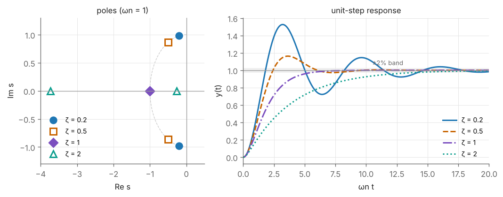

# M6 — Laplace Transforms and Linear Systems

> **Mathematics Primer · Chapter 6 of 8** · Previous: [M5 — Calculus and Differential Equations](M5-calculus-and-differential-equations.md) · [Primer home](README.md) · Next: [M7 — Numerical Methods](M7-numerical-methods.md)

## Why this matters in robotics

Classical control is the language in which robot-joint servos are designed, tuned and specified. A motor datasheet quotes a time constant; a servo specification asks for less than 5% overshoot and a settling time under 0.2 s; a stability margin decides whether a gain can be raised. All of these are statements about **transfer functions** and their **poles**, and the tool that produces them from differential equations is the **Laplace transform**. It converts linear ODEs into algebra, so that a feedback loop can be analysed by multiplying and dividing polynomials. Craig Chapter 9 (linear control of manipulators), Spong's chapter on independent joint control, Ogata's whole text and the first half of RMC are written in this language. This chapter collects what you need: the transform and its table, partial fractions, transfer functions, the standard first- and second-order step responses, the final value theorem, stability tests, and a brief look at frequency response.

## Learning objectives

After studying this chapter you should be able to:

1. compute Laplace transforms from a table and its properties, and invert rational transforms by partial fractions;
2. derive the transfer function of a linear system and of a feedback loop, and find its poles and zeros;
3. predict the step response of first- and second-order systems, including overshoot, peak time and settling time;
4. use the final value theorem correctly to find steady-state errors, and know when it does not apply;
5. decide stability from pole locations and from the Routh–Hurwitz conditions for low-order polynomials;
6. compute and interpret the magnitude and phase of a frequency response.

## Contents

1. [The Laplace transform](#1-the-laplace-transform)
2. [Transform table and properties](#2-transform-table-and-properties)
3. [Solving ODEs and partial fractions](#3-solving-odes-and-partial-fractions)
4. [Transfer functions, poles and zeros](#4-transfer-functions-poles-and-zeros)
5. [First- and second-order step responses](#5-first--and-second-order-step-responses)
6. [The final value theorem and steady-state error](#6-the-final-value-theorem-and-steady-state-error)
7. [Stability](#7-stability)
8. [Frequency response](#8-frequency-response)
9. [Worked examples](#9-worked-examples)
10. [Exercises](#10-exercises)
11. [Further reading](#11-further-reading)

---

## 1. The Laplace transform

For a function $f(t)$ defined for $t \ge 0$, the (one-sided) **Laplace transform** is

$$
F(s) = \mathcal{L}\lbrace f(t)\rbrace = \int_0^\infty f(t)\,e^{-st}\,dt,
$$

where $s = \sigma + i\omega$ is a complex variable. The integral converges for $\operatorname{Re}s$ large enough whenever $f$ grows no faster than an exponential, which covers every signal met in control. The transform is **linear**, $\mathcal{L}\lbrace af + bg\rbrace = aF + bG$, and it is one-to-one on such functions, so a transform can be inverted unambiguously (usually by recognising entries in a table).

The power of the transform comes from the derivative rule (Section 2): differentiation in time becomes multiplication by $s$. A linear ODE with constant coefficients therefore becomes an algebraic equation in $s$.

## 2. Transform table and properties

Here $1(t)$ denotes the unit step (zero for $t < 0$, one for $t \ge 0$) and $a$, $\omega$ are real constants.

| $f(t)$ for $t \ge 0$ | $F(s)$ |
|---|---|
| $\delta(t)$ (unit impulse) | $1$ |
| $1(t)$ (unit step) | $\dfrac{1}{s}$ |
| $t$ (unit ramp) | $\dfrac{1}{s^2}$ |
| $t^n$ | $\dfrac{n!}{s^{n+1}}$ |
| $e^{-at}$ | $\dfrac{1}{s + a}$ |
| $te^{-at}$ | $\dfrac{1}{(s + a)^2}$ |
| $\sin\omega t$ | $\dfrac{\omega}{s^2 + \omega^2}$ |
| $\cos\omega t$ | $\dfrac{s}{s^2 + \omega^2}$ |
| $e^{-at}\sin\omega t$ | $\dfrac{\omega}{(s + a)^2 + \omega^2}$ |
| $e^{-at}\cos\omega t$ | $\dfrac{s + a}{(s + a)^2 + \omega^2}$ |

| Property | Time domain | $s$-domain |
|---|---|---|
| Linearity | $af(t) + bg(t)$ | $aF(s) + bG(s)$ |
| First derivative | $\dot{f}(t)$ | $sF(s) - f(0)$ |
| Second derivative | $\ddot{f}(t)$ | $s^2F(s) - sf(0) - \dot{f}(0)$ |
| Integral | $\int_0^t f(\tau)\,d\tau$ | $\dfrac{F(s)}{s}$ |
| Time delay | $f(t - T)\,1(t - T)$ | $e^{-sT}F(s)$ |
| Frequency shift | $e^{-at}f(t)$ | $F(s + a)$ |
| Convolution | $\int_0^t g(t - \tau)u(\tau)\,d\tau$ | $G(s)U(s)$ |
| Initial value | $f(0^{+})$ | $\lim_{s\to\infty}sF(s)$ |
| Final value | $\lim_{t\to\infty}f(t)$ | $\lim_{s\to0}sF(s)$, *if* the limit on the left exists (Section 6) |

The derivative rule follows from integration by parts: $\int_0^\infty\dot f e^{-st}dt = [fe^{-st}]_0^\infty + s\int_0^\infty fe^{-st}dt = -f(0) + sF(s)$.

## 3. Solving ODEs and partial fractions

The recipe is: (1) transform both sides, using the derivative rules to bring in initial conditions; (2) solve algebraically for $X(s)$; (3) expand $X(s)$ in **partial fractions**; (4) invert term by term from the table.

For a proper rational function $N(s)/D(s)$ (degree of $N$ less than that of $D$) whose denominator has distinct roots $p_1, \dots, p_n$,

$$
\frac{N(s)}{D(s)} = \sum_{i=1}^{n}\frac{r_i}{s - p_i}, \qquad r_i = \left.(s - p_i)\frac{N(s)}{D(s)}\right|_{s = p_i}
$$

(the "cover-up" rule). Each term inverts to $r_ie^{p_it}$. A repeated root $p$ of multiplicity $k$ contributes terms $\dfrac{r_{1}}{s - p} + \dots + \dfrac{r_{k}}{(s - p)^k}$, which invert to polynomials times $e^{pt}$. A complex-conjugate pair is best kept together as a quadratic factor and matched to the damped sine and cosine entries of the table. The time function is thus a sum of **modes** $e^{p_it}$, one for each root of the denominator, which is why the roots decide everything.

## 4. Transfer functions, poles and zeros

### Transfer function

For a linear time-invariant system initially at rest, the ratio of the transforms of output and input is the **transfer function**,

$$
G(s) = \frac{Y(s)}{U(s)} .
$$

For $m\ddot{y} + b\dot{y} + ky = u$ with zero initial conditions, $(ms^2 + bs + k)Y(s) = U(s)$, so $G(s) = 1/(ms^2 + bs + k)$. $G(s)$ is the Laplace transform of the **impulse response**, and for any input $Y(s) = G(s)U(s)$. From a state-space model ([M5](M5-calculus-and-differential-equations.md) §6), $G(s) = C(sI - A)^{-1}B + D$.

### Poles and zeros

Write $G(s) = N(s)/D(s)$ in lowest terms. The roots of $N$ are the **zeros** and the roots of $D$ are the **poles**. Each pole $p$ contributes a mode $e^{pt}$ to the response:

| Pole location | Mode | Behaviour |
|---|---|---|
| real, $p < 0$ | $e^{pt}$ | decays, time constant $1/\lvert p\rvert$ |
| real, $p > 0$ | $e^{pt}$ | grows: unstable |
| complex pair $-\sigma \pm i\omega_d$, $\sigma > 0$ | $e^{-\sigma t}\sin(\omega_dt + \phi)$ | decaying oscillation |
| imaginary pair $\pm i\omega$ | $\sin(\omega t + \phi)$ | sustained oscillation: marginally stable |
| at the origin | constant (or ramp if repeated) | integrator |

Zeros do not change which modes are present, but they change how much of each appears; a zero close to a pole nearly cancels it. Poles farther to the left decay faster, so the **dominant poles** are those nearest the imaginary axis.

### Block-diagram algebra

| Connection | Equivalent transfer function |
|---|---|
| Series: $G_1$ then $G_2$ | $G_1G_2$ |
| Parallel: $G_1 + G_2$ | $G_1 + G_2$ |
| Negative feedback: forward path $G$, feedback path $H$ | $\dfrac{G}{1 + GH}$ |

The denominator $1 + G(s)H(s) = 0$ is the closed-loop **characteristic equation**; designing a controller means placing its roots.

## 5. First- and second-order step responses

### First order

For $G(s) = \dfrac{K}{\tau s + 1}$ (single pole at $-1/\tau$) the unit-step response is

$$
y(t) = K\left(1 - e^{-t/\tau}\right).
$$

It reaches $63.2\%$ of its final value at $t = \tau$; its 10–90% rise time is $\tau\ln9 \approx 2.2\tau$; and it settles within 2% at $\tau\ln50 \approx 3.9\tau$, usually quoted as $4\tau$. There is no overshoot.

### Second order

The **standard second-order system**

$$
G(s) = \frac{\omega_n^2}{s^2 + 2\zeta\omega_ns + \omega_n^2}
$$

has unit DC gain and, for $0 < \zeta < 1$, poles at $s = -\zeta\omega_n \pm i\omega_d$ with $\omega_d = \omega_n\sqrt{1 - \zeta^2}$. In the $s$-plane these poles lie at distance $\omega_n$ from the origin, at angle $\arccos\zeta$ from the negative real axis. The unit-step response is

$$
y(t) = 1 - \frac{e^{-\zeta\omega_nt}}{\sqrt{1 - \zeta^2}}\sin\left(\omega_dt + \arccos\zeta\right),
$$

and its standard performance measures are:

| Measure | Formula | Depends on |
|---|---|---|
| Peak time | $t_p = \dfrac{\pi}{\omega_d}$ | imaginary part of the poles |
| Maximum (percent) overshoot | $M_p = \exp\left(-\dfrac{\zeta\pi}{\sqrt{1 - \zeta^2}}\right)$ | $\zeta$ only |
| 2% settling time | $t_s \approx \dfrac{4}{\zeta\omega_n}$ | real part of the poles |

Some reference values of overshoot: $\zeta = 0.2$: $52.7\%$; $0.4$: $25.4\%$; $0.5$: $16.3\%$; $0.6$: $9.5\%$; $0.7$: $4.6\%$; $0.8$: $1.5\%$; $\zeta \ge 1$: none. For $\zeta = 1$ the response is $1 - e^{-\omega_nt}(1 + \omega_nt)$; for $\zeta > 1$ it is a sum of two decaying exponentials.

*Figure M6.1 — Left: closed-loop poles in the $s$-plane for $\omega_n = 1$ and several values of $\zeta$. Right: the corresponding unit-step responses.*

**Where this is used.** A PD-controlled joint is exactly this system (M5 §5 and Example M6.2). Robot servos are usually tuned for critical or near-critical damping, because overshoot means the arm moves past its goal, possibly into an obstacle or a workpiece (Craig Ch. 9).

## 6. The final value theorem and steady-state error

**Theorem (final value).** If $f(t)$ has a limit as $t \to \infty$, then

$$
\lim_{t\to\infty}f(t) = \lim_{s\to0}sF(s).
$$

A sufficient condition is that **all poles of $sF(s)$ lie in the open left half-plane**. If $sF(s)$ has poles on the imaginary axis or in the right half-plane, the right-hand side may still produce a number, but it is meaningless (Exercise E6.5).

For a unity-feedback loop with open-loop transfer function $L(s)$, the error $E(s) = R(s)/(1 + L(s))$, and the steady-state errors are:

| Reference | Steady-state error | Error constant |
|---|---|---|
| unit step, $R = 1/s$ | $\dfrac{1}{1 + K_{\text{pos}}}$ | $K_{\text{pos}} = \lim_{s\to0}L(s)$ |
| unit ramp, $R = 1/s^2$ | $\dfrac{1}{K_v}$ | $K_v = \lim_{s\to0}sL(s)$ |

A loop with one integrator in $L(s)$ ("type 1") tracks steps with zero error and ramps with error $1/K_v$. Disturbances are treated the same way (Example M6.3): a constant load such as gravity produces a constant error in a PD-controlled joint, which is the motivation for **integral action** or **gravity compensation** in RMC.

## 7. Stability

A linear time-invariant system is **BIBO stable** (every bounded input gives a bounded output) if and only if **all poles of its transfer function have strictly negative real parts**. For a state-space model, the system is asymptotically stable if and only if all eigenvalues of $A$ do. Poles on the imaginary axis give marginal stability, which is not acceptable for a servo.

Finding roots numerically is easy today (`numpy.roots`), but for design one wants conditions on the *coefficients*, which may contain a gain $K$. The **Routh–Hurwitz criterion** supplies them. For low orders, with leading coefficient positive:

| Characteristic polynomial | Necessary and sufficient condition for stability |
|---|---|
| $a_1s + a_0$ | $a_1, a_0 > 0$ |
| $a_2s^2 + a_1s + a_0$ | all $a_i > 0$ |
| $a_3s^3 + a_2s^2 + a_1s + a_0$ | all $a_i > 0$ **and** $a_2a_1 > a_3a_0$ |

For higher orders, build the Routh array: the number of sign changes in its first column equals the number of right-half-plane roots (Ogata Ch. 5). Positivity of all coefficients is always *necessary*.

## 8. Frequency response

If a stable system with transfer function $G(s)$ is driven by $u(t) = \sin\omega t$, then after the transients die out the output is

$$
y_{ss}(t) = \lvert G(i\omega)\rvert\,\sin\left(\omega t + \angle G(i\omega)\right).
$$

The complex number $G(i\omega)$ thus gives the **gain** and **phase shift** at each frequency. A **Bode plot** shows the gain in decibels, $20\log_{10}\lvert G(i\omega)\rvert$, and the phase, against $\log\omega$. For a first-order lag $1/(\tau s + 1)$ the gain is flat up to the **corner frequency** $1/\tau$, where it is $-3$ dB with phase $-45^\circ$, and then falls at $-20$ dB per decade with phase approaching $-90^\circ$. A lightly damped second-order system has a **resonant peak** near $\omega_n$ when $\zeta < 1/\sqrt2$. The **bandwidth** (the frequency at which the closed-loop gain has fallen by 3 dB) measures how fast a reference the servo can follow.

**Where this is used.** Real robot links and drives are not rigid: they have structural resonances. Craig Ch. 9 recommends keeping the closed-loop natural frequency below about half the lowest unmodelled structural resonance, so that the controller does not excite it. Frequency-domain thinking also underlies filter design for noisy velocity estimates and the analysis of time delays in teleoperation.

---

## 9. Worked examples

### Example M6.1 — Solving an ODE by Laplace transform

*Solve $\ddot{x} + 3\dot{x} + 2x = 1(t)$ with $x(0) = \dot{x}(0) = 0$.*

**Solution.** Transforming, $(s^2 + 3s + 2)X(s) = 1/s$, so

$$
X(s) = \frac{1}{s(s + 1)(s + 2)} = \frac{r_1}{s} + \frac{r_2}{s + 1} + \frac{r_3}{s + 2}.
$$

By cover-up: $r_1 = \dfrac{1}{(1)(2)} = \dfrac12$, $r_2 = \dfrac{1}{(-1)(1)} = -1$, $r_3 = \dfrac{1}{(-2)(-1)} = \dfrac12$. Hence

$$
x(t) = \frac12 - e^{-t} + \frac12e^{-2t}, \qquad t \ge 0 .
$$

Check: $x(0) = \tfrac12 - 1 + \tfrac12 = 0$, $\dot{x}(0) = 1 - 1 = 0$, and $x(\infty) = \tfrac12$, which the final value theorem also gives: $\lim_{s\to0}sX(s) = 1/2$.

### Example M6.2 — Step response of a PD-controlled joint

*A joint with $I = 0.5$ kg m² is controlled by $\tau = K_p(\theta_d - \theta) - K_d\dot{\theta}$ with $K_p = 50$ N m/rad and $K_d = 5$ N m s/rad. Find the closed-loop transfer function $\Theta(s)/\Theta_d(s)$, its poles, and the overshoot, peak time and settling time for a step in $\theta_d$.*

**Solution.** From $I\ddot\theta + K_d\dot\theta + K_p\theta = K_p\theta_d$,

$$
\frac{\Theta(s)}{\Theta_d(s)} = \frac{K_p}{Is^2 + K_ds + K_p} = \frac{100}{s^2 + 10s + 100}.
$$

Thus $\omega_n = 10$ rad/s and $2\zeta\omega_n = 10$, so $\zeta = 0.5$. The poles are $-5 \pm 8.660i$ and $\omega_d = 8.660$ rad/s. Then

$$
M_p = \exp\left(-\frac{0.5\pi}{\sqrt{0.75}}\right) = 0.163 = 16.3\%, \qquad t_p = \frac{\pi}{8.660} = 0.363\ \text{s}, \qquad t_s \approx \frac{4}{5} = 0.80\ \text{s}.
$$

A numerical simulation (`scipy.signal.step`) gives a peak of $1.1630$ at $t = 0.3628$ s and a 2% settling time of $0.81$ s. Doubling $K_d$ to $10$ gives $\zeta = 1$ and removes the overshoot (Example M5.5).

*Remark.* If the derivative acts on the error, $\tau = K_p e + K_d\dot e$, the closed loop becomes $(K_ds + K_p)/(Is^2 + K_ds + K_p)$, which has the same poles but an extra zero at $s = -10$; the overshoot then rises to $29.8\%$. Zeros matter.

### Example M6.3 — Steady-state error caused by gravity

*In Example M6.2, suppose the link carries a constant gravity load $d = 2$ N m opposing the motor, so $I\ddot\theta = \tau - d$. Find the steady-state position error.*

**Solution.** Now $I\ddot\theta + K_d\dot\theta + K_p\theta = K_p\theta_d - d$, so with step inputs $\theta_d(t) = A\,1(t)$ and $d(t) = d_0\,1(t)$,

$$
\Theta(s) = \frac{K_pA/s - d_0/s}{Is^2 + K_ds + K_p}, \qquad \lim_{t\to\infty}\theta(t) = \lim_{s\to0}s\Theta(s) = A - \frac{d_0}{K_p}.
$$

(The theorem applies: the poles $-5 \pm 8.66i$ are in the left half-plane.) The error is $d_0/K_p = 2/50 = 0.04$ rad $= 2.29^\circ$. Raising $K_p$ reduces it but never removes it; adding an integral term $K_i\int e\,dt$ or feeding forward the gravity torque removes it entirely.

### Example M6.4 — Stability range of a gain by Routh–Hurwitz

*For which $K$ is $s^3 + 4s^2 + 5s + K = 0$ stable?*

**Solution.** All coefficients must be positive, so $K > 0$, and $a_2a_1 > a_3a_0$ gives $4 \cdot 5 > K$. Hence the system is stable for $0 < K < 20$. The Routh array confirms this:

| Row | First column | Second column |
|---|---|---|
| $s^3$ | $1$ | $5$ |
| $s^2$ | $4$ | $K$ |
| $s^1$ | $(20 - K)/4$ | $0$ |
| $s^0$ | $K$ | |

At $K = 20$ the $s^1$ row vanishes; the auxiliary polynomial $4s^2 + 20 = 0$ gives poles at $\pm i\sqrt5 = \pm2.236i$, i.e. a sustained oscillation at $2.236$ rad/s. Numerically, at $K = 25$ the roots are $-4.219$ and $0.110 \pm 2.432i$: unstable.

### Example M6.5 — Frequency response of a first-order lag

*Evaluate the gain and phase of $G(s) = 1/(0.1s + 1)$ at $\omega = 10$ and $\omega = 100$ rad/s.*

**Solution.** At $\omega = 10$: $G(10i) = 1/(1 + i)$, so $\lvert G\rvert = 1/\sqrt2 = 0.707$ ($-3.01$ dB) and $\angle G = -45^\circ$: this is the corner frequency. At $\omega = 100$: $G = 1/(1 + 10i)$, $\lvert G\rvert = 1/\sqrt{101} = 0.0995$ ($-20.04$ dB) and $\angle G = -\arctan10 = -84.29^\circ$. One decade above the corner, the gain has dropped by about 20 dB.

---

## 10. Exercises

**E6.1** Find the Laplace transform of $f(t) = 3 - 2e^{-4t} + \sin2t$.

Answer

$F(s) = \dfrac{3}{s} - \dfrac{2}{s + 4} + \dfrac{2}{s^2 + 4}$.

**E6.2** Invert $F(s) = \dfrac{s + 3}{(s + 1)(s + 2)}$.

Answer

Cover-up: $r_1 = \dfrac{-1 + 3}{-1 + 2} = 2$ at $s = -1$ and $r_2 = \dfrac{-2 + 3}{-2 + 1} = -1$ at $s = -2$. So $f(t) = 2e^{-t} - e^{-2t}$.

**E6.3** Find the poles and zeros of $G(s) = \dfrac{s + 2}{s^2 + 2s + 5}$ and the $\omega_n$ and $\zeta$ of its poles.

Answer

Zero at $-2$. Poles at $-1 \pm 2i$. $\omega_n = \sqrt5 = 2.236$ rad/s and $\zeta = 1/\sqrt5 = 0.447$.

**E6.4** A standard second-order system has $\zeta = 0.7$ and $\omega_n = 4$ rad/s. Find $M_p$, $t_p$ and $t_s$.

Answer

$M_p = \exp(-0.7\pi/\sqrt{0.51}) = 0.046 = 4.6\%$; $\omega_d = 4\sqrt{0.51} = 2.857$ rad/s so $t_p = 1.10$ s; $t_s \approx 4/(0.7 \times 4) = 1.43$ s.

**E6.5** (a) Use the final value theorem to find $\lim_{t\to\infty}y(t)$ for $Y(s) = \dfrac{5}{s(s^2 + 3s + 2)}$. (b) For $Y(s) = \dfrac{1}{s(s^2 + 1)}$ the formula gives $1$. Is that the final value?

Answer

(a) $sY(s) = 5/(s^2 + 3s + 2)$ has poles $-1, -2$, so the theorem applies: the limit is $5/2 = 2.5$. (b) No. $sY(s) = 1/(s^2 + 1)$ has poles at $\pm i$, so the theorem does not apply. Indeed $y(t) = 1 - \cos t$ oscillates for ever and has no limit.

**E6.6** The plant $G(s) = K/(s(s + 2))$ is placed in a unity negative-feedback loop. Find the closed-loop transfer function and the value of $K$ that gives $\zeta = 0.5$. What is the steady-state error to a unit ramp for that $K$?

Answer

$T(s) = \dfrac{K}{s^2 + 2s + K}$, so $\omega_n = \sqrt K$ and $2\zeta\omega_n = 2$. With $\zeta = 0.5$, $\omega_n = 2$ and $K = 4$ (poles $-1 \pm 1.732i$). $K_v = \lim_{s\to0}sG(s) = K/2 = 2$, so the ramp error is $1/K_v = 0.5$.

**E6.7** Is $s^3 + 2s^2 + 3s + 10$ stable? How many roots lie in the right half-plane?

Answer

No: $a_2a_1 = 6 < a_3a_0 = 10$. The Routh first column is $1, 2, (6 - 10)/2 = -2, 10$, with two sign changes, so two roots are in the right half-plane. (Numerically: $-2.445$ and $0.223 \pm 2.010i$.)

**E6.8** A joint's lowest structural resonance is at $\omega_{\text{res}} = 40$ rad/s and its effective inertia is $I = 0.8$ kg m². Following Craig's guideline, choose PD gains for critical damping with the largest permitted $\omega_n$.

Answer

$\omega_n = \omega_{\text{res}}/2 = 20$ rad/s. $K_p = I\omega_n^2 = 0.8 \times 400 = 320$ N m/rad and $K_d = 2\omega_nI = 2 \times 20 \times 0.8 = 32$ N m s/rad.

---

## 11. Further reading

* K. Ogata, *Modern Control Engineering*, Ch. 2 (Laplace-domain modelling and transfer functions), Ch. 5 (Transient and Steady-State Response Analyses, including Routh's stability criterion), Ch. 7 (Frequency-response analysis) and Appendices A–B (Laplace transform tables, partial-fraction expansion).
* E. Kreyszig, *Advanced Engineering Mathematics*, Ch. 6 (Laplace Transforms).
* J. J. Craig, *Introduction to Robotics*, Ch. 9 (Linear Control of Manipulators).
* M. W. Spong et al., *Robot Modeling and Control*, the chapter on independent joint control.
* B. Siciliano et al., *Robotics: Modelling, Planning and Control*, Appendix C (Feedback Control) and Ch. 8 (Motion Control).

---

Previous: [M5 — Calculus and Differential Equations](M5-calculus-and-differential-equations.md) · [Primer home](README.md) · Next: [M7 — Numerical Methods](M7-numerical-methods.md)
