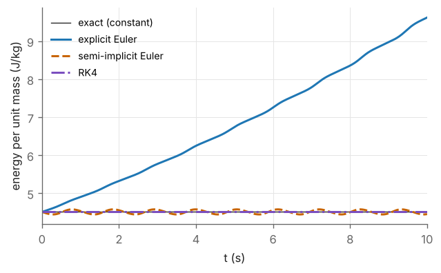

# M7 — Numerical Methods

> **Mathematics Primer · Chapter 7 of 8** · Previous: [M6 — Laplace Transforms and Linear Systems](M6-laplace-and-linear-systems.md) · [Primer home](README.md) · Next: [M8 — Lagrangian Mechanics Primer](M8-lagrangian-mechanics-primer.md)

## Why this matters in robotics

Closed-form solutions are the exception in robotics. Most robots have no analytic inverse kinematics, so the joint angles for a desired pose are found iteratively, by **Newton–Raphson** or **gradient** methods. A robot's motion under given torques is found by **numerically integrating** its equations of motion, which is what every simulator (and every model-based controller that predicts ahead) does. And all of this runs in **floating-point arithmetic**, which is not the arithmetic of the real numbers: rotation matrices that are updated thousands of times per second slowly stop being rotations unless they are repaired. This chapter introduces the methods and, just as importantly, their failure modes. It supports Lynch & Park §6.2 (numerical inverse kinematics), Craig Ch. 6 (simulation of dynamics) and the simulation work in RMC.

## Learning objectives

After studying this chapter you should be able to:

1. explain machine precision, rounding and cancellation, and avoid the common floating-point traps in robotics code;
2. apply Newton–Raphson to scalar equations and to systems, and explain quadratic convergence and its failure modes;
3. analyse fixed-point iterations with the contraction condition;
4. apply gradient descent and choose a step size that guarantees convergence for a quadratic;
5. integrate ODEs with explicit Euler, semi-implicit Euler and fourth-order Runge–Kutta, and compare their accuracy, stability and energy behaviour;
6. re-orthonormalise a drifting rotation matrix.

## Contents

1. [Floating-point arithmetic](#1-floating-point-arithmetic)
2. [Newton–Raphson for scalar equations](#2-newtonraphson-for-scalar-equations)
3. [Newton–Raphson for systems: numerical inverse kinematics](#3-newtonraphson-for-systems-numerical-inverse-kinematics)
4. [Fixed-point iteration and convergence](#4-fixed-point-iteration-and-convergence)
5. [Gradient descent](#5-gradient-descent)
6. [Numerical integration of ODEs](#6-numerical-integration-of-odes)
7. [Keeping rotation matrices orthonormal](#7-keeping-rotation-matrices-orthonormal)
8. [Worked examples](#8-worked-examples)
9. [Exercises](#9-exercises)
10. [Further reading](#10-further-reading)

---

## 1. Floating-point arithmetic

Computers store real numbers in IEEE 754 **double precision**: a sign, an 11-bit exponent and a 52-bit fraction, giving about 16 significant decimal digits over a range from about $10^{-308}$ to $10^{308}$. The key number is the **machine epsilon**,

$$
\varepsilon_{\text{mach}} = 2^{-52} \approx 2.22\times10^{-16},
$$

the gap between $1$ and the next representable number. Every arithmetic operation is exact up to a relative rounding error of at most $\varepsilon_{\text{mach}}/2$. Three consequences matter constantly in robotics code.

1. **Do not test floating-point numbers for equality.** In double precision, $0.1 + 0.2 = 0.30000000000000004 \neq 0.3$, because none of these decimals is exactly representable in binary. Compare with a tolerance: $|a - b| < \text{tol}$.

2. **Beware of cancellation.** Subtracting two nearly equal numbers destroys significant digits. For $x = 10^{-8}$, computing $1 - \cos x$ directly gives exactly $0$, because $\cos x$ rounds to $1$; the algebraically identical expression $2\sin^2(x/2)$ gives the correct $5.0\times10^{-17}$. Rewriting a formula to avoid subtracting nearly equal quantities is a standard technique.

3. **Clamp before calling $\arccos$ or $\arcsin$.** Rounding can produce a cosine such as $1.0000000000000002$, for which `acos` returns NaN. Better still, use $\operatorname{atan2}$ ([M4](M4-trigonometry-and-atan2.md)): for the angle of a rotation matrix, $\theta = \operatorname{atan2}\left(\tfrac12\lVert\mathbf{r}\rVert,\ \tfrac12(\operatorname{tr}R - 1)\right)$, where $\mathbf{r} = (r_{32} - r_{23},\ r_{13} - r_{31},\ r_{21} - r_{12})$, is accurate for all angles (Exercise E7.7).

Errors also propagate through algorithms. The condition number of [M3](M3-eigen-svd-least-squares.md) measures how much a problem amplifies input errors; a *numerically stable* algorithm adds little error of its own. Solving $A\mathbf{x} = \mathbf{b}$ by a factorisation is stable; forming $A^{-1}$ or $A^{T}A$ explicitly is less so.

## 2. Newton–Raphson for scalar equations

To solve $f(x) = 0$, replace $f$ near the current guess $x_k$ by its tangent line ([M5](M5-calculus-and-differential-equations.md) §3), $f(x) \approx f(x_k) + f'(x_k)(x - x_k)$, and solve the linear equation instead:

$$
x_{k+1} = x_k - \frac{f(x_k)}{f'(x_k)} .
$$

**Theorem (quadratic convergence).** If $f$ is twice continuously differentiable, $f(x^{\ast}) = 0$ and $f'(x^{\ast}) \neq 0$, then for $x_0$ close enough to $x^{\ast}$ the errors $e_k = x_k - x^{\ast}$ satisfy

$$
e_{k+1} \approx \frac{f''(x^{\ast})}{2f'(x^{\ast})}\,e_k^2 .
$$

Roughly, the number of correct digits doubles at each step (Example M7.1). The fine print matters:

| Failure mode | Cause | Remedy |
|---|---|---|
| Divergence or cycling | starting point too far from the root | better initial guess; damping (take only part of the step); line search |
| Slow (linear) convergence | multiple root, $f'(x^{\ast}) = 0$ | reformulate; accept slower convergence |
| Division by (nearly) zero | $f'(x_k) \approx 0$ | damping; switch to a bracketing method |
| Wrong root | several roots exist | choose $x_0$ deliberately (e.g. the previous solution) |

**Bisection**, which halves a bracketing interval $[a, b]$ with $f(a)f(b) < 0$ at each step, is slow (one binary digit per step) but cannot fail; robust solvers combine it with Newton steps.

## 3. Newton–Raphson for systems: numerical inverse kinematics

For a system $\mathbf{f}(\mathbf{x}) = \mathbf{0}$ of $n$ equations in $n$ unknowns, linearise with the Jacobian and solve the linear system for the step:

$$
J(\mathbf{x}_k)\,\Delta\mathbf{x} = -\mathbf{f}(\mathbf{x}_k), \qquad \mathbf{x}_{k+1} = \mathbf{x}_k + \Delta\mathbf{x}.
$$

In **inverse kinematics**, we seek joint angles $\boldsymbol{\theta}$ with $\mathbf{f}_{\text{fk}}(\boldsymbol{\theta}) = \mathbf{x}_d$. Define the error $\mathbf{e} = \mathbf{x}_d - \mathbf{f}_{\text{fk}}(\boldsymbol{\theta})$; then the Newton step is

$$
\boldsymbol{\theta}_{k+1} = \boldsymbol{\theta}_k + J(\boldsymbol{\theta}_k)^{-1}\,\mathbf{e}_k .
$$

This is the Newton–Raphson inverse-kinematics algorithm of Lynch & Park §6.2. When $J$ is not square (redundant robots) or is close to singular, the inverse is replaced by the pseudoinverse $J^{+}$ or, more robustly, by the damped least-squares inverse $J^{T}(JJ^{T} + \lambda^2I)^{-1}$ of [M3](M3-eigen-svd-least-squares.md) §6. For full spatial poses, the error is computed with the matrix logarithm of the pose error rather than by subtracting angles (Lynch & Park Ch. 6). Practical implementations also cap the step size, wrap angles to $(-\pi, \pi]$ and stop when $\lVert\mathbf{e}\rVert$ falls below a tolerance. Newton's method finds *one* solution, the one in whose basin of attraction the initial guess lies; seeding it with the robot's current configuration usually yields the nearest solution, which is generally the one wanted.

## 4. Fixed-point iteration and convergence

Many algorithms have the form $x_{k+1} = g(x_k)$. A **fixed point** satisfies $x^{\ast} = g(x^{\ast})$. Subtracting, and applying the mean-value theorem, $e_{k+1} = g'(\xi_k)\,e_k$ for some $\xi_k$ between $x_k$ and $x^{\ast}$. Hence:

**Theorem (contraction).** If $|g'(x)| \le L < 1$ on an interval containing $x^{\ast}$ and the iterates, then the iteration converges to $x^{\ast}$, and $|e_{k+1}| \le L|e_k|$: **linear convergence** with rate $L$. If $|g'(x^{\ast})| > 1$ the fixed point repels the iterates.

For vector iterations $\mathbf{x}_{k+1} = G(\mathbf{x}_k)$ the condition is that the Jacobian of $G$ has norm (or spectral radius) less than $1$. Newton's method is a fixed-point iteration with $g(x) = x - f(x)/f'(x)$, for which $g'(x^{\ast}) = 0$, which is why it converges faster than linearly. Gradient descent and the explicit integration schemes below can be analysed in exactly this way.

## 5. Gradient descent

To minimise a smooth scalar function $\phi(\mathbf{x})$, step downhill along the negative gradient:

$$
\mathbf{x}_{k+1} = \mathbf{x}_k - \alpha\,\nabla\phi(\mathbf{x}_k), \qquad \alpha > 0 .
$$

For the quadratic $\phi = \tfrac12\mathbf{x}^{T}Q\mathbf{x}$ with $Q \succ 0$, the gradient is $Q\mathbf{x}$, so $\mathbf{x}_{k+1} = (I - \alpha Q)\mathbf{x}_k$. This is a linear fixed-point iteration, and in the eigenbasis of $Q$ each component is multiplied by $1 - \alpha\lambda_i$ per step. Hence

$$
\text{gradient descent converges} \iff |1 - \alpha\lambda_i| < 1 \text{ for all } i \iff 0 < \alpha < \frac{2}{\lambda_{\max}} .
$$

The slowest component contracts by $\max_i|1 - \alpha\lambda_i|$, and even the best $\alpha$ gives a rate of $(\kappa - 1)/(\kappa + 1)$ where $\kappa = \lambda_{\max}/\lambda_{\min}$: **ill-conditioned problems make gradient descent slow**, which is why Newton-type and quasi-Newton methods are preferred when second-order information is available.

**Where this is used.** Applying gradient descent to $\phi(\boldsymbol{\theta}) = \tfrac12\lVert\mathbf{x}_d - \mathbf{f}_{\text{fk}}(\boldsymbol{\theta})\rVert^2$ gives $\nabla\phi = -J^{T}\mathbf{e}$, i.e. the update $\Delta\boldsymbol{\theta} = \alpha J^{T}\mathbf{e}$. This is the **Jacobian-transpose** method of inverse kinematics: cheap, singularity-tolerant, but slow. Gradient-based optimisation also underlies trajectory optimisation and learning-based control.

## 6. Numerical integration of ODEs

We want to approximate the solution of $\dot{\mathbf{x}} = \mathbf{f}(t, \mathbf{x})$, $\mathbf{x}(0) = \mathbf{x}_0$, at times $t_k = kh$ with step size $h$. For a robot, $\mathbf{x} = (\mathbf{q}, \dot{\mathbf{q}})$ and $\mathbf{f}$ is the forward dynamics of [M5](M5-calculus-and-differential-equations.md) §6.

### Explicit (forward) Euler

$$
\mathbf{x}_{k+1} = \mathbf{x}_k + h\,\mathbf{f}(t_k, \mathbf{x}_k).
$$

It follows the tangent for one step. The **local error** per step is $O(h^2)$ and the **global error** at a fixed final time is $O(h)$: halving $h$ halves the error. It is a *first-order* method.

**Stability.** Applied to the test equation $\dot{x} = -\lambda x$ with $\lambda > 0$, Euler gives $x_{k+1} = (1 - h\lambda)x_k$, which decays only if $|1 - h\lambda| < 1$, that is, $h < 2/\lambda$. Stiff systems (with some very fast modes, such as stiff joint controllers or contact springs) therefore force tiny steps on explicit methods. Applied to an undamped oscillator, Euler is *never* stable: its amplification factor has modulus $\sqrt{1 + h^2\omega^2} > 1$, so a simulated pendulum steadily gains energy (Figure M7.1).

### Semi-implicit (symplectic) Euler

For mechanical systems $\ddot{q} = a(q, \dot q)$, update the velocity first and use the *new* velocity to update the position:

$$
\dot{q}_{k+1} = \dot{q}_k + h\,a(q_k, \dot{q}_k), \qquad q_{k+1} = q_k + h\,\dot{q}_{k+1}.
$$

It is still first-order accurate, but for conservative systems its energy error stays bounded instead of growing. Its cheapness and good long-run behaviour make it the default in many physics engines used for robot simulation.

### Classical fourth-order Runge–Kutta (RK4)

$$
\begin{aligned}
\mathbf{k}_1 &= \mathbf{f}(t_k, \mathbf{x}_k), &\qquad \mathbf{k}_2 &= \mathbf{f}\left(t_k + \tfrac{h}{2},\ \mathbf{x}_k + \tfrac{h}{2}\mathbf{k}_1\right), \\
\mathbf{k}_3 &= \mathbf{f}\left(t_k + \tfrac{h}{2},\ \mathbf{x}_k + \tfrac{h}{2}\mathbf{k}_2\right), &\qquad \mathbf{k}_4 &= \mathbf{f}(t_k + h,\ \mathbf{x}_k + h\mathbf{k}_3), \\
\mathbf{x}_{k+1} &= \mathbf{x}_k + \tfrac{h}{6}\left(\mathbf{k}_1 + 2\mathbf{k}_2 + 2\mathbf{k}_3 + \mathbf{k}_4\right). & &
\end{aligned}
$$

RK4 uses four evaluations of $\mathbf{f}$ per step and has global error $O(h^4)$: halving $h$ reduces the error by a factor of about $16$. For smooth robot dynamics it is the standard fixed-step workhorse. Library solvers such as `scipy.integrate.solve_ivp` (default `RK45`) go further and adapt $h$ automatically to meet a requested tolerance.

| Method | $\mathbf{f}$-evaluations per step | Global error | Energy behaviour on an undamped oscillator |
|---|---|---|---|
| Explicit Euler | 1 | $O(h)$ | grows without bound |
| Semi-implicit Euler | 1 | $O(h)$ | bounded oscillation about the true value |
| RK4 | 4 | $O(h^4)$ | very slow decay (tiny for small $h$) |

*Figure M7.1 — A pendulum ($l = 1$ m, released from $1$ rad) simulated for 10 s with $h = 0.01$ s. Explicit Euler more than doubles the energy; semi-implicit Euler oscillates near the true value; RK4 is indistinguishable from it at this scale.*

## 7. Keeping rotation matrices orthonormal

When orientation is propagated numerically, for example by integrating $\dot{R} = [\boldsymbol{\omega}]_\times R$ from gyroscope measurements, or by multiplying many rotation matrices in sequence, rounding and truncation errors accumulate and the computed $R$ drifts off $SO(3)$: its columns stop being unit length and perpendicular. Explicit Euler is especially bad: $R_{k+1} = (I + h[\boldsymbol{\omega}]_\times)R_k$, and $\det(I + h[\boldsymbol{\omega}]_\times) = 1 + h^2\lVert\boldsymbol{\omega}\rVert^2 > 1$, so the "rotation" inflates a little at every step (Example M7.6). There are three standard cures.

1. **Integrate on the group.** Use the exact incremental rotation $R_{k+1} = \exp(h[\boldsymbol{\omega}]_\times)R_k$ (Rodrigues' formula, [M1](M1-vectors-and-geometry.md) §7), which is a rotation up to rounding.
2. **Use unit quaternions** and renormalise the four-vector after each step; this is the usual practice in inertial navigation and simulators.
3. **Project back onto $SO(3)$ periodically.** The nearest rotation matrix (in the Frobenius norm) to a matrix $\tilde{R}$ with SVD $\tilde{R} = U\Sigma V^{T}$ is

$$
R = U\,\operatorname{diag}\left(1, 1, \det(UV^{T})\right)V^{T},
$$

which is simply $UV^{T}$ when $\det(UV^{T}) = +1$. A cheaper alternative is **Gram–Schmidt**: normalise the first column, remove its component from the second and normalise, and set the third to the cross product of the first two. Gram–Schmidt is not symmetric in the columns (it trusts the first column most), whereas the SVD projection distributes the correction evenly (Example M7.5).

---

## 8. Worked examples

### Example M7.1 — Newton's method for the square root of 2

*Apply Newton's method to $f(x) = x^2 - 2$ from $x_0 = 1$.*

**Solution.** $x_{k+1} = x_k - (x_k^2 - 2)/(2x_k) = \tfrac12(x_k + 2/x_k)$.

| $k$ | $x_k$ | error $\lvert x_k - \sqrt2\rvert$ |
|---|---|---|
| 0 | 1 | $4.1\times10^{-1}$ |
| 1 | 1.5 | $8.6\times10^{-2}$ |
| 2 | 1.416 666 666 7 | $2.5\times10^{-3}$ |
| 3 | 1.414 215 686 3 | $2.1\times10^{-6}$ |
| 4 | 1.414 213 562 4 | $1.6\times10^{-12}$ |
| 5 | 1.414 213 562 373 095 | $0$ (to double precision) |

The error is roughly squared at each step; the constant $f''/(2f') = 1/(2\sqrt2) \approx 0.354$ predicts $e_4 \approx 0.354\,(2.1\times10^{-6})^2 = 1.6\times10^{-12}$, as observed.

### Example M7.2 — Numerical inverse kinematics of a 2R arm

*For the arm of [M4](M4-trigonometry-and-atan2.md) Example M4.4 ($l_1 = 1$, $l_2 = 0.8$, target $(1.2, 0.9)$), apply Newton–Raphson from $\boldsymbol{\theta}_0 = (0, 1.0)$ rad.*

**Solution.** At each step compute $\mathbf{e}_k = \mathbf{x}_d - \mathbf{f}_{\text{fk}}(\boldsymbol{\theta}_k)$ and solve $J(\boldsymbol{\theta}_k)\Delta\boldsymbol{\theta} = \mathbf{e}_k$. At $\boldsymbol{\theta}_0$ the tip is at $(1.4322, 0.6732)$, so $\mathbf{e}_0 = (-0.2322, 0.2268)$.

| $k$ | $\theta_1$ (deg) | $\theta_2$ (deg) | $\lVert\mathbf{e}_k\rVert$ (m) |
|---|---|---|---|
| 0 | 0.000 | 57.296 | $3.2\times10^{-1}$ |
| 1 | 4.452 | 72.610 | $4.9\times10^{-2}$ |
| 2 | 7.271 | 67.754 | $1.5\times10^{-3}$ |
| 3 | 7.3284 | 67.5890 | $1.7\times10^{-6}$ |
| 4 | 7.328537 | 67.588868 | $1.9\times10^{-12}$ |

The iteration converges quadratically to $(7.3285^\circ, 67.5889^\circ)$, exactly the "elbow-down" closed-form solution of Example M4.4. Starting from $\boldsymbol{\theta}_0 = (1.0, -1.0)$ would instead lead to the other solution.

### Example M7.3 — A fixed-point iteration

*Iterate $x_{k+1} = \cos x_k$ from $x_0 = 1$. Does it converge, and how fast?*

**Solution.** The iterates are $0.5403, 0.8576, 0.6543, 0.7935, 0.7014, \dots$, oscillating about and converging to $x^{\ast} = 0.739085$. Since $g'(x) = -\sin x$ and $|g'(x^{\ast})| = \sin0.739085 = 0.674 < 1$, convergence is linear: each step reduces the error by a factor of about $0.674$ (and the negative sign of $g'$ explains the alternation). Since $0.674^{n}$ must fall to about $10^{-16}$, it takes about $90$ iterations to reach full double precision, whereas Newton's method on $\cos x - x = 0$ needs four (Exercise E7.1).

### Example M7.4 — Euler versus RK4

*Integrate $\dot{x} = -2x$, $x(0) = 1$, to $t = 1$ with $h = 0.1$ by explicit Euler and by RK4, and compare with the exact $e^{-2} = 0.135335$.*

**Solution.** For this linear equation each step multiplies $x$ by a fixed factor. Euler: $1 - 2h = 0.8$, so $x(1) \approx 0.8^{10} = 0.107374$ (error $2.8\times10^{-2}$). RK4: the factor is the Taylor polynomial $1 - 0.2 + \tfrac{0.2^2}{2} - \tfrac{0.2^3}{6} + \tfrac{0.2^4}{24} = 0.818733$, so $x(1) \approx 0.818733^{10} = 0.135340$ (error $4.3\times10^{-6}$). Halving the step to $h = 0.05$ reduces the errors to $1.4\times10^{-2}$ (Euler, a factor of $2$) and $2.5\times10^{-7}$ (RK4, a factor of about $17$), confirming orders $1$ and $4$.

### Example M7.5 — Re-orthonormalising a rotation matrix

*Accumulated errors have turned a rotation into $\tilde{R} = \begin{bmatrix} 1.01&-0.02&0\\0.01&0.99&0\\0&0&1 \end{bmatrix}$. Project it onto $SO(3)$.*

**Solution.** $\tilde{R}^{T}\tilde{R}$ has diagonal $(1.0202, 0.9805, 1)$ and off-diagonal $-0.0103$, so $\tilde{R}$ is visibly not orthogonal ($\lVert\tilde{R}^{T}\tilde{R} - I\rVert_F = 0.032$). Its singular values are $1.0113$, $1$ and $0.9889$. Replacing them by ones, $R = UV^{T}$ gives

$$
R = \begin{bmatrix} 0.999888 & -0.014998 & 0 \\ 0.014998 & 0.999888 & 0 \\ 0 & 0 & 1 \end{bmatrix},
$$

a rotation of $0.859^\circ$ about $z$, with $\det R = 1$ and $\lVert R^{T}R - I\rVert_F \approx 10^{-16}$. Gram–Schmidt instead keeps the direction of the first column, $(1.01, 0.01, 0)$, and produces a rotation of $0.567^\circ$. The SVD answer lies between the angles suggested by the two columns ($0.567^\circ$ and $1.157^\circ$), as a fair compromise should.

### Example M7.6 — How fast does Euler integration of orientation drift?

*Integrate $\dot{R} = [\boldsymbol{\omega}]_\times R$ with constant $\boldsymbol{\omega} = (0.3, -0.5, 1.0)$ rad/s, $R(0) = I$, $h = 0.01$ s for 10 s by explicit Euler. Predict $\det R$ at the end.*

**Solution.** Each step multiplies $\det R$ by $1 + h^2\lVert\boldsymbol{\omega}\rVert^2 = 1 + 10^{-4}(1.34)$. After $1000$ steps, $\det R = (1.000134)^{1000} = 1.1434$: the "rotation" now enlarges volumes by 14%. The numerical experiment gives $\det R = 1.1434$ and $\lVert R^{T}R - I\rVert_F = 0.20$. Using the exact exponential update instead keeps $\lVert R^{T}R - I\rVert_F$ near $10^{-13}$ over the same run.

---

## 9. Exercises

**E7.1** Apply Newton's method to $f(x) = \cos x - x$ from $x_0 = 1$. Give three iterates.

Answer

$x_{k+1} = x_k + (\cos x_k - x_k)/(\sin x_k + 1)$. Iterates: $0.750364$, $0.739113$, $0.739085$ (and $0.7390851332$ at the fourth step), the same fixed point as Example M7.3.

**E7.2** Show that Newton's method fails for $f(x) = x^{1/3}$ (real cube root) from any $x_0 \neq 0$, even though $x^{\ast} = 0$ is a simple-looking root.

Answer

$f'(x) = \tfrac13x^{-2/3}$, so $x_{k+1} = x_k - x_k^{1/3}/(\tfrac13x_k^{-2/3}) = x_k - 3x_k = -2x_k$. The iterates double in magnitude and alternate in sign. The theorem's hypothesis fails: $f'$ is unbounded at the root.

**E7.3** What is the largest step size for which explicit Euler applied to $\dot{x} = -50x$ does not blow up?

Answer

$|1 - 50h| < 1$ requires $h < 2/50 = 0.04$. (For a non-oscillating decay one needs $h < 1/50 = 0.02$.)

**E7.4** In double precision, what is $(1 + 10^{-17}) - 1$? Explain.

Answer

$0$. The number $1 + 10^{-17}$ is not representable; the nearest double is $1$ itself, because $10^{-17}$ is smaller than half the spacing $\varepsilon_{\text{mach}} \approx 2.2\times10^{-16}$ between $1$ and the next double.

**E7.5** Take one gradient-descent step on $\phi(x, y) = (x - 1)^2 + 4(y + 2)^2$ from $(0, 0)$ with $\alpha = 0.1$. What is the largest step size that guarantees convergence?

Answer

$\nabla\phi = (2(x - 1),\ 8(y + 2)) = (-2, 16)$ at the origin, so the new point is $(0, 0) - 0.1(-2, 16) = (0.2, -1.6)$. The Hessian is $\operatorname{diag}(2, 8)$, so convergence requires $\alpha < 2/8 = 0.25$.

**E7.6** Take one RK4 step of size $h = 0.5$ for $\dot{x} = x$, $x(0) = 1$, and compare with the exact value.

Answer

$k_1 = 1$, $k_2 = 1 + 0.25(1) = 1.25$, $k_3 = 1 + 0.25(1.25) = 1.3125$, $k_4 = 1 + 0.5(1.3125) = 1.65625$. $x_1 = 1 + \tfrac{0.5}{6}(1 + 2.5 + 2.625 + 1.65625) = 1.6484375$. Exact: $e^{0.5} = 1.6487213$; the error is $2.8\times10^{-4}$ even with this large step. (Euler would give $1.5$.)

**E7.7** For a rotation by $\theta = 10^{-8}$ rad about $z$, compute the angle by $\arccos\left(\tfrac12(\operatorname{tr}R - 1)\right)$ and by the $\operatorname{atan2}$ formula of Section 1. Explain the difference.

Answer

$\arccos$ returns exactly $0$: $\cos(10^{-8}) = 1 - 5\times10^{-17}$ rounds to $1$, so the information is lost before $\arccos$ is called, and in any case $\arccos$ is ill-conditioned near $1$. The $\operatorname{atan2}$ formula uses the off-diagonal entries $\pm\sin\theta \approx \pm10^{-8}$, which are stored to full relative precision, and returns $1.0\times10^{-8}$.

**E7.8** How many bisection steps are needed to locate a root in $[0, 1]$ to within $10^{-6}$?

Answer

After $n$ steps the interval has length $2^{-n}$, so we need $2^{-n} \le 10^{-6}$, i.e. $n \ge \log_2 10^6 = 19.93$: $20$ steps. Newton's method from a good start would need about four or five.

---

## 10. Further reading

* E. Kreyszig, *Advanced Engineering Mathematics*, Ch. 19 (Numerics in General: rounding, solution of equations by iteration), Ch. 20 (Numeric Linear Algebra) and Ch. 21 (Numerics for ODEs and PDEs: Euler and Runge–Kutta methods).
* G. Strang, *Introduction to Linear Algebra*, Ch. 11 (Numerical Linear Algebra).
* D. Goldberg, "What every computer scientist should know about floating-point arithmetic", *ACM Computing Surveys*, 23(1), 1991.
* K. M. Lynch and F. C. Park, *Modern Robotics*, §6.2 (Numerical Inverse Kinematics) and Ch. 8 (forward dynamics and its numerical integration).
* J. Nocedal and S. J. Wright, *Numerical Optimization*, chapters on line-search methods (gradient descent and Newton's method).
* E. Hairer, C. Lubich and G. Wanner, *Geometric Numerical Integration*, for why symplectic and Lie-group integrators preserve energy and orthogonality (advanced).

---

Previous: [M6 — Laplace Transforms and Linear Systems](M6-laplace-and-linear-systems.md) · [Primer home](README.md) · Next: [M8 — Lagrangian Mechanics Primer](M8-lagrangian-mechanics-primer.md)
