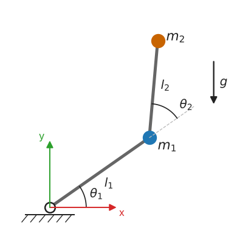

# M8 — Lagrangian Mechanics Primer

> **Mathematics Primer · Chapter 8 of 8** · Previous: [M7 — Numerical Methods](M7-numerical-methods.md) · [Primer home](README.md)

## Why this matters in robotics

To control a robot well we need to know how it responds to torques: its **equations of motion**. For a chain of links connected by joints, Newton's laws applied link by link involve the internal constraint forces at every joint, which we do not care about and must eliminate. The **Lagrangian** method avoids them entirely. One writes down two scalar quantities, the kinetic energy $T$ and the potential energy $V$, in terms of the joint variables, and a mechanical recipe, the **Euler–Lagrange equations**, produces the equations of motion directly in the form used by every control law in RMC:

$$
M(\mathbf{q})\ddot{\mathbf{q}} + C(\mathbf{q}, \dot{\mathbf{q}})\dot{\mathbf{q}} + \mathbf{g}(\mathbf{q}) = \boldsymbol{\tau}.
$$

This chapter introduces the method on simple systems, develops the rigid-body **inertia tensor** and the **parallel-axis theorem** that the kinetic energy requires, and sketches the two-link arm. It is a preview of Craig Ch. 6, Lynch & Park Ch. 8, Spong's chapter on dynamics and Siciliano Ch. 7.

## Learning objectives

After studying this chapter you should be able to:

1. choose generalised coordinates for a mechanical system and count its degrees of freedom;
2. write the kinetic and potential energy of particles and rigid bodies;
3. apply the Euler–Lagrange equations, including generalised forces such as joint torques;
4. compute inertia tensors of simple bodies, transform them by rotation, and shift them with the parallel-axis theorem;
5. recognise the standard structure $M\ddot{\mathbf{q}} + C\dot{\mathbf{q}} + \mathbf{g} = \boldsymbol{\tau}$ and its key properties;
6. derive the dynamics of a planar two-link arm with point masses.

## Contents

1. [Generalised coordinates and degrees of freedom](#1-generalised-coordinates-and-degrees-of-freedom)
2. [Kinetic and potential energy](#2-kinetic-and-potential-energy)
3. [The Euler–Lagrange equations](#3-the-eulerlagrange-equations)
4. [The rigid-body inertia tensor](#4-the-rigid-body-inertia-tensor)
5. [The structure of manipulator dynamics](#5-the-structure-of-manipulator-dynamics)
6. [Sketch: the planar two-link arm](#6-sketch-the-planar-two-link-arm)
7. [Worked examples](#7-worked-examples)
8. [Exercises](#8-exercises)
9. [Further reading](#9-further-reading)

---

## 1. Generalised coordinates and degrees of freedom

A set of **generalised coordinates** $\mathbf{q} = (q_1, \dots, q_n)$ is a set of independent variables that determines the position of every part of a system. Their number $n$ is the number of **degrees of freedom**. A free particle in space has three; a rigid body in space has six (three for position, three for orientation; [M2](M2-matrices-and-linear-maps.md) §7); a pendulum swinging in a plane has one, the angle $\theta$, because the rod length constrains the bob to a circle.

Constraints of the form $\phi(\mathbf{x}) = 0$ that relate positions alone are called **holonomic**. Each one removes a degree of freedom. For an open-chain manipulator the natural generalised coordinates are the **joint variables**: angles $\theta_i$ for revolute joints and displacements $d_i$ for prismatic joints. The joints themselves are the constraints, and choosing joint variables as coordinates builds the constraints in automatically. This is the key advantage of the Lagrangian approach: the constraint forces that hold the joints together never appear.

## 2. Kinetic and potential energy

### Particles

A particle of mass $m$ with velocity $\mathbf{v}$ has kinetic energy $T = \tfrac12m\,\mathbf{v}^{T}\mathbf{v}$. In a uniform gravitational field $\mathbf{g}_0$ (for example $\mathbf{g}_0 = (0, -g, 0)^{T}$ with $y$ up), its potential energy is $V = -m\,\mathbf{g}_0^{T}\mathbf{p}$, which with $y$ up is simply $V = mgy$ (mass times $g$ times height). A linear spring of stiffness $k$ stretched by $\delta$ stores $V = \tfrac12k\delta^2$.

### Rigid bodies

For a rigid body of mass $m$ whose centre of mass moves with velocity $\mathbf{v}_C$ and which rotates with angular velocity $\boldsymbol{\omega}$, the kinetic energy splits into translational and rotational parts (König's theorem):

$$
T = \frac12m\,\mathbf{v}_C^{T}\mathbf{v}_C + \frac12\boldsymbol{\omega}^{T}I_C\,\boldsymbol{\omega},
$$

where $I_C$ is the **inertia tensor about the centre of mass** (Section 4), with $\boldsymbol{\omega}$ and $I_C$ expressed in the same frame. For a body rotating about a fixed axis through a point $O$, the formula reduces to $T = \tfrac12I_O\dot{\theta}^2$, where $I_O$ is the moment of inertia about that axis. Gravity acts as if all the mass were at the centre of mass: $V = mg\,h_C$.

For a manipulator, $T$ is the sum of the link energies. Since each link's $\mathbf{v}_C$ and $\boldsymbol{\omega}$ are linear in $\dot{\mathbf{q}}$ (through the link Jacobians, [M5](M5-calculus-and-differential-equations.md) §2), $T$ is a quadratic form in $\dot{\mathbf{q}}$:

$$
T = \frac12\dot{\mathbf{q}}^{T}M(\mathbf{q})\,\dot{\mathbf{q}}, \qquad M(\mathbf{q}) = \sum_{i}\left(m_iJ_{v,i}^{T}J_{v,i} + J_{\omega,i}^{T}R_iI_{C,i}R_i^{T}J_{\omega,i}\right),
$$

where $J_{v,i}$ and $J_{\omega,i}$ are the Jacobians of the linear velocity of the centre of mass and of the angular velocity of link $i$, and $R_i$ its orientation. The **mass matrix** $M(\mathbf{q})$ is symmetric and positive-definite ([M3](M3-eigen-svd-least-squares.md) §3).

## 3. The Euler–Lagrange equations

The **Lagrangian** is the difference between kinetic and potential energy,

$$
\mathcal{L}(\mathbf{q}, \dot{\mathbf{q}}) = T(\mathbf{q}, \dot{\mathbf{q}}) - V(\mathbf{q}).
$$

**Euler–Lagrange equations.** The motion satisfies, for each coordinate $i = 1, \dots, n$,

$$
\frac{d}{dt}\left(\frac{\partial\mathcal{L}}{\partial\dot{q}_i}\right) - \frac{\partial\mathcal{L}}{\partial q_i} = Q_i,
$$

where $Q_i$ is the **generalised force** associated with $q_i$: the non-conservative forces (motor torques, friction, external loads) projected onto that coordinate. It is defined by the virtual work $\delta W = \sum_iQ_i\,\delta q_i$. For a revolute joint driven by a motor, $Q_i$ is the joint torque $\tau_i$; for a prismatic joint it is the joint force; a viscous friction contributes $-b_i\dot{q}_i$; and an external force $\mathbf{F}$ at the end-effector contributes $J^{T}\mathbf{F}$ (Craig Ch. 5–6).

**Where do these equations come from?** They are equivalent to Newton's laws for systems with ideal (workless) constraints. One route is d'Alembert's principle of virtual work; another is **Hamilton's principle**, which states that the actual motion makes the action $\int\mathcal{L}\,dt$ stationary, the Euler–Lagrange equations being the condition for stationarity from the calculus of variations. For a single free particle with $\mathbf{q} = \mathbf{p}$, $\partial\mathcal{L}/\partial\dot{\mathbf{p}} = m\dot{\mathbf{p}}$ and $\partial\mathcal{L}/\partial\mathbf{p} = -\partial V/\partial\mathbf{p}$, so the equations reduce to $m\ddot{\mathbf{p}} = -\nabla V + \mathbf{Q}$: Newton's second law.

**Procedure.**

1. Choose generalised coordinates $\mathbf{q}$.
2. Write the position of each mass (or centre of mass) as a function of $\mathbf{q}$, and differentiate to obtain velocities (and angular velocities).
3. Form $T$ and $V$, and hence $\mathcal{L}$.
4. Compute $\partial\mathcal{L}/\partial\dot{q}_i$, differentiate it with respect to time (using the chain rule: $\mathbf{q}$ and $\dot{\mathbf{q}}$ depend on $t$), and subtract $\partial\mathcal{L}/\partial q_i$.
5. Identify the generalised forces and equate.

## 4. The rigid-body inertia tensor

### Definition

The rotational kinetic energy $\tfrac12\boldsymbol{\omega}^{T}I\boldsymbol{\omega}$ comes from summing $\tfrac12\lVert\boldsymbol{\omega}\times\mathbf{r}\rVert^2\,dm$ over the body. Using Lagrange's identity ([M1](M1-vectors-and-geometry.md) §4) one finds

$$
I = \int_{\text{body}}\left(\mathbf{r}^{T}\mathbf{r}\,I_3 - \mathbf{r}\mathbf{r}^{T}\right)dm = \begin{bmatrix} \int(y^2 + z^2)\,dm & -\int xy\,dm & -\int xz\,dm \\ -\int xy\,dm & \int(x^2 + z^2)\,dm & -\int yz\,dm \\ -\int xz\,dm & -\int yz\,dm & \int(x^2 + y^2)\,dm \end{bmatrix},
$$

where $\mathbf{r} = (x, y, z)$ is measured from the chosen reference point and $I_3$ is the $3\times3$ identity. The diagonal entries are the **moments of inertia** about the axes; the off-diagonal entries are the negatives of the **products of inertia**. (Craig defines the products of inertia $I_{xy} = \int xy\,dm$ and writes $-I_{xy}$ in the matrix; Lynch & Park put the minus sign inside the definition. The matrix is the same.)

The inertia tensor is symmetric and positive-definite (for any body that is not concentrated on a line). By the spectral theorem ([M3](M3-eigen-svd-least-squares.md) §3) there is a body frame, the **principal axes**, in which it is diagonal; for bodies with symmetry the principal axes are the symmetry axes.

### Standard bodies (about the centre of mass, along the symmetry axes)

| Body | Moments of inertia |
|---|---|
| Thin rod, mass $m$, length $L$, along $x$ | $I_{xx} \approx 0$, $I_{yy} = I_{zz} = \tfrac{1}{12}mL^2$ |
| Solid box, sides $a, b, c$ along $x, y, z$ | $I_{xx} = \tfrac{1}{12}m(b^2 + c^2)$, $I_{yy} = \tfrac{1}{12}m(a^2 + c^2)$, $I_{zz} = \tfrac{1}{12}m(a^2 + b^2)$ |
| Solid cylinder, radius $r$, length $h$, axis $z$ | $I_{zz} = \tfrac12mr^2$, $I_{xx} = I_{yy} = \tfrac{1}{12}m(3r^2 + h^2)$ |
| Solid sphere, radius $r$ | $\tfrac25mr^2$ about any diameter |
| Point mass at distance $d$ from an axis | $md^2$ about that axis |

### Changing the frame: rotation

If ${}^{B}I$ is the inertia tensor written in frame $\lbrace B\rbrace$ and ${}^{A}_{B}R$ the orientation of $\lbrace B\rbrace$ relative to $\lbrace A\rbrace$ (same reference point), then

$$
{}^{A}I = {}^{A}_{B}R\;{}^{B}I\;{}^{A}_{B}R^{T},
$$

a similarity transform ([M2](M2-matrices-and-linear-maps.md) §8). It follows from requiring $\tfrac12\boldsymbol{\omega}^{T}I\boldsymbol{\omega}$ to be the same in both frames.

### Changing the reference point: the parallel-axis theorem

Let $I_C$ be the inertia tensor about the centre of mass and let $\mathbf{r}_C$ be the position of the centre of mass relative to another point $O$, with axes parallel. Then

$$
I_O = I_C + m\left(\mathbf{r}_C^{T}\mathbf{r}_C\,I_3 - \mathbf{r}_C\mathbf{r}_C^{T}\right).
$$

For a single axis this is the familiar scalar form $I_O = I_C + md^2$, with $d$ the distance between the parallel axes. The proof substitutes $\mathbf{r} = \mathbf{r}_C + \boldsymbol{\rho}$ into the definition; the cross terms vanish because $\int\boldsymbol{\rho}\,dm = \mathbf{0}$ about the centre of mass. The theorem only works *from* the centre of mass: to move between two other points, go through $C$. Craig Ch. 6 states the theorem in this form and uses it to compute link inertias about joint axes.

## 5. The structure of manipulator dynamics

Inserting $T = \tfrac12\dot{\mathbf{q}}^{T}M(\mathbf{q})\dot{\mathbf{q}}$ and $V(\mathbf{q})$ into the Euler–Lagrange equations and carrying out the differentiation gives, for every open-chain robot,

$$
M(\mathbf{q})\ddot{\mathbf{q}} + C(\mathbf{q}, \dot{\mathbf{q}})\dot{\mathbf{q}} + \mathbf{g}(\mathbf{q}) = \boldsymbol{\tau},
$$

where:

* $M(\mathbf{q})\ddot{\mathbf{q}}$ is the **inertial** term;
* $C(\mathbf{q}, \dot{\mathbf{q}})\dot{\mathbf{q}}$ collects the **Coriolis and centrifugal** terms, quadratic in $\dot{\mathbf{q}}$. A standard choice of $C$ uses the **Christoffel symbols**

$$
C_{kj} = \sum_{i=1}^{n}c_{ijk}\,\dot{q}_i, \qquad c_{ijk} = \frac12\left(\frac{\partial M_{kj}}{\partial q_i} + \frac{\partial M_{ki}}{\partial q_j} - \frac{\partial M_{ij}}{\partial q_k}\right);
$$

* $\mathbf{g}(\mathbf{q}) = \partial V/\partial\mathbf{q}$ is the **gravity** vector.

Craig writes the same equations as $M(\Theta)\ddot\Theta + V(\Theta, \dot\Theta) + G(\Theta) = \tau$, with the velocity terms collected in the vector $V$.

**Properties used throughout RMC.**

| Property | Statement | Use |
|---|---|---|
| Symmetry, positive-definiteness | $M = M^{T} \succ 0$, so $M^{-1}$ exists | forward dynamics, simulation ([M7](M7-numerical-methods.md)) |
| Skew-symmetry | $\dot{M} - 2C$ is skew-symmetric (with the Christoffel choice of $C$) | passivity and Lyapunov proofs of PD and adaptive control |
| Linearity in parameters | $\boldsymbol{\tau} = Y(\mathbf{q}, \dot{\mathbf{q}}, \ddot{\mathbf{q}})\,\boldsymbol{\pi}$ for a vector $\boldsymbol{\pi}$ of masses, first moments and inertias | parameter identification by least squares ([M3](M3-eigen-svd-least-squares.md) §5), adaptive control |
| Energy balance | $\dfrac{d}{dt}(T + V) = \dot{\mathbf{q}}^{T}\boldsymbol{\tau}$ | power and passivity arguments |

The energy balance is a consequence of the skew-symmetry property: differentiating $T + V$ and substituting the equations of motion leaves $\dot{\mathbf{q}}^{T}\boldsymbol{\tau} + \tfrac12\dot{\mathbf{q}}^{T}(\dot{M} - 2C)\dot{\mathbf{q}}$, and the last term vanishes because $\mathbf{x}^{T}S\mathbf{x} = 0$ for any skew-symmetric $S$ ([M1](M1-vectors-and-geometry.md) §7).

## 6. Sketch: the planar two-link arm

Consider the planar arm of Craig's Chapter 6 example: two links of lengths $l_1$, $l_2$, with the mass of each link concentrated as a point mass $m_1$, $m_2$ at its distal end, joint angles $\theta_1$, $\theta_2$ (with $\theta_1$ measured from the horizontal), and gravity acting in the $-y$ direction.

*Figure M8.1 — The planar two-link arm with point masses at the distal ends of the links.*

**Positions and velocities.** $\mathbf{p}_1 = (l_1c_1,\ l_1s_1)$ and $\mathbf{p}_2 = (l_1c_1 + l_2c_{12},\ l_1s_1 + l_2s_{12})$. Differentiating,

$$
\lVert\dot{\mathbf{p}}_1\rVert^2 = l_1^2\dot\theta_1^2, \qquad \lVert\dot{\mathbf{p}}_2\rVert^2 = l_1^2\dot\theta_1^2 + l_2^2(\dot\theta_1 + \dot\theta_2)^2 + 2l_1l_2c_2\,\dot\theta_1(\dot\theta_1 + \dot\theta_2).
$$

**Energies.** $T = \tfrac12m_1\lVert\dot{\mathbf{p}}_1\rVert^2 + \tfrac12m_2\lVert\dot{\mathbf{p}}_2\rVert^2$ and $V = m_1gl_1s_1 + m_2g(l_1s_1 + l_2s_{12})$.

**Result.** Applying the Euler–Lagrange equations (a page of careful algebra, worth doing once by hand, and checked here symbolically with SymPy) gives $M\ddot{\boldsymbol{\theta}} + C\dot{\boldsymbol{\theta}} + \mathbf{g} = \boldsymbol{\tau}$ with

$$
M(\boldsymbol{\theta}) = \begin{bmatrix} (m_1 + m_2)l_1^2 + m_2l_2^2 + 2m_2l_1l_2c_2 & m_2l_2^2 + m_2l_1l_2c_2 \\ m_2l_2^2 + m_2l_1l_2c_2 & m_2l_2^2 \end{bmatrix},
$$

$$
C(\boldsymbol{\theta}, \dot{\boldsymbol{\theta}})\dot{\boldsymbol{\theta}} = \begin{bmatrix} -m_2l_1l_2s_2\left(2\dot\theta_1\dot\theta_2 + \dot\theta_2^2\right) \\ m_2l_1l_2s_2\,\dot\theta_1^2 \end{bmatrix}, \qquad
\mathbf{g}(\boldsymbol{\theta}) = \begin{bmatrix} (m_1 + m_2)gl_1c_1 + m_2gl_2c_{12} \\ m_2gl_2c_{12} \end{bmatrix}.
$$

**Reading the terms.** The mass matrix depends only on $\theta_2$: folding the elbow brings $m_2$ closer to the shoulder and reduces the inertia seen by joint 1. The term in $\dot\theta_1^2$ in the second equation is **centrifugal** (rotation of the shoulder flings the outer mass outward, which tends to rotate the elbow); the term in $\dot\theta_1\dot\theta_2$ is **Coriolis**. The Christoffel construction gives

$$
C = m_2l_1l_2s_2\begin{bmatrix} -\dot\theta_2 & -(\dot\theta_1 + \dot\theta_2) \\ \dot\theta_1 & 0 \end{bmatrix}, \qquad \dot{M} - 2C = m_2l_1l_2s_2\begin{bmatrix} 0 & 2\dot\theta_1 + \dot\theta_2 \\ -(2\dot\theta_1 + \dot\theta_2) & 0 \end{bmatrix},
$$

which is indeed skew-symmetric. The general $n$-link case, with distributed link masses and inertia tensors, is the subject of the MFoR dynamics chapter (Craig Ch. 6, where both the Lagrangian and the recursive Newton–Euler formulations are developed).

---

## 7. Worked examples

### Example M8.1 — The simple pendulum

*A point mass $m$ hangs on a massless rod of length $l$ from a motorised pivot that applies torque $\tau$. Derive the equation of motion with $\theta$ measured from the downward vertical.*

**Solution.** The mass is at $(l\sin\theta,\ -l\cos\theta)$, so its speed is $l\dot\theta$, $T = \tfrac12ml^2\dot\theta^2$ and $V = -mgl\cos\theta$. Then $\mathcal{L} = \tfrac12ml^2\dot\theta^2 + mgl\cos\theta$, and

$$
\frac{\partial\mathcal{L}}{\partial\dot\theta} = ml^2\dot\theta, \qquad \frac{d}{dt}\frac{\partial\mathcal{L}}{\partial\dot\theta} = ml^2\ddot\theta, \qquad \frac{\partial\mathcal{L}}{\partial\theta} = -mgl\sin\theta,
$$

so $ml^2\ddot\theta + mgl\sin\theta = \tau$. Here $M = ml^2$, $C = 0$ and $g(\theta) = mgl\sin\theta$. With $\tau = 0$ this is the pendulum linearised in [M5](M5-calculus-and-differential-equations.md) Example M5.3.

### Example M8.2 — A uniform rod pendulum

*A uniform rod of mass $m = 2$ kg and length $L = 0.6$ m pivots about one end. Find its equation of motion, its small-oscillation frequency, and the motor torque needed to hold it at $30^\circ$ from the downward vertical.*

**Solution.** The rod rotates about a fixed pivot, so $T = \tfrac12I_O\dot\theta^2$ with, by the parallel-axis theorem, $I_O = \tfrac{1}{12}mL^2 + m(L/2)^2 = \tfrac13mL^2 = \tfrac13(2)(0.36) = 0.24$ kg m². The centre of mass is at distance $L/2$, so $V = -mg(L/2)\cos\theta$, and the Euler–Lagrange equation gives

$$
0.24\,\ddot\theta + mg\frac{L}{2}\sin\theta = \tau \quad\Longrightarrow\quad 0.24\,\ddot\theta + 5.886\sin\theta = \tau .
$$

For small angles, $\omega_n = \sqrt{5.886/0.24} = 4.952$ rad/s, a period of $2\pi/\omega_n = 1.269$ s. Holding still at $30^\circ$ requires $\ddot\theta = 0$ and hence $\tau = 5.886\sin30^\circ = 2.943$ N m.

### Example M8.3 — Inertia tensor of a box, shifted and rotated

*A solid box of mass $3$ kg has sides $0.2 \times 0.1 \times 0.05$ m along $x, y, z$. (a) Find $I_C$. (b) Find the inertia tensor about the centre of one end face, at $\mathbf{r}_C = (0.1, 0, 0)$ m from it. (c) Express $I_C$ in a frame rotated by $90^\circ$ about $z$.*

**Solution.** (a) From the table,

$$
I_C = \operatorname{diag}\left(\tfrac{3}{12}(0.01 + 0.0025),\ \tfrac{3}{12}(0.04 + 0.0025),\ \tfrac{3}{12}(0.04 + 0.01)\right) = \operatorname{diag}(0.003125,\ 0.010625,\ 0.0125)\ \text{kg m}^2.
$$

(b) $\mathbf{r}_C^{T}\mathbf{r}_C = 0.01$ and $\mathbf{r}_C\mathbf{r}_C^{T} = \operatorname{diag}(0.01, 0, 0)$, so $m(\mathbf{r}_C^{T}\mathbf{r}_C I_3 - \mathbf{r}_C\mathbf{r}_C^{T}) = 3\operatorname{diag}(0, 0.01, 0.01)$ and

$$
I_O = \operatorname{diag}(0.003125,\ 0.040625,\ 0.0425)\ \text{kg m}^2 .
$$

The moment about the $x$-axis is unchanged because that axis passes through both points; the other two grow by $md^2 = 0.03$.

(c) With $R = R_z(90^\circ)$, $RI_CR^{T} = \operatorname{diag}(0.010625,\ 0.003125,\ 0.0125)$: the long side of the box now lies along $y$, so the $x$- and $y$-moments swap.

### Example M8.4 — Numbers for the two-link arm

*For the arm of Section 6 with $m_1 = m_2 = 1$ kg, $l_1 = l_2 = 1$ m and $g = 9.81$ m/s², evaluate $M$ at $\theta_2 = 0$ and $\theta_2 = 90^\circ$, the gravity torques at $\boldsymbol{\theta} = (0, 0)$, and the velocity terms at $\boldsymbol{\theta} = (0, 90^\circ)$, $\dot{\boldsymbol{\theta}} = (1, 0.5)$ rad/s.*

**Solution.** With $c_2 = 1$: $M_{11} = 2 + 1 + 2 = 5$, $M_{12} = 1 + 1 = 2$, $M_{22} = 1$, so $M = \begin{bmatrix} 5&2\\2&1 \end{bmatrix}$ (eigenvalues $0.172$ and $5.828$, both positive). With $c_2 = 0$: $M = \begin{bmatrix} 3&1\\1&1 \end{bmatrix}$ (eigenvalues $0.586$ and $3.414$). The shoulder sees an inertia of $5$ kg m² with the arm stretched but only $3$ kg m² with the elbow bent.

At $\boldsymbol{\theta} = (0, 0)$ the arm is horizontal, $c_1 = c_{12} = 1$, and $\mathbf{g} = (2 \cdot 9.81 + 9.81,\ 9.81) = (29.43,\ 9.81)$ N m: the shoulder must support both masses at their full lever arms.

At $\boldsymbol{\theta} = (0, 90^\circ)$ with $s_2 = 1$: $C\dot{\boldsymbol{\theta}} = \left(-(2 \cdot 1 \cdot 0.5 + 0.25),\ 1^2\right) = (-1.25,\ 1.00)$ N m. Even with zero acceleration and no gravity, these torques would be needed just to sustain the motion.

---

## 8. Exercises

**E8.1** A cart of mass $m$ on a frictionless track is attached to a wall by a spring of stiffness $k$ and pushed by a force $F$. Using the displacement $x$ from the spring's rest length, derive the equation of motion by the Euler–Lagrange method.

Answer

$T = \tfrac12m\dot x^2$, $V = \tfrac12kx^2$, $\mathcal{L} = \tfrac12m\dot x^2 - \tfrac12kx^2$. Then $\tfrac{d}{dt}(m\dot x) - (-kx) = F$, i.e. $m\ddot x + kx = F$.

**E8.2** A uniform rod of mass $1$ kg and length $1$ m carries a $0.5$ kg point mass at its tip and pivots about its other end. Find the equation of motion (angle from the downward vertical) and the small-oscillation frequency.

Answer

$I_O = \tfrac13(1)(1)^2 + 0.5(1)^2 = 0.8333$ kg m². $V = -(1 \cdot 9.81 \cdot 0.5 + 0.5 \cdot 9.81 \cdot 1)\cos\theta = -9.81\cos\theta$. Hence $0.8333\,\ddot\theta + 9.81\sin\theta = \tau$, and $\omega_n = \sqrt{9.81/0.8333} = 3.431$ rad/s.

**E8.3** Use the parallel-axis theorem to find the moment of inertia of a thin uniform rod about a perpendicular axis through one end.

Answer

$I_{\text{end}} = \tfrac{1}{12}mL^2 + m(L/2)^2 = \left(\tfrac{1}{12} + \tfrac14\right)mL^2 = \tfrac13mL^2$.

**E8.4** A motor rotor is a solid cylinder of mass $2$ kg and radius $0.05$ m. Find its moment of inertia about its axis.

Answer

$I = \tfrac12mr^2 = \tfrac12(2)(0.0025) = 0.0025$ kg m².

**E8.5** Explain why the mass matrix $M(\mathbf{q})$ must be positive-definite.

Answer

$T = \tfrac12\dot{\mathbf{q}}^{T}M\dot{\mathbf{q}}$ is the kinetic energy, which is positive whenever any part of the robot moves. For an open chain with independent joint coordinates, every $\dot{\mathbf{q}} \neq \mathbf{0}$ moves some part, so $\dot{\mathbf{q}}^{T}M\dot{\mathbf{q}} > 0$ for all $\dot{\mathbf{q}} \neq \mathbf{0}$, which is the definition of positive-definiteness ([M3](M3-eigen-svd-least-squares.md) §3). $M$ is symmetric because only its symmetric part contributes to a quadratic form, and it is constructed symmetric.

**E8.6** For the two-link arm of Example M8.4, find the gravity torques at $\boldsymbol{\theta} = (30^\circ, 60^\circ)$ and at $\boldsymbol{\theta} = (90^\circ, 0)$, and interpret.

Answer

At $(30^\circ, 60^\circ)$: $c_1 = 0.8660$, $c_{12} = \cos90^\circ = 0$, so $\mathbf{g} = (2 \cdot 9.81 \cdot 0.8660,\ 0) = (16.99,\ 0)$ N m. Link 2 is vertical, so it exerts no gravity torque about the elbow. At $(90^\circ, 0)$: $c_1 = c_{12} = 0$ and $\mathbf{g} = (0, 0)$: the arm points straight up, an (unstable) equilibrium.

**E8.7** A vertical prismatic joint lifts a payload of total mass $m$ (displacement $d$ upward) with actuator force $f$. Derive its equation of motion.

Answer

$T = \tfrac12m\dot d^2$, $V = mgd$, so $m\ddot d + mg = f$. The constant $mg$ is the gravity term $g(\mathbf{q})$; a PD controller alone would leave a steady-state error $mg/K_p$ ([M6](M6-laplace-and-linear-systems.md) Example M6.3).

**E8.8** For the box of Example M8.3, find the inertia tensor about a corner, at $\mathbf{r}_C = (0.1, 0.05, 0.025)$ m from it. Why do off-diagonal terms appear?

Answer

$\mathbf{r}_C^{T}\mathbf{r}_C = 0.013125$. Then

$$
I_O = I_C + 3\left(0.013125\,I_3 - \mathbf{r}_C\mathbf{r}_C^{T}\right) = \begin{bmatrix} 0.0125 & -0.015 & -0.0075 \\ -0.015 & 0.0425 & -0.00375 \\ -0.0075 & -0.00375 & 0.05 \end{bmatrix}\ \text{kg m}^2.
$$

Off-diagonal terms appear because, viewed from the corner, the mass is not symmetrically distributed about the axes: the axes through the corner are not principal axes.

---

## 9. Further reading

* J. J. Craig, *Introduction to Robotics*, Ch. 6 (Manipulator Dynamics: inertia tensor, parallel-axis theorem, Newton–Euler and Lagrangian formulations).
* K. M. Lynch and F. C. Park, *Modern Robotics*, §8.1 (Lagrangian formulation) and §8.2 (dynamics of a single rigid body).
* M. W. Spong et al., *Robot Modeling and Control*, the chapter on dynamics (Euler–Lagrange equations and the properties of robot dynamics).
* B. Siciliano et al., *Robotics: Modelling, Planning and Control*, Ch. 7 (Dynamics) and Appendix B (Rigid-Body Mechanics).
* J. R. Taylor, *Classical Mechanics*, Ch. 7 (Lagrange's Equations) and Ch. 10 (Rotational Motion of Rigid Bodies), for a gentle physics-oriented introduction.
* H. Goldstein, C. Poole and J. Safko, *Classical Mechanics*, Ch. 1–2 (advanced).

---

Previous: [M7 — Numerical Methods](M7-numerical-methods.md) · [Primer home](README.md)
